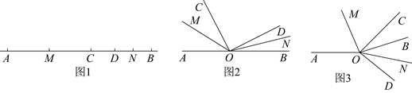

# Mathematics - 题目 850

**ID**: 71876140c49d4d72a598986cbc231bc7
**年级**: Grade 7
**难度**: Medium
**题型**: Calculation

## 题目
【初步探究】（1）如图1，已知线段 $AB=12{\rm cm}$ ，点 $C$ 和点 $D$ 为线段 $AB$ 上的两个动点，且 $CD=3{\rm cm}$ ，点 $M$ 、 $N$ 分别是 $AC$ 和 $BD$ 的中点，求 $MN$ 的长是多少？【类比探究】如图2，已知，直角 $\angle COD$ 与平角 $∠AOB$ 如图摆放在一起，且 $OM$ 和 $ON$ 分别是 $∠AOC$ ， $\angle BOD$ 的角平分线，则 $\angle MON$ 的度数为多少？【知识迁移】（3）当 $\angle AOB=α$ ， $\angle COD=β$ 时，如图3摆放在一起，且 $OM$ 和 $ON$ 分别是 $∠AOC$ ， $\angle BOD$ 的角平分线，则 $\angle MON$ 的度数为多少？（ $α$ 和 $β$ 均为小于平角的角）​​​​​​​‌

## 解答

1. 解：（1） $\because $ 点 $M$ 、 $N$ 分别是 $AC$ 和 $BD$ 的中点，
2. $\therefore AM=\frac {1}{2}AC,BN=\frac {1}{2}BD$ ，
3. $\because $  $AB=12{\rm cm}$ , $CD=3{\rm cm}$ ，
4. $\therefore AC+BD=12-3=9$  $cm$ ，
5. $\therefore MN=CD+MC+DN=CD+\frac {1}{2}\left ({AC+BD}\right )=3+\frac {9}{2}=7.5cm$ ；
6. （2） $\because $  $OM$ 和 $ON$ 分别是 $∠AOC$ ， $\angle BOD$ 的角平分线，
7. $\therefore \angle AOM=\angle MOC,\angle BON=\angle NOD$ ，
8. $\therefore \angle MOC=\frac {1}{2}\angle AOC,\angle DON=\frac {1}{2}\angle BOD$ ，
9. $\because \angle COD=90{}\degree ，\angle AOB=180{}\degree $ , $\angle AOC+\angle COD+\angle BOD=\angle AOB$ ，
10. $\therefore \angle AOC+\angle BOD=90{}\degree $ ，
11. $\therefore \angle MOC+\angle NOD=45{}\degree $ ，
12. $\therefore \angle MON=\angle MOC+\angle COD+\angle DON=90{}\degree +45{}\degree =135{}\degree $ ；
13. （3）∵ $OM$ 是 $∠AOC$ 的角平分线，
14. ∴ $\angle MOC=\frac {1}{2}\angle AOC$ ，
15. ∵ $ON$ 是 $\angle BOD$ 的角平分线，
16. ∴ $\angle NOD=\frac {1}{2}\angle BOD$ ，
17. ∵ $\angle AOB=α$ ， $\angle COD=β$ ，
18. ∴ $\angle MON=\angle MOC+\angle COD-\angle NOD$
19. $=\frac {1}{2}\angle AOC+\angle BOC+\angle BOD-\angle NOD$
20. $=\frac {1}{2}\angle AOC+\angle BOC+\frac {1}{2}\angle BOD$
21. $=\frac {1}{2}\angle AOC+\frac {1}{2}\angle BOC+\frac {1}{2}\angle BOC+\frac {1}{2}\angle BOD$
22. $=\frac {1}{2}(\angle AOB+\angle COD)$
23. $=\frac {α+β}{2}$ ．

## 知识点

**中文**:
  - 线段的中点
  - 线段的和差
  - 角的运算
  - 角平分线

**English**:
  - Midpoint of a Line Segment
  - Sum and Difference of Line Segments
  - Operations with Angles
  - Angle Bisector

---
