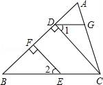

# Mathematics - 题目 451

**ID**: 7bbadbc9068d4c80bca29e301908a736
**年级**: Grade 7
**难度**: Medium
**题型**: Calculation

## 题目
如图，在△ABC中，CD是高，点E、F、G分别在BC、AB、AC上且EF⊥AB，∠1＝∠2，试判断DG与BC的位置关系，并说明理由．​​​​​​​‌

## 解答

1. 试题分析：根据垂直的定义可得∠EFB=∠CDB=90°，然后根据同位角相等两直线平行可得CD∥EF，再根据两直线平行，同位角相等求出∠2=∠3，然后求出∠1=∠3，再根据内错角相等，两直线平行证明即可．
2. 试题解析： $DG//BC$ ．
3. 理由如下： $\because CD$ 是高， $EF\bot AB$ ，
4. $\therefore \angle EFB=\angle CDB=90{^{\circ }}$ ，
5. $\therefore CD//EF$ ，
6. $\therefore \angle 2=\angle 3$ ，
7. $\because \angle 1=\angle 2$ ，
8. $\therefore \angle 1=\angle 3$ ，
9. $\therefore DG//BC$ ．
10. 

## 知识点

**中文**:
  - 内错角相等两直线平行

**English**:
  - Parallel if Alternate Interior Angles Equal

---
