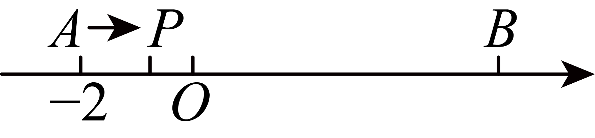

# Mathematics - 题目 2042

**ID**: 9167c6c4e37042668bca7fff9c146f83
**年级**: Grade 7
**难度**: Medium
**题型**: Calculation

## 题目
如图，已知数轴上点 $A$ 表示的数为 $-2$ ， $B$ 是数轴上在 $A$ 右侧的一点，且 $A$ ， $B$ 两点间的距离为10．动点 $P$ 从点 $A$ 出发，以每秒3个单位长度的速度沿数轴向右匀速运动，设运动时间为 $t\left ({t>0}\right )$ 秒．（1）求数轴上点 $B$ 表示的数，并直接写出点 $P$ 表示的数（用含 $t$ 的代数式表示）；​​​​​​​‌（2）动点 $Q$ 从点 $B$ 出发，以每秒2个单位长度的速度沿数轴匀速运动，若点 $P$ 、 $Q$ 同时出发．求：①若点 $Q$ 沿数轴向左匀速运动，当点 $P$ 与点 $Q$ 相遇时，此时点 $P$ 表示的数；②当点 $P$ 运动多少秒时，点 $P$ 与点 $Q$ 间的距离为6个单位长度？

## 解答

1. （1）解：∵点 $A$ 表示的数为 $-2$ ， $B$ 是数轴上在 $A$ 右侧的一点，且 $A$ ， $B$ 两点间的距离为10，
2. ∴ $-2+10=8$ ，即数轴上点 $B$ 所表示的数为8，
3. ∵动点 $P$ 从点 $A$ 出发，以每秒3个单位长度的速度沿数轴向右匀速运动，
4. ∴ $P$ 所表示的数为： $-2+3t$ ；
5. （2）解：①根据题意得 $10\div \left ({2+3}\right )=2$ 秒， $-2+3\times 2=4$ ，
6. 答：点 $P$ 表示的数是4；
7. ②当点 $Q$ 向左运动时，
8. 点 $P$ 不超过 $Q$ ，则 $\left ({10-6}\right )\div \left ({2+3}\right )=\frac {4}{5}$ 秒，
9. 点 $P$ 超过 $Q$ ，则 $\left ({10+6}\right )\div \left ({2+3}\right )=\frac {16}{5}$ 秒，
10. 当点 $Q$ 向右运动时，
11. 点 $P$ 不超过 $Q$ ，则 $\left ({10-6}\right )\div \left ({3-2}\right )=4$ 秒，
12. 点 $P$ 超过 $Q$ ，则 $\left ({10+6}\right )\div \left ({3-2}\right )=16$ 秒，
13. 答：当点 $P$ 与点 $Q$ 间的距离为6个单位长度时，点 $P$ 的运动时间为 $\frac {4}{5}$ 秒或 $\frac {16}{5}$ 秒或4秒或16秒．

## 知识点

**中文**:
  - 数轴上两点之间的距离
  - 用数轴上的点表示有理数
  - 数轴上的动点问题

**English**:
  - Distance Between Two Points on Number Line
  - Representing Rational Numbers on Number Line
  - Moving Point Problems on Number Line

---
