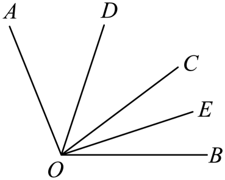

# Mathematics - 题目 495

**ID**: a7e04193652147559a07e80bdca9f2d7
**年级**: Grade 7
**难度**: Medium
**题型**: Calculation

## 题目
已知：如图， $OD$ 平分 $∠AOC$ ， $OE$ 平分 $\angle COB$ ．若 $\angle DOB=80\mathrm{°}$ ， $\angle DOE=60{}\degree $ ，求 $\angle DOA$ 的度数．​​​​​​​‌

## 解答

1. ∵ ${\rm ∠\mathit{DOB}=80°，∠\mathit{DOE}=60°}$ ，
2. ∴ ${\rm ∠\mathit{BOE}=∠\mathit{DOB}−∠\mathit{DOE}=80°−60°=20°}$ ，
3. ∵OE平分 ${\rm ∠\mathit{COB}}$ ，
4. ∴ ${\rm ∠\mathit{BOC}=2∠\mathit{BOE}=2×20°=40°}$ ，
5. ∵OD平分 ${\rm ∠\mathit{AOC}}$ ，
6. ${\rm ∠\mathit{DOA}=∠\mathit{DOC}=∠\mathit{DOB}−∠\mathit{BOC}=80°−40°=40°}$ ．

## 知识点

**中文**:
  - 角平分线

**English**:
  - Angle Bisector

---
