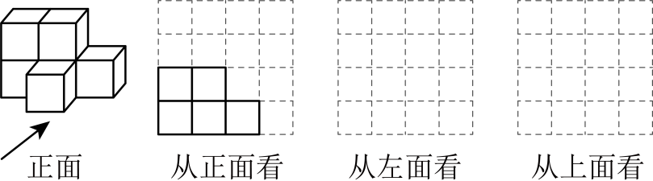

# Mathematics - 题目 2086

**ID**: ae5978084db04691a5442cbdd4a87c34
**年级**: Grade 7
**难度**: Medium
**题型**: Calculation

## 题目
如图是由6块小正方体搭成的几何体（从正面看到的图形已给出）．(1)请在方格中画出该几何体从左面和上面看到的图形；​​​​​​​‌(2)如果在这个几何体上再添加一些小正方体，并保持从正面和左面看到的图形不变，最多可以再添加块小正方体．

## 解答

1. （1）解：如图所示，下图依次是从左面、上面所看到的形状图，
2. 
3. （2）解：从正面看到的图形需满足的几何体是2层3列，从左面看到图形需满足的几何体是2层2排，最上层只有2个立方体，保持从正面和从左面看到的形状图不变，即几何体有2层3列2排，最上层只有2个立方体，因此可以添加的是下层前排左右两侧的空缺位置，即最多可以再添加2块小正方体．
4. 故此题答案为：2．

## 知识点

**中文**:
  - 数正方体的个数
  - 画三视图

**English**:
  - Counting Cubes
  - Drawing Three Views

---
