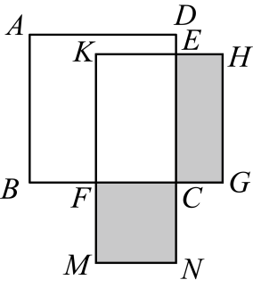

# Mathematics - 题目 596

**ID**: b05554c84ce94f9a8e9ceaa00b0e2aae
**年级**: Grade 7
**难度**: Medium
**题型**: Calculation

## 题目
阅读下面材料，解答下列问题：已知： $(x-2)(5-x)=2$  ，求 ${\left(x-2\right)^{2}}+{\left(5-x\right)^{2}}$  的值．课堂上，两位同学给出了两种不同的解题思路：小王同学的解题思路：∵ $(x-2)(5-x)=2$  ，∴ $5x-{x}^{2}-10+2x=2$  ，∴ ${x}^{2}-7x=-12$  ，∴ ${\left(x-2\right)^{2}}+{\left(5-x\right)^{2}}$$={x}^{2}-4x+4+25-10x+{x}^{2}=2{x}^{2}-14x+29$$=2({x}^{2}-7x)+29=2×(-12)+29=5$  ，小李同学的解题思路：设 $x-2=m$  ， $5-x=n$  ，则 $(x-2)(5-x)=2=mn$  ， $(x-2)+(5-x)=3=m+n$  ，∴ ${\left(x-2\right)^{2}}+{\left(5-x\right)^{2}}={m}^{2}+{n}^{2}={\left(m+n\right)^{2}}-2mn={3}^{2}-2×2=5$  ，(1)请你根据两位同学的解题思路，任选一种思路解答：已知 ${\left(x-10\right)^{2}}+{\left(x-8\right)^{2}}=34$  ，求 $(x-10)(x-8)$  的值；​​​​​​​‌(2)如图，已知正方形 $ABCD$  的边长为a，点E，点F分别在 $CD$  ， $BC$  上，且 $DE=2$  ， $BF=6$  ，长方形 $FKEC$  的面积是21，分别以 $CF$  ， $FK$  为边作正方形 $FMNC$  和正方形 $FKHG$  ．求图中阴影部分的面积．

## 解答

1. （1）解：解法1：
2. ∵ ${\left(x-10\right)^{2}}+{\left(x-8\right)^{2}}={x}^{2}-20x+100+{x}^{2}-16x+64=2{x}^{2}-36x+164=34$  ，
3. ∴ $2{x}^{2}-36x=-130$  ，
4. 即 ${x}^{2}-18x=-65$  ，
5. ∴ $(x-10)(x-8)={x}^{2}-18x+80=-65+80=15$  ，
6. 解法2：
7. 设 $x-10=m$  ， $x-8=n$  ，则 ${\left(x-10\right)^{2}}+{\left(x-8\right)^{2}}={m}^{2}+{n}^{2}=34$  ，
8. ∵ $(x-10)-(x-8)=-2=m-n$  ，
9. ∵ ${m}^{2}+{n}^{2}={\left(m-n\right)^{2}}+2mn$  ，
10. ∴ $34={\left(-2\right)^{2}}+2mn$  ，
11. ∴ $mn=\frac{34-4}{2}=15$  ，
12. ∴ $(x-10)(x-8)=mn=15$  ．
13. （2）解法1：
14. 由题意可知， $FK=CE=a-2$  ， $CF=EK=a-6$  ，则有 $(a-2)(a-6)=21$  ，
15. 设 $m=a-2$  ， $n=a-6$  ，
16. ∴ $m-n=(a-2)-(a-6)=4$  ， $mn=(a-2)(a-6)=21$  ，
17. ∴ ${m}^{2}+{n}^{2}={\left(m-n\right)^{2}}+2mn={4}^{2}+2×21=58$  ，
18. 即 ${\left(a-2\right)^{2}}+{\left(a-6\right)^{2}}={m}^{2}+{n}^{2}=58$  ，
19. Ｓ_{阴影}＝Ｓ_{正方形}_{FＫHG}＋Ｓ_{正方形}_{FＭＮC}－Ｓ_{长方形}_{FCEＫ}＝（a－2）^{2}＋（a－6）^{2}－21＝58－21＝37，
20. 解法2：
21. 由题意可知 $FK=CE=a-2$  ， $CF=a-6$  ，则有 $(a-2)(a-6)={a}^{2}-8a+12=21$  ，
22. ∴ ${a}^{2}-8a=9$  ，
23. 又∵ $EH=KH-EK=(a-2)-(a-6)=4$  ，
24. Ｓ_{阴影}＝Ｓ_{正方形}_{CEHG}＋Ｓ_{正方形}_{FＭＮC}＝EH•CE＋CF^{2}＝4（a－2）＋（a－6）^{2}＝ａ^{2}－8ａ＋28＝9＋28＝37．

## 知识点

**中文**:
  - 整式的应用
  - 整式的混合运算

**English**:
  - Applications of Polynomials
  - Mixed Operations of Polynomials

---
