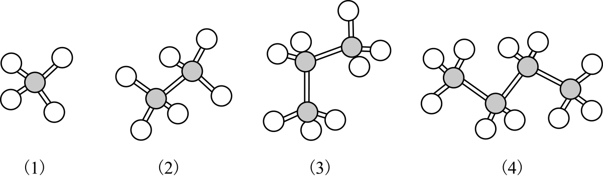

# Mathematics - 题目 1101

**ID**: b0cf72fa0d41444cb931737434eb0ad6
**年级**: Grade 7
**难度**: Medium
**题型**: Calculation

## 题目
某类简单化合物是一类由碳、氢元素组成的有机化合物质，如图是这类物质前4种化合物的分子结构模型图，其中灰球代表碳原子，白球代表氢原子.​​​​​​​‌(1)按照图中规律，第5种化合物的分子结构模型中氢原子的个数是个,第10种化合物的分子结构模型中氢原子的个数是个;(2)按照规律，第n种化合物的分子结构模型中氢原子的个数是个；(3)按照这一规律，这类物质化合物的分子结构模型中会有2024个氢原子吗？如果有，请说明是第几种化合物；如果没有，请说明理由．

## 解答

1. （1）解：由所给图形可知，
2. 第1种化合物的分子模型中，氢原子的个数为 $4=1\times 2+2$ ,
3. 第2种化合物的分子模型中，氢原子的个数为 $6=2\times 2+2$ ,
4. 第3种化合物的分子模型中，氢原子的个数为 $8=3\times 2+2$ ,
5. …，
6. 所以第n种化合物的分子模型中，氢原子的个数为 $\left ({2n+2}\right )$ 个，
7. 当 $n=5$ 时， $2n+2=2\times 5+2=12$ （个）
8. 当 $n=10$ 时， $2n+2=2\times 10+2=22$ （个），
9. 故答案为12，22．
10. （2）解：由（1）知，第n种化合物的分子结构模型中氢原子的个数是 $\left ({2n+2}\right )$ 个,
11. 故答案为 $\left ({2n+2}\right )$ ；
12. （3）解：存在，理由如下,
13. 令 $2n+2=2024$ ，
14. 解得 $n=1011$ ，
15. 所以，第1011种物质化合物的分子结构模型中会有2024个氢原子．

## 知识点

**中文**:
  - 规律型：图形的变化类

**English**:
  - Patterns: Geometric Variations

---
