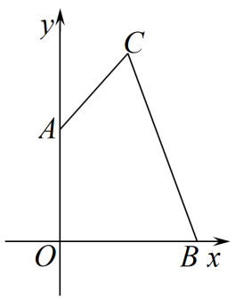

# Mathematics - 题目 871

**ID**: b14669b8ae2e4fddbe429bfb37c60aeb
**年级**: Grade 7
**难度**: Medium
**题型**: Calculation

## 题目
如图，平面直角坐标系中，已知 $A(0,a)$ 、 $B(b,0)$ 、 $C(2,c)$ ，且 $\left |{a-2}\right |+{\left({b-3}\right)^{2}}+\sqrt {c-4}=0$ ．(1)则 $a=$， $b=$， $c=$；​​​​​​​‌(2)求四边形AOBC的面积；(3)点p在y轴上，且 $S{{}_{△BOP}}=S{{}_{四边形OACB}}$ 求点p的坐标．

## 解答

1. （1）解：∵ $\left |{a-2}\right |+{\left({b-3}\right)^{2}}+\sqrt {c-4}=0$ ，
2. $\therefore a-2=0$ ， $b-3=0$ ， $c-4=0$ ，
3. 解得： $a=2$ ， $b=3$ ， $c=4$ ，
4. 故答案为：2，3，4．
5. （2）过点C作 $CD\bot OB$ 交 $OB$ 于D，如图所示：
6. 
7. 由（1）可知， $A(0,2)$ ， $B(3,0)$ ， $C(2,4)$ ，
8. $\therefore OA=2$ ， $OD=x{{}_{c}}=2$ ， $CD=x{{}_{y}}=4$ ， $BD=OB-OD=1$ ，
9. $\therefore S{{}_{四边形AOBC}}=\frac {1}{2}(2+4)\times 2+\frac {1}{2}\times 1\times 4=8$ ．
10. （3）设点P的坐标为： $(0,y)$ ，由  $S{{}_{△BOP}}=S{{}_{四边形OACB}}$ 得：
11. $\frac {1}{2}OB\cdot \left |{y}\right |=8$ ，即： $\frac {1}{2}\times 3\cdot \left |{y}\right |=8$ ，
12. 解得： $y=\pm \frac {16}{3}$ ，
13. $\therefore $ 点P的坐标为： $(0,\frac {16}{3})$ 或 $(0,-\frac {16}{3})$ ．

## 知识点

**中文**:
  - 坐标与图形性质
  - 绝对值非负性的应用
  - 算术平方根非负性的应用

**English**:
  - Coordinates and Geometric Properties
  - Applications of Non-negativity of Absolute Value
  - Applications of Non-negativity of Arithmetic Square Roots

---
