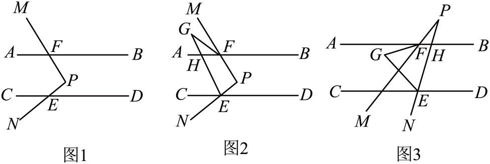

# Mathematics - 题目 137

**ID**: b7a88544e51f471a9f59fcf14ec9dc46
**年级**: Grade 7
**难度**: Medium
**题型**: Calculation

## 题目
如图，已知 $AB{\rm{/\mskip-4mu/}}CD$ ，点P为平面内一点，过点P作射线 $PM、PN，PM$ 与 $AB$ 相交于点 ${\rm \mathit{F}，}PN$ 与 $CD$ 相交于点E．（1）如图1，当点P在直线 $AB、CD$ 之间区域内时，若 $\angle AFM=55{}\degree $ ， $\angle PED=30{}\degree $ ，求 $∠MPN$ 的度数；​​​​​​​‌（2）分别在 $\angle AFM、\angle CEP$ 的内部作射线 $FG、EG$ 交于点G，使得 $\angle MFG=\frac {1}{n}\angle AFM$ ， $\angle PEG=\frac {1}{n}\angle PEC$ （ $n>1$ ，且n为整数）．①如图2，当点P在直线 $AB、CD$ 之间区域内时， $EG$ 与 $AB$ 交于点H，若 $n=3$ ， $\angle G=40{}\degree $ ，求 $∠P$ 的度数；②如图3，当点P在直线 $AB$ 上方时，请直接写出 $∠P$ 与 $\angle G$ 的数量关系（用含n的式子表示）．

## 解答

1. （1）解：过点P作 $PQ/\mskip-4mu/AB$ ，如图1所示：
2. 
3. ∵ $AB/\mskip-4mu/CD$ ，
4. ∴ $AB\mathrm{/\mskip-4mu/}PQ\mathrm{/\mskip-4mu/}CD$ ，
5. ∴ $\angle MPQ=\angle AFM，\angle NPQ=\angle PED$ ，
6. ∴ $\angle MPQ+\angle NPQ=\angle AFM+\angle PED$ ，
7. 即 $\angle MPN=\angle AFM+\angle PED$ ，
8. ∵ $\angle AFM=55{}\degree ，\angle PED=30{}\degree $ ，
9. ∴ $\angle MPN=\angle AFM+\angle PED=55{}\degree +30{}\degree =85{}\degree $ ；
10. （2）解：①过点G作 $GH\mathrm{/\mskip-4mu/}AB$ ，如图2所示：
11. 
12. 当 $n=3$ 时， $\angle MFG=\frac {1}{3}\angle AFM，\angle PEG=\frac {1}{3}\angle PEC$ ，
13. ∴ $\angle AFM=3\angle MFG，\angle PEC=3\angle PEG$ ，
14. 设 $\angle MFG=α，\angle PEG=β$ ，
15. ∴ $\angle AFM=3α，\angle PEC=3β$ ，
16. ∴ $\angle AFG=\angle AFM-\angle MFG=2α，\angle CEG=\angle PEC-\angle PEG=2β$ ，
17. ∴ $\angle PED=180{}\degree -\angle PEC=180{}\degree -3β$ ，
18. ∵ $GH/\mskip-4mu/AB，AB/\mskip-4mu/CD$ ，
19. ∴ $GH\parallel AB\parallel CD$ ，
20. ∴ $\angle HGF=\angle AFG=2α，\angle HGE=\angle CEG=2β$ ，
21. 由（1）可知： $\angle MPN=\angle AFM+\angle PED=3α+180{}\degree -3β=180{}\degree -3\left ({β-α}\right )$ ，
22. ∴ $\angle FGE=\angle HGE-\angle HGF=2\left ({β-α}\right )$ ，
23. ∵ $\angle FGE=40{}\degree $ ，
24. ∴ $2\left ({β-α}\right )=40{}\degree $ ，
25. ∴ $β-α=20{}\degree $ ，
26. ∴ $\angle MPN=180{}\degree -3\left ({β-α}\right )=120{}\degree $ ；
27. ② $∠MPN$ 与 $\angle G$ 的数量关系是： $\angle MPN+\frac {n}{n-1}\angle G=180{}\degree $ ，理由如下：
28. 延长 $GF$ 到T，过点P作 $PR\parallel AB$ ，如图3所示：
29. 
30. ∵ $\angle MFG=\frac {1}{n}\angle AFM，\angle PEG=\frac {1}{n}\angle PEC$ ，
31. ∴ $\angle AFM=n\angle MFG，\angle PEC=n\angle PEG$ ，
32. 设 $\angle MFG=α，\angle PEG=β$ ，
33. ∴ $\angle AFM=nα，\angle PEC=nβ$ ，
34. ∴ $\angle AFG=\angle AFM-\angle MFG=\left ({n-1}\right )α，\angle CEG=\angle PEC-\angle PEG=\left ({n-1}\right )β$ ，
35. ∴ $\angle PFT=\angle AFG=\left ({n-1}\right )α，\angle PED=180{}\degree -\angle PEC=180{}\degree -nβ$ ，
36. ∵ $PR/\mskip-4mu/AB，AB/\mskip-4mu/CD$ ，
37. ∴ $PR\parallel AB\parallel CD$ ，
38. ∴ $\angle RPE=\angle PED=180{}\degree -nβ，\angle RPM=\angle AFM=nα$ ，
39. 由（1）可知： $\angle G=\angle PFT+\angle CEG=\left ({n-1}\right )α+\left ({n-1}\right )β=\left ({n-1}\right )\left ({α+β}\right )$ ，
40. ∴ $α+β=\frac {1}{n-1}\angle G$ ，
41. ∴ $\angle MPN=\angle RPE-\angle RPM=180{}\degree -nβ-nα=180{}\degree -n\left ({α+β}\right )$ ，
42. ∴ $\angle MPN=180{}\degree -n\cdot \frac {1}{n-1}\angle G$ ，
43. ∴ $\angle MPN+\frac {n}{n-1}\angle G=180{}\degree $ ．

## 知识点

**中文**:
  - 两直线平行内错角相等
  - 平行公理及推论
  - 两直线平行同位角相等

**English**:
  - Parallel Lines have Equal Alternate Interior Angles
  - Parallel Axiom
  - Parallel Lines have Equal Corresponding Angles

---
