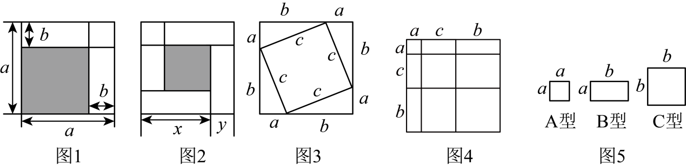

# Mathematics - 题目 440

**ID**: d5bdcf40e88a45a8b606bdd91ea9b9f6
**年级**: Grade 7
**难度**: Medium
**题型**: Calculation

## 题目
数形结合是数学学习中一种很重要的思维方法，“数”的精确描述与“形”的直观刻画，使代数问题与几何问题相互转化，例如，利用图1中图形面积的两种不同表示方式可以得到等式 ${\left({a-b}\right)^{2}}=a{^{2}}-2ab+b{^{2}}$ ．【解决问题】（1）如图2，用四个全等的长方形（x，y为两条邻边长，且 $x>y$ ）拼成一个大正方形，内含一个小正方形，若大正方形的边长为m，小正方形的边长为n，则下列关系式中，正确的是．（只填序号）① $x-y=n$ ；​​​​​​​‌② $xy=\frac {m{^{2}}-n{^{2}}}{4}$ ；③ $x{^{2}}-y{^{2}}=mn$ ；④ ${\left({x+y}\right)^{2}}=m{^{2}}+n{^{2}}$ ．（2）用四个全等的直角三角形（a，b是直角边，c是斜边）和一个边长为c的正方形拼接成一个大正方形如图3所示，根据此图形，可以得到一个关于a，b，c的等式，请你写出这个等式，并说明理由．（3）①如图4是由几个小正方形和小长方形拼成的一个边长为 $a+b+c$ 的大正方形，用不同的方法表示这个大正方形的面积，得到的等式为；②已知 $a+b+c=11$ ， $ab+bc+ac=38$ ，利用①中所得到的等式，求代数式 $a{^{2}}+b{^{2}}+c{^{2}}$ 的值．【创新设计】（4）如图5，A型是边长为a的正方形，B型是长为b、宽为a的长方形，C型是边长为b的正方形，其中A型、B型、C型都有若干个．请你用A型、B型、C型拼出一个长方形或正方形（A型、B型、C型至少使用一次，拼接时不可有重叠、不可有缝隙），并根据你的拼图写出一个关于a，b的等式．

## 解答

1. 解：（1）图2中，小正方形的边长 $x-y=n$ ，因此①正确；
2. 图2中大正方形的边长 $m$ ，因此面积为 $m{^{2}}$ ，中间小正方形的边长为 $n$ ，因此面积为 $n{^{2}}{\rm ，4}$ 个小长方形的面积为 $4xy$ ，由拼图可知 $m{^{2}}-n{^{2}}=4xy$ ，即 $xy=\frac {m{^{2}}-n{^{2}}}{4}$ ，因此②正确；
3. 由拼图可知 $x+y=m$ ， $x-y=n$ ，所以 $(x+y)(x-y)=mn$ ，即 $x{^{2}}-y{^{2}}=mn$ ，因此③正确；
4. ∵ $x+y=m$ ， $x-y=n$ ，
5. ∴ ${\left({x+y}\right)^{2}}=m{^{2}}$ ， ${\left({x-y}\right)^{2}}=n{^{2}}$ ，
6. ∴ $x{^{2}}+2xy+y{^{2}}=m{^{2}}$ ， $x{^{2}}-2xy+y{^{2}}=n{^{2}}$ ，
7. ∴ $m{^{2}}+n{^{2}}=2\left ({x{^{2}}+y{^{2}}}\right )$ ，故④错误.
8. （2） $a{^{2}}+b{^{2}}=c{^{2}}$ ，理由如下：
9. 图3中大正方形的面积为 $(a+b){^{2}}$ ，小正方形的面积为 $c{^{2}}{\rm ，4}$ 个直角三角形的面积和为 $2ab$ ，
10. 因此有 $(a+b){^{2}}=c{^{2}}+2ab$ ，即 $a{^{2}}+b{^{2}}=c{^{2}}$ ；
11. （3）①由拼图可知，图4中大正方形的边长为 $a+b+c$ ，∴图4中大正方形的面积为 ${\left({a+b+c}\right)^{2}}$ ，
12. 又∵图4中大正方形是由三个边长为a，b，c的正方形和两个边长为a，b的长方形，两个边长为c，b的长方形，两个边长为a，c的长方形拼成，
13. ∴图4中大正方形的面积为 ${\left({a+b+c}\right)^{2}}=a{^{2}}+b{^{2}}+c{^{2}}+2ab+2bc+2ac$ ；
14. ② $\because a+b+c=11$ ， $ab+bc+ac=38$ ，
15. $\mathrm{∴}a{^{2}}+b{^{2}}+c{^{2}}$
16. $=(a+b+c){^{2}}-2(ab+bc+ac)$
17. $=121-76$
18. $=45$ ．
19. （4）画图：如图所示（画图不唯一），
20. 
21. 根据拼图，可得关于 $a$ ， $b$ 的等式是： $(a+b){^{2}}=a{^{2}}+2ab+b{^{2}}$

## 知识点

**中文**:
  - 完全平方公式与几何图形

**English**:
  - Perfect Square Formula and Geometric Figures

---
