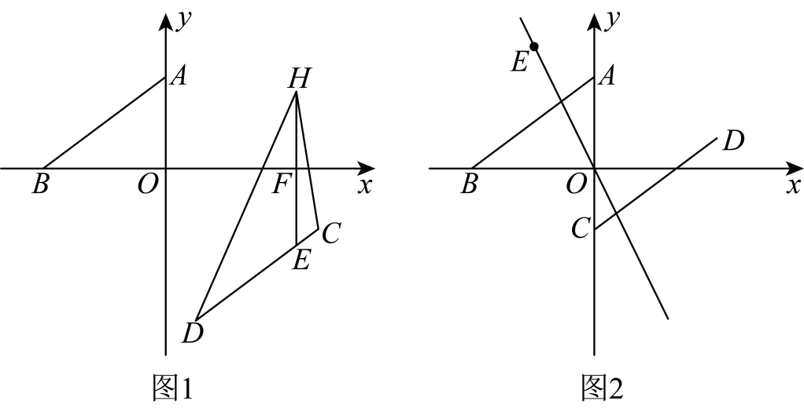

# Mathematics - 题目 3962

**ID**: e922d9ed25924f35a027e9ea4fa54138
**年级**: Grade 7
**难度**: Medium
**题型**: Calculation

## 题目
在平面直角坐标系中， $A\left ({0,a}\right )，B\left ({b,0}\right )，b=\sqrt {3-a}+\sqrt {a-3}-4$ ．（1）求 $\mathrm{A}$ 点， $B$ 点坐标；​​​​​​​‌（2）如图1，将线段 $AB$ 平移，使点 $\mathrm{A}$ 平移到 $C$ ，点 $B$ 平移到 $D\left ({1,-5}\right )，E$ 在线段 $CD$ 上，过 $E$ 作 $EF\bot x$ 轴于点 $F$ ，延长 $EF$ 至 $H$ 使 $EF=FH$ ，若三角形 $HCD$ 的面积等于10，求 $H$ 点坐标；（3）如图2，将线段 $AB$ 平移使点 $\mathrm{A}$ 平移到 $D\left ({4,1}\right )$ ，点 $B$ 平移到 $C\left ({0,-2}\right )，E\left ({-2,4}\right )$ ，点 $P$ 在直线 $OE$ 上，且 $S{{}_{\vartriangle PCD}}=\frac {5}{2}S{{}_{\vartriangle OPC}}+6$ ，直接写出 $P$ 点坐标．

## 解答

1. （1）解：∵ $b=\sqrt {3-a}+\sqrt {a-3}-4$
2. ∴ $3-a\geqslant 0,a-3\geqslant 0$
3. ∴ $a=3,b=-4$
4. ∴ $A\left ({0,3}\right )$ ， $B\left ({-4,0}\right )$
5. （2）∵使点 $A\left ({0,3}\right )$ 平移到 $C$ ， $B\left ({-4,0}\right )$ 平移到 $D\left ({1,-5}\right )$ ， $1-\left ({-4}\right )=5,-5-0=-5$ ，
6. ∴平移方式为向右平移5个单位，向下平移5个单位，
7. ∴ $C\left ({5,-2}\right )$ ，
8. 设 $E\left ({x,y}\right )$ ，
9. ∵ $EF=FH$ ，
10. ∴ $H\left ({x,-y}\right )$
11. ∴ $HE=-2y$
12. ∵ $S{{}_{\vartriangle HCD}}=S{{}_{\vartriangle HED}}+S{{}_{\vartriangle HEC}}$
13. ∴ $\frac {1}{2}\times \left ({5-1}\right )\times \left ({-2y}\right )=\frac {1}{2}\times \left ({-2y}\right )\times \left ({x-1}\right )+\frac {1}{2}\times \left ({-2y}\right )\times \left ({5-x}\right )$
14. ∴ $-4y=10$
15. 解得： $y=-\frac {5}{2}$
16. 如图所示，过点 $C$ ， $D$ 分别作 $x,y$ 的平行线，交于点 $G$ ，则 $G\left ({5,-5}\right )$ ，连接 $EG$
17. 
18. ∵ $S{{}_{\vartriangle DEC}}=S{{}_{\vartriangle DEG}}+S{{}_{\vartriangle ECG}}$
19. ∴ $\frac {1}{2}\times 4\times 3=\frac {1}{2}\times 4\times 2.5+\frac {1}{2}\times 3\times \left ({5-x}\right )$
20. 解得： $x=\frac {13}{3}$
21. ∴ $H\left ({\frac {13}{3},\frac {5}{2}}\right )$
22. （3）将线段 $AB$ 平移使点 $\mathrm{A}$ 平移到 $D\left ({4,1}\right )$ ，点 $B$ 平移到 $C\left ({0,-2}\right )，E\left ({-2,4}\right )$ ，
23. 设 $P\left ({x,y}\right )$
24. 当 $P$ 在 $y$ 轴的右侧时，过点 $P,D$ 分别作 $y$ 轴的垂线，
25. 
26. ∴ $S{{}_{\vartriangle PCD}}=S{{}_{梯形MDPC}}-S{{}_{\vartriangle MDC}}-S{{}_{\vartriangle PCN}}$
27. $=\frac {1}{2}\left ({4+x}\right )\left ({1-y}\right )-\frac {1}{2}\times 4\times \left ({1+2}\right )-\frac {1}{2}\times \left ({-2-y}\right )x$
28. $=\frac {3x}{2}-2y-4$
29. ∵ $S{{}_{\vartriangle POC}}=\frac {1}{2}OC\cdot x{{}_{P}}=\frac {1}{2}\times 2\times x=x$ ， $S{{}_{\vartriangle PCD}}=\frac {5}{2}S{{}_{\vartriangle OPC}}+6$
30. ∴ $\frac {3x}{2}-2y-4=\frac {5x}{2}+6$ 即 $x=-2y-10$
31. 如图， 过点 $E,P$ 分别作 $x,y$ 的垂线交于点 $F$ ，连接 $FC,EC,PC$ ，
32. 
33. ∵ $S{{}_{\vartriangle EFP}}=S{{}_{\vartriangle EFC}}+S{{}_{\vartriangle ECP}}+S{{}_{\vartriangle FCP}}$
34. ∴ $\frac {1}{2}\times \left ({4-y}\right )\left ({x+2}\right )=\frac {1}{2}\left ({4-y}\right )\times 2+\frac {1}{2}\times \left ({-2-y}\right )\times \left ({x+2}\right )+\frac {1}{2}\times 2\times \left ({x+2}\right )$ ，
35. ∴ $x=-\frac {y}{2}$  即 $y=-2x$
36. 将 $y=-2x$ 代入 $x=-2y-10$ 得
37. 解得： $x=\frac {10}{3}$
38. ∴ $y=-\frac {20}{3}$
39. ∴ $\left ({\frac {10}{3},-\frac {20}{3}}\right )$
40. 当 $P$ 在 $y$ 轴的左侧时，如图
41. 
42. ∵ $S{{}_{\vartriangle EFP}}=S{{}_{\vartriangle EFC}}+S{{}_{\vartriangle ECP}}-S{{}_{\vartriangle FCP}}$
43. ∴ $\frac {1}{2}\times \left ({4-y}\right )\left ({x+2}\right )=\frac {1}{2}\left ({4-y}\right )\times 2+\left [\frac {1}{2}\left ({2\times 2}\right )-\frac {1}{2}\times \left ({-x}\right )\times 2\right ]-\frac {1}{2}\times \left ({y+2}\right )\times \left ({x+2}\right )$ ，
44. ∴ $x=-\frac {y}{2}$  即 $y=-2x$ ，
45. 如图，过点 $P,D$ 分别作 $x$ 的垂线与过点 $C$ 平行于 $x$ 的直线交于点 $GH$ ，则 $P\left ({x,y}\right ),G\left ({x,-2}\right ),D\left ({4,1}\right ),H\left ({4,y}\right )$
46. 
47. ∴ $S{{}_{\vartriangle PCD}}=S{{}_{梯形GHDP}}-S{{}_{\vartriangle PCG}}-S{{}_{\vartriangle DCH}}$
48. $=\frac {1}{2}\left [\left ({y+2}\right )+\left ({1+2}\right )\right ]\left ({4-x}\right )-\frac {1}{2}\times \left ({y+2}\right )\times \left ({-x}\right )-\frac {1}{2}\left ({1+2}\right )\times 4$
49. $=-\frac {3x}{2}+2y+4$
50. ∵ $S{{}_{\vartriangle PCD}}=\frac {5}{2}S{{}_{\vartriangle OPC}}+6$ ， $S{{}_{\vartriangle POC}}=-x$
51. ∴ $-\frac {3x}{2}+2y+4=\frac {5}{2}\cdot \left ({-x}\right )+6$ 即 $x=2-2y$
52. 代入 $y=-2x$ ，得 $x=2+4x$
53. 解得： $x=-\frac {2}{3}$
54. ∴ $y=\frac {4}{3}$
55. ∴ $P\left ({-\frac {2}{3}，\frac {4}{3}}\right )$
56. 综上所述， $P\left ({-\frac {2}{3}，\frac {4}{3}}\right )$ 或 $\left ({\frac {10}{3},-\frac {20}{3}}\right )$ ．

## 知识点

**中文**:
  - 坐标与图形变化——平移
  - 坐标与图形性质
  - 平移的性质

**English**:
  - Coordinates and Translation
  - Coordinates and Geometric Properties
  - Properties of Translation

---
