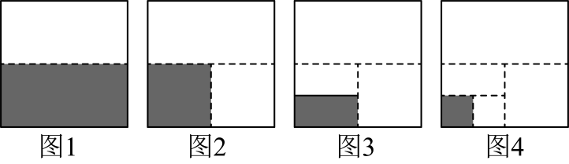

# Mathematics - 题目 3687

**ID**: eb06a8d4fd3d45b2b0c2d96fbfb2d3e0
**年级**: Grade 7
**难度**: Medium
**题型**: Calculation

## 题目
《庄子•天下》：“一尺之棰，日取其半，万世不竭．”意思是说：一尺长的木棍，每天截掉一半，永远也截不完．我国智慧的古代入在两千多年前就有了数学极限思想，今天我们运用此数学思想研究下列问题．（规律探索）（1）如图1所示的是边长为1的正方形，将它剪掉一半，则 $S{{}_{阴影1}}=1-\frac {1}{2}=\frac {1}{2}$ ；​​​​​​​‌如图2，在图1的基础上，将阴影部分再裁剪掉一半，则 $S{{}_{阴影2}}=1-\frac {1}{2}-{\left({\frac {1}{2}}\right)^{2}}={\left({\frac {1}{2}}\right)^{2}}=\frac {1}{4}$ ；依此类推，如图 ${\rm 3，}S{{}_{阴影3}}=1-\frac {1}{2}-{\left({\frac {1}{2}}\right)^{2}}-{\left({\frac {1}{2}}\right)^{3}}=$；如图 ${\rm 4，}S{{}_{阴影3}}=1-\frac {1}{2}-{\left({\frac {1}{2}}\right)^{2}}-{\left({\frac {1}{2}}\right)^{3}}-{\left({\frac {1}{2}}\right)^{4}}=$；…$S{{}_{阴影n}}=1-\frac {1}{2}-{\left({\frac {1}{2}}\right)^{2}}-{\left({\frac {1}{2}}\right)^{3}}-\cdots -{\left({\frac {1}{2}}\right)^{n}}=$；(规律应用)（2）规律应用：计算 $\frac {1}{2}+{\left({\frac {1}{2}}\right)^{2}}+{\left({\frac {1}{2}}\right)^{3}}+\cdots +{\left({\frac {1}{2}}\right)^{10}}$ 的值．

## 解答

1. 解：（1）如图 ${\rm 3，}S{{}_{阴影3}}=1-\frac {1}{2}-{\left({\frac {1}{2}}\right)^{2}}-{\left({\frac {1}{2}}\right)^{3}}=\frac {1}{8}$ ；
2. 如图 ${\rm 4，}S{{}_{阴影3}}=1-\frac {1}{2}-{\left({\frac {1}{2}}\right)^{2}}-{\left({\frac {1}{2}}\right)^{3}}-{\left({\frac {1}{2}}\right)^{4}}=\frac {1}{16}$ ；
3. …
4. $S{{}_{阴影n}}=1-\frac {1}{2}-{\left({\frac {1}{2}}\right)^{2}}-{\left({\frac {1}{2}}\right)^{3}}-\cdots -{\left({\frac {1}{2}}\right)^{n}}=\frac {1}{2{^{n}}}$ ；
5. （2）∵ $1-\frac {1}{2}-{\left({\frac {1}{2}}\right)^{2}}-{\left({\frac {1}{2}}\right)^{3}}-\cdots -{\left({\frac {1}{2}}\right)^{10}}=\frac {1}{2{^{10}}}$ ，
6. ∴ $\frac {1}{2}+{\left({\frac {1}{2}}\right)^{2}}+{\left({\frac {1}{2}}\right)^{3}}+\cdots +{\left({\frac {1}{2}}\right)^{10}}=1-\frac {1}{2{^{10}}}$ ．

## 知识点

**中文**:
  - 规律型：图形的变化类

**English**:
  - Patterns: Geometric Variations

---
