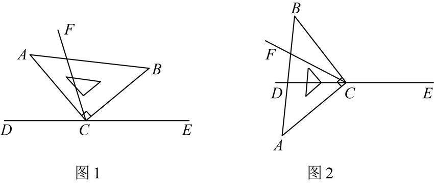

# Mathematics - 题目 1630

**ID**: ecd1b29f36f042bfbd459c0e32f92905
**年级**: Grade 7
**难度**: Medium
**题型**: Calculation

## 题目
直角三角尺 $ABC$ 的直角顶点 $C$ 在直线 $DE$ 上， $CF$ 平分 $\angle BCD$ ．(1)在图 $1$ 中，若 $\angle BCE=40{}\degree $ ，求 $\angle ACF$ 的度数；​​​​​​​‌(2)在图 $1$ 中，若 $\angle BCE=α$ ，直接写出 $\angle ACF$ 的度数（用含 $α$ 的式子表示）；(3)将图 $1$ 中的三角尺 $ABC$ 绕顶点 $C$ 旋转至图 $2$ 的位置，写出 $\angle ACF$ 与 $\angle BCE$ 之间的关系，并说明理由．

## 解答

1. （1）解： $\because \angle ACB=90{}\degree $ ， $\angle BCE=40{}\degree $ ，
2. $\therefore \angle ACD=180{}\degree -\angle ACB-\angle BCE=180{}\degree -90{}\degree -40{}\degree =50{}\degree $ ， $\angle BCD=180{}\degree -\angle BCE=180{}\degree -40{}\degree =140{}\degree $ ，
3. 又 $\because CF$ 平分 $\angle BCD$ ，
4. $\therefore \angle DCF=\angle BCF=\frac {1}{2}\angle BCD=70{}\degree $ ，
5. $\therefore \angle ACF=\angle DCF-\angle ACD=70{}\degree -50{}\degree =20{}\degree $ ；
6. （2）解： $\because \angle ACB=90{}\degree $ ， $\angle BCE=α$ ，
7. $\therefore \angle ACD=180{}\degree -\angle ACB-\angle BCE=180{}\degree -90{}\degree -α=90{}\degree -α$ ，
8. $\angle BCD=180{}\degree -\angle BCE=180{}\degree -α$ ，
9. 又 $\because CF$ 平分 $\angle BCD$ ，
10. $\therefore \angle DCF=\angle BCF=\frac {1}{2}\angle BCD=90{}\degree -\frac {1}{2}α$ ，
11. $\therefore \angle ACF=\angle DCF-\angle ACD=90{}\degree -\frac {1}{2}α-\left ({90{}\degree -α}\right )=\frac {1}{2}α$ ；
12. （3）解： $\angle ACF=\frac {1}{2}\angle BCE$ ．理由如下：
13. $\because $ 点 $C$ 在直线 $DE$ 上，
14. $\therefore \angle BCD=180{}\degree -\angle BCE$ ，
15. $\because CF$ 平分 $\angle BCD$ ，
16. $\therefore \angle BCF=\frac {1}{2}\angle BCD=\frac {1}{2}\left ({180{}\degree -\angle BCE}\right )=90{}\degree -\frac {1}{2}\angle BCE$ ，
17. $\because \angle ACB=90{}\degree $ ，
18. $\therefore \angle ACF=\angle ACB-\angle BCF=90{}\degree -\left ({90{}\degree -\frac {1}{2}\angle BCE}\right )=\frac {1}{2}\angle BCE$ ．

## 知识点

**中文**:
  - 对顶角、邻补角
  - 角平分线

**English**:
  - Vertical and Adjacent Angles
  - Angle Bisector

---
