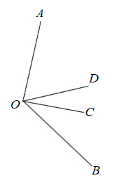

# Mathematics - 题目 1745

**ID**: f5c8789973b04a9f8940f304f90477d3
**年级**: Grade 7
**难度**: Medium
**题型**: Calculation

## 题目
如图，已知 $\angle AOC=2\angle BOC$ ，OD平分 $\angle AOB$ ， $\angle COD=19{}^\circ $ ，求 $\angle AOB$ 的度数．​​​​​​​‌

## 解答

1. 解：设 $\angle BOC=x{}^\circ $ ，
2. ∵OD平分 $\angle AOB$ ，
3. ∴ $\angle AOD=\angle BOD=19{}^\circ +x{}^\circ $ ，
4. ∴ $\angle AOC{\rm{=}}38{}^\circ +x{}^\circ $ ，
5. ∵ $\angle AOC=2\angle BOC$ ，
6. ∴ $38+x=2x$ ，
7. 解得： $x=38{}^\circ $ ．
8. ∴ $\angle AOD=\angle BOD=19{}^\circ +38{}^\circ =57{}^\circ $ ，
9. ∴ $\angle AOB=\angle AOD+\angle BOD=57{}^\circ +57{}^\circ =114{}^\circ $ ．

## 知识点

**中文**:
  - 角平分线

**English**:
  - Angle Bisector

---
