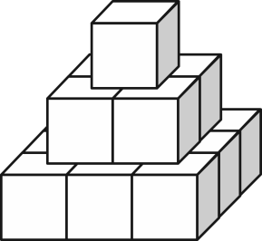

# Mathematics - 题目 3462

**ID**: fa74c3cfb3724385bd15fae93bc4303d
**年级**: Grade 7
**难度**: Medium
**题型**: Calculation

## 题目
把棱长为 ${{1}}{\rm{c}}{\rm{m}}$ 的若干个小正方体摆放成如图所示的几何体，然后再露出的表面上涂上颜色（不含底面）．(1)画出该几何体从正面看到的图形．(2)求出涂上颜色部分的总面积．​​​​​​​‌

## 解答

1. （1）解：如图所示，即为所求；
2. 
3. （2）解：先算侧面：底层12个小面，中层8个，上层4个，
4. 再算上面：上层1个，中层3个（正方体是可以移动的，不管放在哪里，它压住的面积总是它的底面积，也就是一个，所以中层是4减1个），底层 $9-4=5$ 个，总共33个小面．
5. 涂上颜色部分的总面积： $1\times 1\times 33=33{\rm{c}}{\rm{m}}{^{{{2}}}}$ ．
6. 故涂上颜色部分的总面积是 $33{\rm{c}}{\rm{m}}{^{{{2}}}}$ ．

## 知识点

**中文**:
  - 三视图的相关计算
  - 画三视图

**English**:
  - Calculations with Three Views
  - Drawing Three Views

---
