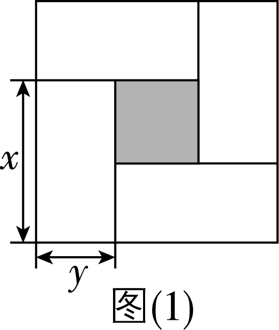
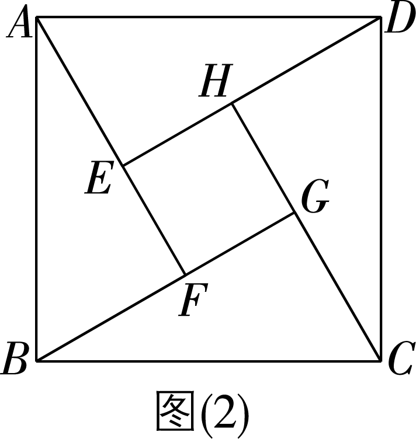

# Mathematics - 题目 403

**ID**: e5957d7be7d84634b85b23cf02e909aa
**年级**: Grade 7
**难度**: Medium
**题型**: 刷综合

## 题目
图(1)是一个用4个长为x，宽为y的长方形和中间一个小正方形密铺而形成的大正方形．(x＞y＞0)(1)若大正方形的面积为36，小正方形的面积为4，则x－y的值为，x＋y的值为．(2)若长方形的长和宽分别为9－m和m－4，则大正方形的边长为；​​​​​​​‌若满足(9－m)·(m－4)＝4，则(9－m)^{2}＋(m－4)^{2}的值为．(3)如图(2)，正方形ABCD的边长是c，它由四个直角边长分别是a，b(a＞b)的直角三角形和中间一个小正方形组成，猜想a，b，c三边长的数量关系，并说明理由．

## 解答

1. (1)∵大正方形的面积为36，小正方形的面积为4，∴(x＋y)^{2}＝36，(x－y)^{2}＝4.
2. 又∵x＞y＞0，∴x＋y＝6，x－y＝2.
3. 故答案为2，6.
4. (2)大正方形的边长为x＋y＝9－m＋m－4＝5.
5. ∵(9－m)(m－4)＝4，
6. ∴(9－m)^{2}＋(m－4)^{2}＝[(9－m)＋(m－4)]^{2}－2(9－m)(m－4)＝5^{2}－8＝17.
7. 故答案为5，17.
8. (3)a，b，c三边长的数量关系为a^{2}＋b^{2}＝c^{2}.理由如下：
9. 由题图(2)可得，小正方形的边长为a－b.
10. 由大正方形的面积等于小正方形的面积与4个直角三角形的面积和可得，
11. (a－b)^{2}＋ $\frac{1}{2}$ab×4＝c^{2}，即a^{2}＋b^{2}＝c^{2}.
12. 【方法技巧】
13. a^{2}＋b^{2}＝(a＋b)^{2}－2ab；
14. a^{2}＋b^{2}＝(a－b)^{2}＋2ab；
15. (a＋b)^{2}＋(a－b)^{2}＝2(a^{2}＋b^{2})；
16. (a＋b)^{2}－(a－b)^{2}＝4ab.

## 知识点

**中文**:
  - 完全平方公式与几何图形

**English**:
  - Perfect Square Formula and Geometric Figures

---
