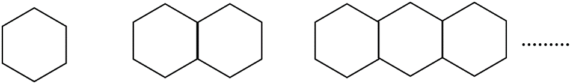

# Mathematics - 题目 651

**ID**: 39f8620c498a4ec4ac3dfb7b27015247
**年级**: Grade 7
**难度**: Medium
**题型**: Fill-in-the-blank

## 题目
用相同的小棒按如图所示方式摆图形摆第5个图形需要（      ）根小棒，用41根小棒摆出的图形是第（      ）个图形．​​​​​​​‌

## 解答

1. 解：由所给图形可知，
2. 摆第1个图形所需小棒的根数为： $6=1\times 5+1$ ；
3. 摆第2个图形所需小棒的根数为： $11=2\times 5+1$ ；
4. 摆第3个图形所需小棒的根数为： $16=3\times 5+1$ ；
5. $\ldots $ ，
6. 所以摆第 $n$ 个图形所需小棒的根数为 $(5n+1)$ 根，
7. 当 $n=5$ 时，
8. $5n+1=26$ （根），
9. 即摆第5个图形所需小棒的根数为26根．
10. 令 $5n+1=41$ ，
11. 解得 $n=8$ ，
12. 即用41根小棒摆出的图形是第8个图形．

## 知识点

**中文**:
  - 规律型：图形的变化类

**English**:
  - Patterns: Geometric Variations

---
