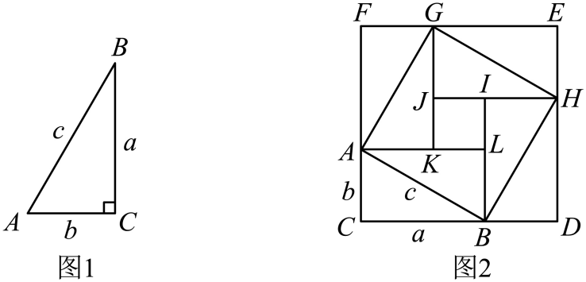
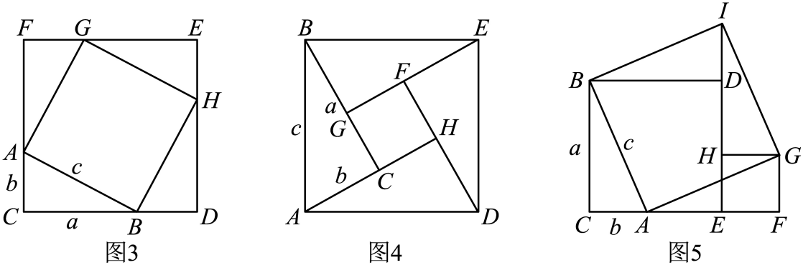

# Mathematics - 题目 3634

**ID**: 0ab72da4ac32417e8447a4fe7969d4ff
**年级**: Grade 7
**难度**: Medium-Hard
**题型**: Calculation

## 题目
如图1， $\vartriangle ABC$ 中， $∠C=90{^{\circ }}$ ， $∠A$ 、 $∠B$ 、 $∠C$ 的对边分别记为 $a$ ， $b$ ， $c$ ．实验一：小聪和小明用八张这样的三角形纸片拼出了如图2所示的正方形（1）在图2中，正方形 $CDEF$ 的面积可表示为，正方形 $IJKL$ 的面积可表示为．（用含 $a$ ， $b$ 的式子表示）（2）请结合图2，用面积法说明 ${\left({a+b}\right)^{2}}$ ， $ab$ ， ${\left({a-b}\right)^{2}}$ 三者之间的等量关系．实验二：小聪和小明分别用四个这样三角形纸片拼成了如图3、4、5所示的图形．他们根据面积法得到了一个关于边 $a$ 、 $b$ 、 $c$ 的等式，整理后发现 $a{^{2}}+b{^{2}}=c{^{2}}$ ．（3）请你从图3、4、5中选一个合适的图形用面积法证明 $a{^{2}}+b{^{2}}=c{^{2}}$ ．你的选择是图，你的证明：（4）根据（3）中的结论回答，当 $a-b-2m=1$ ， $ab+2m{^{2}}+2m=4$ 时， $c$ 的值为．​​​​​​​‌

## 解答

1. 解：（1）在图2中，正方形 $CDEF$ 的面积可表示为 ${\left({a+b}\right)^{2}}$ ，正方形 $IJKL$ 的面积可表示为 ${\left({a-b}\right)^{2}}$ ．
2. 故答案为： ${\left({a+b}\right)^{2}}$ ， ${\left({a-b}\right)^{2}}$ ；
3. （2）由图可知： ${\left({a+b}\right)^{2}}=8\times \frac {1}{2}ab+(a-b){^{2}}$ ，即 ${\left({a+b}\right)^{2}}=4ab+(a-b){^{2}}$ ；
4. （3）选择是图 $3$ ，正方形的面积为 ${\left({a+b}\right)^{2}}=4\times \frac {1}{2}ab+c{^{2}}$
5. 即 $a{^{2}}+2ab+b{^{2}}=2ab+c{^{2}}$ ，
6. ∴ $a{^{2}}+b{^{2}}=c{^{2}}$ ；
7. 选择是图4，正方形的面积为 $c{^{2}}=4\times \frac {1}{2}ab+{\left({a-b}\right)^{2}}$
8. 即 $c{^{2}}=2ab+a{^{2}}-2ab+b{^{2}}$ ，
9. ∴ $a{^{2}}+b{^{2}}=c{^{2}}$ ；
10. （4）∵ $a-b-2m=1$ ， $ab+2m{^{2}}+2m=4$ ，
11. ∴ $a-b=2m+1$ ， $ab=-2m{^{2}}-2m+4$ ，
12. ∴ $c{^{2}}=a{^{2}}+b{^{2}}=(a-b){^{2}}+2ab=(2m+1){^{2}}+2(-2m{^{2}}-2m+4)=4m{^{2}}+4m+1-4m{^{2}}-4m+8=9$ ，
13. ∴ $c=3$ 或 $c=-3$ （舍）．

## 知识点

**中文**:
  - 完全平方公式与几何图形

**English**:
  - Perfect Square Formula and Geometric Figures

---
