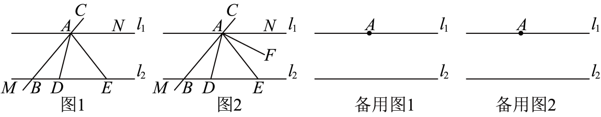

# Mathematics - 题目 1717

**ID**: 0b4cd81c2b234280af142ade0131b20c
**年级**: Grade 7
**难度**: Medium-Hard
**题型**: Calculation

## 题目
已知：直线 $l{{}_{1}}\mathrm{/\mskip-4mu/}l{{}_{2}}{\rm ，\mathit{A}}$ 为直线 $l{{}_{1}}$ 上的一个定点， $D$ ， $E$ 为直线 $l{{}_{2}}$ 上的两个动点，点 $D$ 在点 $E$ 的左侧，连接 $AD$ ， $AE$ ，满足 $\angle AED=\angle DAE$ ．过点 $\mathrm{A}$ 的直线交 $l{{}_{2}}$ 于点 $B$ ，点 $C$ 在线段 $BA$ 的延长线上．点 $M$ 在 $l{{}_{2}}$ 上，且在点 $B$ 的左侧．（1）如图1，若 $\angle AED=52{}\degree $ ， $\angle ABM=130{}\degree $ ，则 $∠BAD$ 的度数为；​​​​​​​‌（2）如图2，点 $D$ 、 $E$ 均在点 $B$ 右侧，射线 $AF$ 为 $\angle CAD$ 的角平分线，用等式表示 $∠EAF$ 与 $∠ABD$ 之间的数量关系，并证明；（3）若点 $D$ 与点 $E$ 在直线 $l{{}_{2}}$ 上运动，且点 $D$ 不与点 $B$ 重合，射线 $AF$ 为 $\angle CAD$ 的角平分线， $\angle ABM+\angle EAF=144{}\degree $ ，请直接写出 $∠EAF$ 的度数．

## 解答

1. （1）解： $\because $  $l{{}_{1}}\mathrm{/\mskip-4mu/}l{{}_{2}}$ ， $\angle AED=52{}\degree $ ， $\angle ABM=130{}\degree $ ，
2. $\therefore \angle BAN=\angle ABM=130{}\degree $ ， $\angle EAN=\angle AED=52{}\degree $ ，
3. $\because $  $\angle AED=\angle DAE$ ，
4. $\therefore $  $∠BAD=\angle BAN-\angle DAE-\angle EAN=26{}\degree $ .
5. （2）证明： $\angle ABD=2\angle EAF$ ．
6. $\because l{{}_{1}}/\mskip-4mu/l{{}_{2}}$ ，
7. $\therefore \angle CAN=\angle ABD$ ， $\angle NAE=\angle AED$ ，
8. 
9. 又 $AF$ 平分 $\angle CAD$ ，
10. $\therefore \angle DAF=\angle CAF=\frac {1}{2}\angle CAD$ ．
11. $\because \angle DAE=\angle AED=\angle NAE$ ，
12. $\therefore \angle DAE=\angle NAE=\frac {1}{2}\left ({\angle DAE+\angle NAE}\right )=\frac {1}{2}\angle DAN$ ，
13. $\therefore \angle EAF=\angle DAF-\angle DAE$ ，
14. $=\frac {1}{2}\angle CAD-\frac {1}{2}\angle DAN$
15. $=\frac {1}{2}\angle CAN=\frac {1}{2}\angle ABD$ ，
16. 即 $\angle ABD=2\angle EAF$ ．
17. （3）解： $36{}\degree $ 或 $108{}\degree $ ．
18. ①当点 $D$ 在点 $B$ 右侧时，如图．
19. 
20. 由（2）得 $\angle EAF=\frac {1}{2}\angle ABD$ ．
21. $\because \angle ABM+\angle EAF=144{}\degree $ ，
22. $\therefore \angle ABM+\frac {1}{2}\angle ABD=144{}\degree $ ，
23. 又 $\angle ABM+\angle ABD=180{}\degree $ ，
24. $\therefore \frac {1}{2}\angle ABD=180{}\degree -144{}\degree =36{}\degree $ ，
25. $\therefore \angle EAF=36{}\degree $ ．
26. ②当点 $D$ 在点 $B$ 左侧，点 $E$ 在点 $B$ 右侧时，如图．
27. $\because $  $AF$ 平分 $\angle CAD$ ，
28. $\therefore \angle DAF=\frac {1}{2}\angle CAD$ ．
29. $\because l{{}_{1}}/\mskip-4mu/l{{}_{2}}$ ，
30. $\therefore \angle AED=\angle NAE$ ， $∠CAN=∠ABE$ ，
31. $\therefore \angle DAE=\angle AED=\angle NAE$ ，
32. $\therefore \angle DAE=\frac {1}{2}\left ({\angle DAE+\angle NAE}\right )=\frac {1}{2}\angle DAN$ ，
33. $\therefore \angle EAF=\angle DAF+\angle DAE=\frac {1}{2}\left ({\angle CAD+\angle DAN}\right )=\frac {1}{2}\times \left ({360{}\degree -\angle CAN}\right )=180{}\degree -\frac {1}{2}\angle ABE$ ．
34. $\because \angle ABE+\angle ABM=180{}\degree $ ，
35. $\therefore \angle EAF=180{}\degree -\frac {1}{2}\left ({180{}\degree -\angle ABM}\right )=90{}\degree +\frac {1}{2}\angle ABM$ ．
36. 又 $\angle EAF+\angle ABM=144{}\degree $ ，
37. $\therefore \angle EAF=90{}\degree +\frac {1}{2}\left ({144{}\degree -\angle EAF}\right )=162{}\degree -\frac {1}{2}\angle EAF$ ，
38. $\therefore \angle EAF=108{}\degree $ ．
39. ③当 $D$ 、 $E$ 均在 $B$ 点左侧，如图．
40. 
41. 此时， $∠DAE=\frac {1}{2}∠DAN$ ， $∠DAF=\frac {1}{2}∠CAD$ ，
42. $\therefore \angle EAF=\angle DAE+\angle DAF$ ，
43. $=\frac {1}{2}\left ({360{}\degree -\angle CAN}\right )=180{}\degree -\frac {1}{2}\angle ABG$
44. $=180{}\degree -\frac {1}{2}\left ({180{}\degree -\angle ABM}\right )=90{}\degree +\frac {1}{2}\angle ABM$ ．
45. $\because \angle ABM+\angle EAF=144{}\degree $ ，
46. $\therefore \angle EAF=108{}\degree $ ．
47. 综上所述： $\angle EAF=36{}\degree $ 或 $108{}\degree $ ．

## 知识点

**中文**:
  - 平行线性质的应用
  - 角平分线

**English**:
  - Applications of Properties
  - Angle Bisector

---
