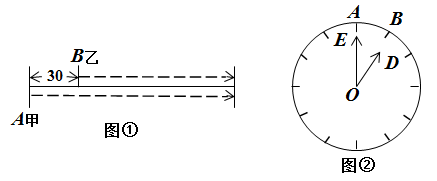

# Mathematics - 题目 3738

**ID**: 0e22125aa31a41229d8e72c95e72d703
**年级**: Grade 7
**难度**: Medium-Hard
**题型**: Calculation

## 题目
知识的迁移与应用问题一：如图①，甲，乙两人分别从相距 $30{\rm{k}}{\rm{m}}$ 的A，B两地同时出发，若甲的速度为 ${\rm{6}}{\rm{0}}{\rm{k}}{\rm{m}}{\rm{/}}{\rm{h}}$ ，乙的速度为 ${\rm{4}}{\rm{0}}{\rm{k}}{\rm{m}}{\rm{/}}{\rm{h}}$ ，甲追上乙需花多长时间?设甲追到乙所花时间为 $x{\rm{h}}$ ，则可列方程为；​​​​​​​‌问题二：在线段 $AC$ （足够长）上有一点B， $AB=30{\rm{c}}{\rm{m}}$ ，动点P从A点出发，以每秒 $4{\rm{c}}{\rm{m}}$ 的速度向C移动，同时Q点从B点出发，以每秒 $2{\rm{c}}{\rm{m}}$ 的速度向C点移动，出发几秒后， $PQ=10{\rm{c}}{\rm{m}}$ ?问题三：如图②，若将线段 $AC$ 弯曲后视作时钟面的一部分，线段 $AB$ 对应钟表上的弧 $AB$ （1小时的间隔）， $OD$ 表示时针， $OE$ 表示分针（O为两针的旋转中心），时钟的时针与分针所成的角称为钟面角，在 $1:00\sim 1:30$ 之间，从 $1:00$ 开始，经过多少分钟，钟面角为90°．

## 解答

1. 问题一：由甲追到乙所花时间为 $x{\rm{h}}$ ，甲速度为60km/h，乙速度为40km/h，
2. 等量关系为：（甲速度-乙速度）×时间=要追上的距离，
3. 依题意有： $\left ({60{\rm{-}}40}\right )x=30$ ，
4. 故答案为： $\left ({60{\rm{-}}40}\right )x=30$ ；
5. 问题二：设出发a秒后， $PQ=10{\rm{c}}{\rm{m}}$ ，
6. 则 $AP=4a{\rm{c}}{\rm{m}},AQ=30+2a{\rm{c}}{\rm{m}}$ ，
7. 由题意得 $30+2a-4a=10$ 或 $4a-\left ({30+2a}\right )=10$ ，
8. 解得 $a=10$ 或 $a=20$ ，
9. 答：出发10秒或20秒后， $PQ=10{\rm{c}}{\rm{m}}$ ；
10. 问题三：分针 $OE$ 的速度为每分钟转动6度；时针 $OD$ 的速度为每分钟转动0.5度，
11. 设从 $1:00$ 起计时，经过y分钟后钟面角为90°，
12. 依题意有： $6y-0.5y=90+30$ ，
13. 解得 $y=\frac {240}{11}$ ，
14. 答：经过 $\frac {240}{11}$ 分钟后钟面角为90°．

## 知识点

**中文**:
  - 钟面角

**English**:
  - Clock Face Angles

---
