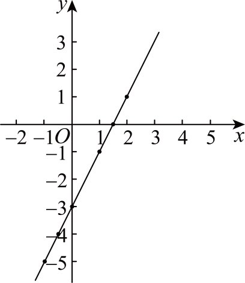

# Mathematics - 题目 2146

**ID**: 1702f90a300d4163b6a639237c49e37f
**年级**: Grade 7
**难度**: Medium-Hard
**题型**: Calculation

## 题目
关于 $x$ ， $y$ 的二元一次方程 $ax+by=c$ ，（ $a$ ， $b$ ， $c$ 是常数，且 $a\ne 0$ ， $b\ne 0$ ）有无数组解，如果我们把每组解 $x$ 和 $y$ 的值都分别作为点的横坐标和纵坐标，并描在平面直角坐标系中，会得到一个图形，我们把这个图形叫做这个二元一次方程的图象．例如：⋯ $\begin{cases}x=-1\\y=-5\end{cases}$ 、 $\begin{cases}x=-\frac {1}{2}\\y=-4\end{cases}$ 、 $\begin{cases}x=0\\y=-3\end{cases}$ 、 $\begin{cases}x=1\\y=-1\end{cases}$ 、 $\begin{cases}x=\frac {3}{2}\\y=0\end{cases}$ 、 $\begin{cases}x=2\\y=1\end{cases}$ ⋯都是方程 $2x-y=3$ 的解，对应可以得到点⋯ $\left ({-1,-5}\right )$ 、 $\left ({-\frac {1}{2},-4}\right )$ 、 $\left ({0,-3}\right )$ 、 $\left ({1,-1}\right )$ 、 $\left ({\frac {3}{2},0}\right )$ 、 $\left ({2,1}\right )$ ⋯，把所有的解对应的点都描在坐标系内，得到了方程 $2x-y=3$ 的图象．回答下列问题：(1) $\left ({13,2}\right )$ 和 $\left ({\frac {72}{5},1}\right )$ 是二元一次方程 $ax+by=79$ 图象上的两个点，求 $a$ ， $b$ 的值；​​​​​​​‌(2)若 $P\left ({\sqrt {m},\left |{n}\right |}\right )$ 是（1）所求二元一次方程图象上的一个点，且满足 $3\sqrt {m}+2k{^{2}}+5\left |{n}\right |=57$ ， $m$ ， $n$ ， $k$ 都是实数，求 $\sqrt {m}+5k{^{2}}+3\left |{n}\right |$ 的最小值．

## 解答

1. （1）解：把 $\left ({13,2}\right )$ 和 $\left ({\frac {72}{5},1}\right )$ 代入二元一次方程 $ax+by=79$ ，得 $\begin{cases}13a+2b=79\\\frac {72}{5}a+b=79\end{cases}$ ，
2. 解得 $\begin{cases}a=5\\b=7\end{cases}$ ；
3. （2）解：由（1）知：二元一次方程为 $5x+7y=79$ ，
4. ∵ $P\left ({\sqrt {m},\left |{n}\right |}\right )$ 是二元一次方程 $5x+7y=79$ 图象上的一个点，
5. ∴ $5\sqrt {m}+7\left |{n}\right |=79$ ，
6. 与 $3\sqrt {m}+2k{^{2}}+5\left |{n}\right |=57$ 联立方程组，
7. 得 $\left \{\hspace{-0.5em}\begin{array}{l}5\sqrt {m}+7\left |{n}\right |=79\\3\sqrt {m}+2k{^{2}}+5\left |{n}\right |=57\end{array}\hspace{-0.5em}\right.$ ，
8. 解得 $\left \{\hspace{-0.5em}\begin{array}{l}\sqrt {m}=\frac {7}{2}k{^{2}}-1\\\left |{n}\right |=12-\frac {5}{2}k{^{2}}\end{array}\hspace{-0.5em}\right.$ ，
9. ∵ $\sqrt {m}\geqslant 0$ ， $\left |{n}\right |\geqslant 0$ ，
10. ∴ $\begin{cases}\frac {7}{2}k{^{2}}-1\geqslant 0\\12-\frac {5}{2}k{^{2}}\geqslant 0\end{cases}$ ，
11. 解得 $\frac {2}{7}\leqslant k{^{2}}\leqslant \frac {24}{5}$ ，
12. ∴ $\sqrt {m}+5k{^{2}}+3\left |{n}\right |$
13. $=\frac {7}{2}k{^{2}}-1+5k{^{2}}+3\left ({12-\frac {5}{2}k{^{2}}}\right )$
14. $=\frac {7}{2}k{^{2}}-1+5k{^{2}}+36-\frac {15}{2}k{^{2}}$
15. $=k{^{2}}+35$ ，
16. ∵ $\frac {2}{7}\leqslant k{^{2}}\leqslant \frac {24}{5}$ ，
17. ∴当 $k{^{2}}=\frac {2}{7}$ 时， $k{^{2}}+35$ 取最小值为 $\frac {2}{7}+35=35\frac {2}{7}$ ，
18. 即 $\sqrt {m}+5k{^{2}}+3\left |{n}\right |$ 的最小值为 $35\frac {2}{7}$ ．

## 知识点

**中文**:
  - 一次函数与二元一次方程（组）
  - 加减消元法解二元一次方程组
  - 一次函数的图象和性质

**English**:
  - Linear Functions and Systems of Linear Equations
  - Elimination Method
  - Graphs and Properties of Linear Functions

---
