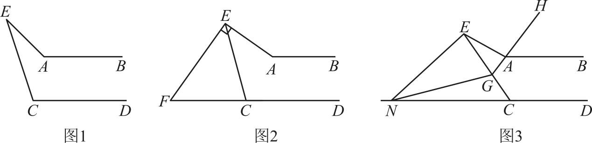

# Mathematics - 题目 2194

**ID**: 18e4a54150594d34a4644664394e3a1d
**年级**: Grade 7
**难度**: Medium-Hard
**题型**: Calculation

## 题目
已知， $AB/\mskip-4mu/CD$ ，点E在 $AB$ 上方， $∠BAE$ 为钝角，连接 $AE$ ， $CE$ ．（1）如图1，若 $\angle EAB=135{}\degree ,\angle ECD=108{}\degree $ ，求 $∠AEC$ 的度数；​​​​​​​‌（2）如图2，过点E作 $EF\bot AE$ 交 $DC$ 的延长线于点F，求 $\angle BAE-\angle F$ 的值；（3）如图3，若 $\angle AEN=108{}\degree ,\angle AEN$ 的边 $EN$ 交直线 $CD$ 于点N，点G为线段 $CE$ 上一点，连接 $NG$ ，使 $\angle ENG:\angle GNC=2:1$ ，连接 $GA$ 并延长至点H，若 $\angle EAH:\angle HAB=2:1$ ，请你直接写出 $\angle HGC$ 和 $\angle EGN$ 之间的数量关系．

## 解答

1. （1）解；如图，过 $E$ 作 $EQ{\rm{/\mskip-4mu/}}AB$ ，而 $\angle EAB=135{}\degree $ ，
2. ∴ $\angle AEQ=180{}\degree -135{}\degree =45{}\degree $ ，
3. 
4. ∵ $AB{\rm{/\mskip-4mu/}}CD$ ，
5. ∴ $EQ{\rm{/\mskip-4mu/}}CD$ ，而 $\angle ECD=108{}\degree $ ，
6. ∴ $\angle CEQ=180{}\degree -108{}\degree =72{}\degree $ ，
7. ∴ $∠AEC=\angle QEC-\angle QEA=72{}\degree -45{}\degree =27{}\degree $ ；
8. （2）解：如图，过 $E$ 作 $EQ{\rm{/\mskip-4mu/}}AB$ ，设 $\angle BAE=α$ ，
9. ∴ $\angle AEQ=180{}\degree -α$ ，
10. 
11. ∵ $EF\bot AE$ ，
12. ∴ $\angle AEF=90{}\degree $ ， $\angle QEF=180{}\degree -α+90{}\degree =270{}\degree -α$ ，
13. ∵ $AB{\rm{/\mskip-4mu/}}CD$ ，
14. ∴ $EQ{\rm{/\mskip-4mu/}}CD$ ，
15. ∴ $\angle F=180{}\degree -\angle QEF=α-90{}\degree $ ，
16. ∴ $\angle BAE-\angle F=α-α+90{}\degree =90{}\degree $ ；
17. （3）解：如图，过 $E$ 作 $EQ{\rm{/\mskip-4mu/}}AB$ ，过 $G$ 作 $GK{\rm{/\mskip-4mu/}}AB$ ，而 $AB{\rm{/\mskip-4mu/}}CD$ ，
18. ∴ $QE{\rm{/\mskip-4mu/}}AB{\rm{/\mskip-4mu/}}CD{\rm{/\mskip-4mu/}}GK$ ，
19. 设 $\angle BAH=α$ ， $\angle GNC=β$ ， $\angle AEG=x$ ，
20. 
21. ∵ $\angle ENG:\angle GNC=2:1$ ， $\angle EAH:\angle HAB=2:1$ ， $\angle AEN=108{}\degree $ ，
22. ∴ $\angle ENG=2β$ ， $\angle EAH=2α$ ， $\angle NEG=108{}\degree -x$ ，
23. ∵ $QE{\rm{/\mskip-4mu/}}AB{\rm{/\mskip-4mu/}}CD{\rm{/\mskip-4mu/}}GK$ ，
24. ∴ $\angle QEA=180{}\degree -3α$ ， $\angle HGK=\angle HAB=α$ ， $\angle KGC=\angle QEG=180{}\degree -3α+x$ ，
25. $\angle ENC=3β=180{}\degree -\angle NEQ=3α-108{}\degree $ ，
26. ∴ $α-β=36{}\degree $ ， $\angle HGC=\angle HGK+\angle KGC=180{}\degree -2α+x$ ，
27. ∵ $\angle NEG=108{}\degree -x$ ，
28. ∴ $\angle EGN=180{}\degree -2β-108{}\degree +x=72{}\degree -2β+x$ ，
29. ∴ $\angle EGN-\angle HGC=-108{}\degree +2\left ({α-β}\right )=-36{}\degree $ ，
30. ∴ $\angle HGC-\angle EGN=36{}\degree $ .

## 知识点

**中文**:
  - 平行公理及推论
  - 平行线的判定与性质

**English**:
  - Parallel Axiom
  - Determination and Properties

---
