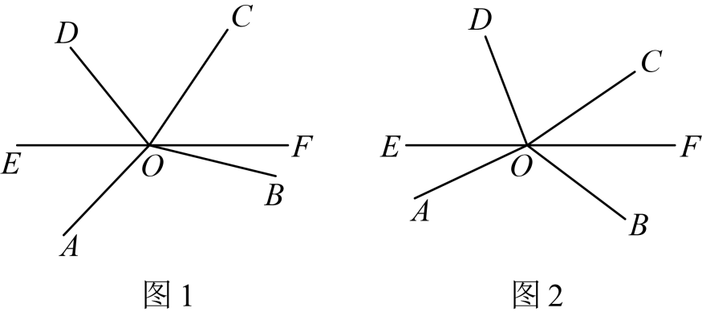

# Mathematics - 题目 3683

**ID**: 1c8fc7d099eb4dc99e9d2d6d82898d5e
**年级**: Grade 7
**难度**: Medium-Hard
**题型**: Calculation

## 题目
如图，点 $O$ 在直线 $EF$ 上，点 $A$ 、 $B$ 与点 $C$ 、 $D$ 分别在直线 $EF$ 两侧，且 $\angle AOB=120{}^\circ $ ， $\angle COD=70{}^\circ $ ．(1)如图1，若 $OC$ 平分 $∠BOD$ ， $OE$ 平分 $\angle AOD$ ，过点 $O$ 作射线 $OG\bot OB$ ，求 $\angle EOG$ 的度数；​​​​​​​‌(2)如图2，若在 $∠BOC$ 内部作一条射线 $OH$ ，若 $\angle COH$ ： $\angle BOH=2$ ： $3$ ， $\angle DOE=5\angle FOH$ ，试判断 $∠AOE$ 与 $\angle DOE$ 的数量关系．

## 解答

1. ${\rm （1）}\because OC$ 平分 $∠BOD$ ，
2. $\therefore \angle BOD=2\angle COD=2\times 70{}^\circ =140{}^\circ $ ，
3. $\because \angle AOB=120{}^\circ $ ，
4. $\therefore \angle AOD=360{}^\circ -\angle AOB-\angle BOD=360{}^\circ -120{}^\circ -140{}^\circ =100{}^\circ $ ．
5. 当 $OG$ 在 $EF$ 下方时，
6. $\because OE$ 平分 $\angle AOD$ ， $\angle AOD=100{}^\circ $ ，
7. $\therefore $  $\angle AOE=\frac {1}{2}\angle AOD=50{}^\circ $ ，
8. $\because OG\bot OB$ ，
9. $\therefore \angle BOG=90{}^\circ $ ，
10. $\therefore \angle AOG=\angle AOB-\angle BOG=120{}^\circ -90{}^\circ =30{}^\circ $ ，
11. $\therefore \angle EOG=\angle AOG+\angle AOE=80{}^\circ $ ．
12. 当 $OG$ 在 $EF$ 上方时，
13. $\because OE$ 平分 $\angle AOD$ ， $\angle AOD=100{}^\circ $ ，
14. $\therefore $  $\angle AOE=\frac {1}{2}\angle AOD=50{}^\circ $ ，
15. $\because OG\bot OB$ ，
16. $\therefore \angle BOG=90{}^\circ $ ，
17. $\because \angle AOE+\angle AOB+\angle BOG+\angle EOG=360{}^\circ $ ， $\angle AOB=120{}^\circ $ ，
18. $\therefore \angle EOG=360{}^\circ -50{}^\circ -120{}^\circ -90{}^\circ =100{}^\circ $ ；
19. （2）设 $\angle DOE=5α$ ，则 $\angle FOH=α$ ，
20. $\therefore \angle COH=180{}^\circ -\angle DOE-\angle COD-\angle FOH=110{}^\circ -6α$ ，
21. $\because \angle COH:\angle BOH=2:3$ ，
22. $\therefore \angle BOC=\frac {5}{2}\angle COH=275{}^\circ -15α$ ，
23. $\therefore \angle AOD=360{}^\circ -\angle COD-\angle BOC-\angle AOB=360{}^\circ -70{}^\circ -(275{}^\circ -15α)-120{}^\circ =15α-105{}^\circ $ ，
24. $\therefore \angle AOE=\angle AOD-\angle DOE=10α-105{}^\circ $ ，
25. $\therefore \angle AOE=2\angle DOE-105{}^\circ $ ．
26. 当 $OH$ 在 $OF$ 的下方时，同理可得
27. $\therefore \angle COH=180{}^\circ -\angle DOE-\angle COD+\angle FOH=110{}^\circ -4α$ ，
28. $\because \angle COH:\angle BOH=2:3$ ，
29. $\therefore \angle BOC=\frac {5}{2}\angle COH=275{}^\circ -10α$ ，
30. $\therefore \angle AOD=360{}^\circ -\angle COD-\angle BOC-\angle AOB=360{}^\circ -70{}^\circ -(275{}^\circ -10α)-120{}^\circ =10α-105{}^\circ $ ，
31. $\therefore \angle AOE=\angle AOD-\angle DOE=5α-105{}^\circ $ ，
32. $\therefore \angle AOE=\angle DOE-105{}^\circ $ ．
33. 综上所述： $\angle AOE=2\angle DOE-105{}^\circ $ 或 $\angle AOE=\angle DOE-105{}^\circ $

## 知识点

**中文**:
  - 垂线
  - 对顶角、邻补角

**English**:
  - Perpendicular Lines
  - Vertical and Adjacent Angles

---
