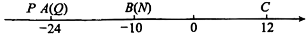

# Mathematics - 题目 3871

**ID**: 1d230bd47f6543e48038f2220b9b1fb1
**年级**: Grade 7
**难度**: Medium-Hard
**题型**: Calculation

## 题目
初一年级开设了丰富多彩的选修课，佳佳同学在“数学实验与探究”课上借助两根木棒 $PQ$ 、 $MN$ 研究数轴上的动点问题：如图，数轴上有A， $B$ ， $C$ 三个点，分别表示有理数 $-24$ ， $-10$ 和12．佳佳把两根木棒放在数轴上，使点 $Q$ 与点A重合，点N与点 $B$ 重合，点 $P$ 在点Q的左边，点 $M$ 在点 $N$ 的左边，且 $PQ=2$ ， $MN=6$ ，木棒 $MN$ 从点 $B$ 开始一直向右以每秒1个单位的速度匀速运动；​​​​​​​‌木棒 $PQ$ 同时从点A开始向右以每秒3个单位的速度匀速运动，当点 $Q$ 运动到 $C$ 时，木棒 $PQ$ 立即以每秒2个单位的速度返回（返回过程中，仍然保持点 $P$ 在点 $Q$ 的左边），当点 $Q$ 再次运动到点A时，两根木棒立即同时停止运动，设运动时间为 $t$ 秒．(1)当 $t=8$ 时，点 $N$ 表示的数为，点 $P$ 表示的数为；(2)当 $0<t\leqslant 12$ 时，若线段 $PM$ 和线段 $QN$ 的长度之和为12，求对应的 $t$ 值；(3)点 $D$ 为木棒 $PQ$ 上一点，在整个运动过程中，是否存在某些时间段，使得点 $D$ 到点 $P$ 、 $Q$ 、 $M$ 、 $N$ 的距离之和为一个定值？若存在，请直接写出这个定值和持续的总时长；若不存在，请说理由．

## 解答

1. （1）解： $t=8$ 点 $N$ 表示的数为 $-10+8=-2$ ；
2. 点 $P$ 表示的数为 $\left ({-24-2+3\times 8}\right )=-2$ ；
3. 故此题答案为  $-2$ ； $-2$ ．
4. （2）解：当 $0<t\leqslant 12$ 时， $P:-26+3t$ ， $M:-16+t$ ， $Q:-24+3t$ ， $N:-10+t$ ，
5. $PM=\left |{\left ({-26+3t}\right )-\left ({-16+t}\right )}\right |=\left |{2t-10}\right |$ ，
6. $QN=\left |{\left ({-24+3t}\right )-\left ({-10+t}\right )}\right |=\left |{2t-14}\right |$ ，
7. $\because PM+QN=12$ ，
8. $\therefore \left |{2t-10}\right |+\left |{2t-14}\right |=12$ ，
9. 即 $\left |{t-5}\right |+\left |{t-7}\right |=6$ ，
10. 解得， $t{{}_{1}}=3$ ， $t{{}_{2}}=9$ ；
11. 当 $t=3$ 或 $t=9$ 时，线段 $PM$ 和线段 $QN$ 的长度之和为12．
12. （3）解：定值为8；持续总时长为 $\frac {10}{3}$ 秒，求解过程如下：
13. 当 $PQ$ 在 $MN$ 上运动时，点 $D$ 到点 $P$ 、 $Q$ 、 $M$ 、 $N$ 的距离之和为一个定值，且点 $D$ 到点 $P$ 、 $Q$ 、 $M$ 、 $N$ 的距离之和为  $PQ+MN=2+6=8$ ；
14. ①当 $0<t\leqslant 12$ 时， $P:-26+3t$ ， $M:-16+t$ ， $Q:-24+3t$ ， $N:-10+t$ ，
15. $\because -26+3t=-16+t$ ，
16. $\therefore t{{}_{1}}=5$ ，
17. $\because -24+3t=-10+t$ ，
18. $\therefore t{{}_{2}}=7$ ，
19. $\therefore 5\leqslant t\leqslant 7$ ，
20. ∴持续时长2秒；
21. ②当 $12<t\leqslant 30$ 时， $P:10-2\left ({t-12}\right )=34-2t$ ， $M:-16+t$ ， $Q:36-2t$ ， $N:-10+t$ ，
22. $\because 36-2t=-10+t$ ，
23. $\therefore t{{}_{1}}=\frac {46}{3}$ ，
24. $\because 34-2t=-16+t$ ，
25. $\therefore t{{}_{2}}=\frac {50}{3}$ ，
26. $\therefore \frac {46}{3}\leqslant t\leqslant \frac {50}{3}$
27. ∴持续时长为 $\frac {50}{3}-\frac {46}{3}=\frac {4}{3}$ （秒），
28. $\because 2+\frac {4}{3}=\frac {10}{3}$ （秒），
29. ∴持续的总时长为 $\frac {10}{3}$ 秒．

## 知识点

**中文**:
  - 数轴上两点之间的距离
  - 用数轴上的点表示有理数
  - 数轴上的动点问题

**English**:
  - Distance Between Two Points on Number Line
  - Representing Rational Numbers on Number Line
  - Moving Point Problems on Number Line

---
