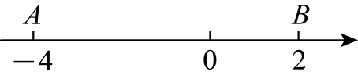

# Mathematics - 题目 1469

**ID**: 1fb5e905cb784b318589feeb7e0d5160
**年级**: Grade 7
**难度**: Medium-Hard
**题型**: Calculation

## 题目
对于数轴上的两条线段，给出如下定义：若其中一条线段的中点恰好是另一条线段的一个三等分点，则称这两条线段互为友好线段．(1)在数轴上，点A表示的数为 $-4$ ，点 $B$ 表示的数为2，点 $C{{}_{1}}$ 表示的数为 $-\frac {5}{2}$ ，点 $C{{}_{2}}$ 表示的数为 $-2$ ，点 $C{{}_{3}}$ 表示的数为4，在线段 $BC{{}_{1}},BC{{}_{2}},BC{{}_{3}}$ 中，与线段 $AB$ 互为友好线段的是；​​​​​​​‌(2)在数轴上，点 $A,B,C,D$ 表示的数分别为 $x,-2-x,\frac {3-x}{2},\frac {9-x}{2}$ ，且 $A,B$ 不重合．若线段 $AB,CD$ 互为友好线段，直接写出 $x$ 的值．

## 解答

1. （1）∵点 $B$ 表示的数为2，点 $C{{}_{1}}$ 表示的数为 $-\frac {5}{2}$ ，
2. ∴ $BC{{}_{1}}=2-\left ({-\frac {5}{2}}\right )=\frac {9}{2}$ ， $\frac {1}{3}BC{{}_{1}}=\frac {3}{2}$ ，
3. ∴ $BC{{}_{1}}$ 的中点表示的数是 $\left ({2-\frac {5}{2}}\right )\div 2=-\frac {1}{4}$ ，
4. 三等分点表示的数是 $-\frac {5}{2}+\frac {3}{2}=-1$ 或 $2-\frac {3}{2}=\frac {1}{2}$ ．
5. ∵点A表示的数为 $-4$ ，点 $B$ 表示的数为2，
6. ∴ $AB=2-\left ({-4}\right )=6$ ， $\frac {1}{3}AB=2$ ，
7. ∴ $AB$ 的中点表示的数是 $\left ({2-4}\right )\div 2=-1$ ，
8. 三等分点表示的数是 $-4+2=-2$ 或 $2-2=0$ ．
9. ∵点 $B$ 表示的数为2，点 $C{{}_{2}}$ 表示的数为 $-2$ ，
10. ∴ $BC{{}_{2}}=2-\left ({-2}\right )=4$ ， $\frac {1}{3}BC{{}_{2}}=\frac {4}{3}$ ，
11. ∴ $BC{{}_{2}}$ 的中点表示的数是 $\left ({2-2}\right )\div 2=0$ ，
12. 三等分点表示的数是 $-2+\frac {4}{3}=-\frac {2}{3}$ 或 $2-\frac {4}{3}=\frac {2}{3}$ ；
13. ∵ $AB$ 的中点是 $BC{{}_{1}}$ 的一个三等分点， $BC{{}_{2}}$ 的中点是 $AB$ 的一个三等分点，
14. ∴ $BC{{}_{1}}$ ， $BC{{}_{2}}$ 与 $AB$ 互为友好线段．
15. ∵ $BC{{}_{3}}$ 与 $AB$ 无重叠部分，
16. ∴ $BC{{}_{3}}$ 与 $AB$ 不可能是互为友好线段．
17. 故此题答案为： $BC{{}_{1}}$ ， $BC{{}_{2}}$ ；
18. （2）∵ $\frac {3-x}{2}-\frac {9-x}{2}=-3<0$ ，
19. ∴ $\frac {3-x}{2}<\frac {9-x}{2}$ ，
20. ∴ $CD=\frac {9-x}{2}-\frac {3-x}{2}=3$ ， $\frac {1}{3}CD=1$ ，
21. ∴ $CD$ 的中点表示的数是 $\left ({\frac {3-x}{2}+\frac {9-x}{2}}\right )\div 2=3-\frac {1}{2}x$ ，
22. 三等分点表示的数是 $\frac {3-x}{2}+1=\frac {5-x}{2}$ 或 $\frac {9-x}{2}-1=\frac {7-x}{2}$ ；
23. ∵点 $A,B$ 表示的数分别为 $x,-2-x$ ，
24. ∴ $AB$ 的中点表示的数是 $\left ({x-2-x}\right )\div 2=-1$ ．
25. 当 $AB$ 的中点是 $CD$ 的一个三等分点时，
26. 则 $\frac {5-x}{2}=-1$ 或 $\frac {7-x}{2}=-1$ ，
27. ∴ $x=7$ 或 $x=9$ ．
28. 当 $CD$ 的中点是 $AB$ 的一个三等分点时，
29. 若 $x>-2-x$ ，即 $x>-1$ 时，
30. $AB=x-\left ({-2-x}\right )=2x+2$ ， $\frac {1}{3}AB=\frac {2}{3}x+\frac {2}{3}$ ，
31. ∴ $AB$ 三等分点表示的数是 $-2-x+\frac {2}{3}x+\frac {2}{3}=-\frac {1}{3}x-\frac {4}{3}$ 或 $x-\left ({\frac {2}{3}x+\frac {2}{3}}\right )=\frac {1}{3}x-\frac {2}{3}$ ，
32. ∴ $-\frac {1}{3}x-\frac {4}{3}=3-\frac {1}{2}x$ 或 $\frac {1}{3}x-\frac {2}{3}=3-\frac {1}{2}x$ ，
33. 解得 $x=26$ 或 $x=\frac {22}{5}$ ．
34. 若 $x<-2-x$ ，即 $x<-1$ 时，
35. $AB=-2-x-x=-2x-2$ ， $\frac {1}{3}AB=-\frac {2}{3}x-\frac {2}{3}$ ，
36. ∴ $AB$ 三等分点表示的数是 $x+\left ({-\frac {2}{3}x-\frac {2}{3}}\right )=\frac {1}{3}x-\frac {2}{3}$ 或 $-2-x-\left ({-\frac {2}{3}x-\frac {2}{3}}\right )=-\frac {1}{3}x-\frac {4}{3}$ ，
37. ∴ $\frac {1}{3}x-\frac {2}{3}=3-\frac {1}{2}x$ 或 $-\frac {1}{3}x-\frac {4}{3}=3-\frac {1}{2}x$ ，
38. 解得 $x=\frac {22}{5}$ （舍去）或 $x=26$ （舍去）．
39. 综上可知，x的值为 $\frac {22}{5}$ ，7，9，26．

## 知识点

**中文**:
  - 两点间的距离
  - 整式的加减
  - 线段的和差

**English**:
  - Distance Between Two Points
  - Addition and Subtraction of Polynomials
  - Sum and Difference of Line Segments

---
