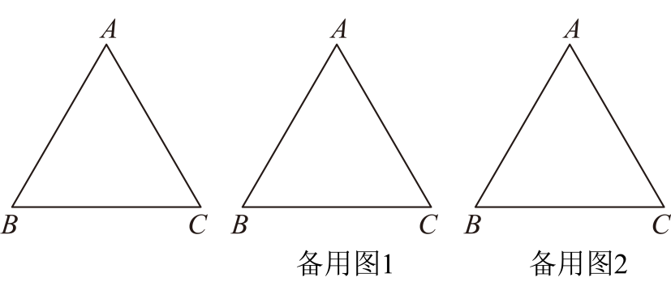

# Mathematics - 题目 2991

**ID**: 2526682a370f43cea78e7df65ccedace
**年级**: Grade 7
**难度**: Medium-Hard
**题型**: Calculation

## 题目
如图，在等边 $\vartriangle ABC$ 中，边 $AB=8$ 厘米，若动点 $P$ 从点 $C$ 开始，按 $C\to B\to A\to C$ 的路径运动，且速度为1厘米/秒，设点 $P$ 的运动时间为 $t$ 秒．（1）当 $t=4$ 时，判断 $AP$ 与 $BC$ 的位置关系，并说明理由；​​​​​​​‌（2）当 $\mathrm{△}PBC$ 的面积为 $\vartriangle ABC$ 面积的一半时，求 $t$ 的值；（3）另有一点 $Q$ ，从点 $C$ 开始，按 $C\to A\to B\to C$ 的路径运动，且速度为2厘米/秒，若 $P$ 、 $Q$ 两点同时出发，当 $P$ 、 $Q$ 中有一点到达终点时，另一点也停止运动．当 $t$ 为何值时，直线 $PQ$ 把 $\vartriangle ABC$ 的周长分成相等的两部分．

## 解答

1. （1）解： $AP\bot BC$ ，理由如下：
2. 如图：当 $t=4$ 秒时， $CP=4\times 1=4{\rm{c}}{\rm{m}}$ ，
3. 
4. ∵在等边 $\vartriangle ABC$ 中， $AB=8{\rm{c}}{\rm{m}}$ ，
5. ∴ $BC=AB=8{\rm{c}}{\rm{m}}$ ，
6. ∴此时P为 $BC$ 的中点，
7. ∴ $AP$ 为等边 $\vartriangle ABC$ 的中线，
8. ∴ $AP\bot BC$ ．
9. （2）解：∵由题意得： $S{{}_{\vartriangle PBC}}=\frac {1}{2}S{{}_{\vartriangle ABC}}$ ，
10. ∴如图：当P为AB中点时，满足题意，
11. 
12. 此时，P点运动路程为： $BC+BP=8+4=12$   ${\rm (cm)}$ ，
13. ∴P点运动时间为： $12\div 1=12$  (秒)；
14. 如图：当P为 $AC$ 中点时，满足题意，
15. 
16. 此时，P点运动路程为： $BC+AB+AP=8+{{8}}+4=20{\rm{c}}{\rm{m}}$ ，
17. ∴P点运动的时间为： $20\div 1=20$  (秒)．
18. ∴综上，t的值为12秒或20秒．
19. （3）解：∵点P的速度为1厘米/秒，点Q的速度为2厘米/秒，
20. ∴如图：当 $0<t\leqslant 4$ 时，点P在 $BC$ 上，点Q在 $AC$ 上，
21. ∴ $PC+CQ=t+2t=3t{\rm{c}}{\rm{m}}$ ，
22. $\because PC+CQ=\frac {1}{2}\left ({AB+AC+BC}\right )=12{\rm{c}}{\rm{m}}$ ，
23. ∴ $3t=12$ ，解得： $t=4$ ，符合 $0<t\leqslant 4$ ；
24. 
25. 当 $4<t\leqslant 8$ 时，点Q在 $AB$ 上，点P在 $BC$ 上，
26. 
27. $\therefore BP=\left ({8-t}\right ){\rm{c}}{\rm{m}}$ ， $BQ=\left ({16-2t}\right ){\rm{c}}{\rm{m}}$ ，
28. $\because BQ+BP=\frac {1}{2}\left ({AB+AC+BC}\right )=12{\rm{c}}{\rm{m}}$ ．
29. ∴ $\left ({8-t}\right )+\left ({16-2t}\right )=12$ ，解得： $t=4$ ，
30. ∴不符合 $4<t\leqslant 8$ ，舍去；
31. 当 $8<t\leqslant 12$ 时，点Q在 $BC$ 上，点P在 $AB$ 上，
32. 
33. ∴ $BP=\left ({t\mathrm{-}8}\right ){\rm{c}}{\rm{m}}{\rm{，}}BQ=\left ({2t\mathrm{-}{{1}}{{6}}}\right ){\rm{c}}{\rm{m}}$ ，
34. $\because BP+BQ=\frac {1}{2}\left ({AB+AC+BC}\right )=12{\rm{c}}{\rm{m}}$ ，
35. ∴ $t-8+2t-16=12$ ，解得： $t=12$ ，符合 $8<t\leqslant 12$ ．
36. ∴综上，符合条件的t的值为：4秒或12秒．

## 知识点

**中文**:
  - 三角形的中线
  - 等边三角形的性质
  - 几何问题

**English**:
  - Medians
  - Properties of Equilateral Triangles
  - Geometry Problems

---
