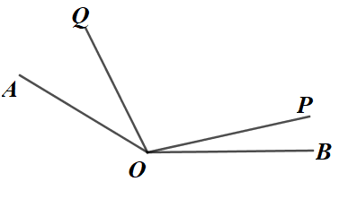

# Mathematics - 题目 2804

**ID**: 289e666e0a054e3eabc333e359831d1b
**年级**: Grade 7
**难度**: Medium-Hard
**题型**: Calculation

## 题目
已知 $\angle AOB=150{}\degree $ ，射线OP从OB出发，绕O逆时针以1°/秒的速度旋转，射线OQ从OA出发，绕O顺时针以3°/秒的速度旋转，两射线同时出发，运动时间为t秒 $\left ({0<t\leqslant 60}\right )$ .​​​​​​​‌（1）当 $t=12$ 秒时，求 $\angle POQ$ ；（2）当 $OP\bot OQ$ ，求 $t$ 的值；（3）射线OP，OQ，OB，其中一条射线是其他两条射线所形成的角的平分线，求t的值．

## 解答

1. （1）当 $t=12$ 时， $\angle AOQ=12\times 3{}\degree =36{}\degree $ ， $\angle POB=12\times 1{}\degree =12{}\degree $ ，
2. ∴ $\angle POQ=\angle AOB-\angle AOQ-\angle POB=150{}\degree -36{}\degree -12{}\degree =102{}\degree $ ．
3. （2） $\angle AOQ=3t$ ， $\angle POB=t$ ，
4. $OQ$ 与 $OP$ 相遇前，当 $0\leqslant t\leqslant 37.5$ 时，
5. $\angle POQ=150-\angle AOQ-\angle POB=150-4t$ ，
6. ∵ $OP\bot OQ$ ，
7. ∴ $150{}\degree -4t=90{}\degree $ ，
8. $t=15$ ，
9. $OQ$ 与 $OP$ 相遇后， $37.5<t\leqslant 50$ 时，
10. $\angle POQ=\angle POB-\left ({150-\angle AOQ}\right )=4t-150\leqslant 50{}\degree $ ，
11. ∴ $OP$ 不垂直 $OQ$ ，
12. 当 $50<t\leqslant 60$ 时，
13. $\angle POQ=\angle POB+\left ({\angle AOQ-150}\right )=4t-150$ ，
14. ∵ $OP\bot OQ$ ，
15. ∴ $4t-150=90{}\degree $ ，
16. $t=60$ ，
17. 综上所述，当 $t=15$ 或60时， $OP\bot OQ$ ．
18. （3）当 $OP$ 平分 $∠QOB$ 时，
19. $\angle POQ=\angle POB=\frac {1}{2}\angle QOB$ ，
20. ∴ $150-4t=t$ ，
21. $t=30$ ，
22. 当 $OQ$ 平分 $∠POB$ 时，
23. $\angle POQ=\angle QOB=\frac {1}{2}\angle POB$ ，
24. $\frac {1}{2}t=150-3t$ ，
25. $7t=300$ ，
26. $t=\frac {300}{7}$ ，
27. 当 $OB$ 平分 $\angle POQ$ 时，
28. $\angle POB=\angle QOB$ ，
29. $t=3t-150$ ，
30. $t=75$ （不合题意），
31. 综上所述，当 $t=30$ 或 $\frac {300}{7}$ 时， $OP$ ， $OQ$ ， $OB$ 其中一条射线是其他两条射线所形成的角的平分线．

## 知识点

**中文**:
  - 角平分线
  - 角的运算

**English**:
  - Angle Bisector
  - Operations with Angles

---
