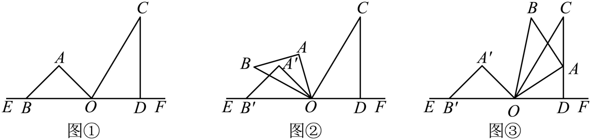

# Mathematics - 题目 1080

**ID**: 32a5170c878b4fc19395a2441c84ee7a
**年级**: Grade 7
**难度**: Medium-Hard
**题型**: Calculation

## 题目
活动课上，王老师将一副三角尺按图①位置摆放在直线 $EF$ 上，45°角的顶点与60°的顶点重合于点 $O$ ，斜边 $OB$ 与直角边 $OD$ 在直线 $EF$ 上，然后将直角三角尺 $OAB$ 绕点 $O$ 按15°/秒的速度顺时针方向旋转一周，设旋转时间为 $t$ 秒．(1)旋转前， $\angle AOC=$， $\angle BOC=$；​​​​​​​‌(2)“希望”小组同学发现：当 $t=2$ 时， $OA$ 是 $∠BOC$ 的角平分线，请利用图②说明理由；(3)“飞翔”小组同学发现：若直角三角板 $OAB$ 旋转至如图③的位置时， $\angle AOC+\angle BOD$ 为定值．请你判断是否正确，如果正确，请求出该度数；如果不正确，请说明理由．

## 解答

1. （1）解： $\angle AOC=180{}\degree -\angle AOB-\angle COD=180{}\degree -45{}\degree -60{}\degree =75{}\degree $ ，
2. $\angle BOC=180{}\degree -\angle COD=180{}\degree -60{}\degree =120{}\degree $ ；
3. （2）解：直角三角尺 $OAB$ 绕点 $O$ 按15°/秒的速度顺时针方向旋转，当 $t=2$ 时，
4. $\angle BOE=2\times 15{}\degree =30{}\degree $ ，则 $\angle BOC=180{}\degree -\angle BOE-\angle COD=180{}\degree -30{}\degree -60{}\degree =90{}\degree $ ,
5. ∵ $\angle AOB=45{}\degree $ ,
6. ∴ $OA$ 是 $∠BOC$ 的角平分线．
7. （3）解：正确， $105{}\degree $ ；
8. 直角三角板 $OAB$ 旋转至如图③的位置时，
9. $\angle AOC=60{}\degree -\angle AOD$ ， $∠BOD=45{}\degree +\angle AOD$ ，
10. $\angle AOC+\angle BOD=60{}\degree -\angle AOD+45{}\degree +\angle AOD=105{}\degree $ ．

## 知识点

**中文**:
  - 角平分线
  - 角的运算

**English**:
  - Angle Bisector
  - Operations with Angles

---
