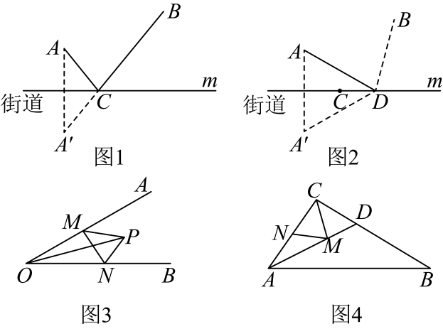

# Mathematics - 题目 1998

**ID**: 353c143854af4489a3404183e99813d4
**年级**: Grade 7
**难度**: Medium-Hard
**题型**: Calculation

## 题目
【任务一】某小区要在街道旁修建一个奶站，向居民区A，B提供牛奶，奶站应建在什么地方，才能使A，B到它的距离之和最短？该问题给牛奶公司造成了困扰，现向居民们征求意见．小明同学将小区和街道抽象出的平面图形，并用轴对称的方法巧妙地解决了这个问题．如图1，作A关于直线m的对称点 $A^{′}$ ，连接 $A^{′}B$ 与直线m交于点C，点C就是所求的位置．请你在下列阅读、应用的过程中，完成解答并填空：证明：如图2，在直线m上另取任一点D，连结 ${\rm \mathit{AD}，}A^{′}D{\rm ，\mathit{BD}}$ ，∵直线m是点 ${\rm \mathit{A}，}A^{′}$ 的对称轴，点C，D在m上，∴ $CA=$， $DA=$，∴ $AC+CB=A^{′}C+CB=$在 $\vartriangle A^{′}DB$ 中，∵ $A^{′}B<A^{′}D+DB$ ，∴ $A^{′}C+CB<A^{′}D+DB$ ．∴ $AC+CB<AD+DB$ ，即 $AC+CB$ 最小，【任务二】如图3，有两条公路AO和BO经过村庄 $O$ ，它们的夹角 $\angle AOB=30{}\degree $ ，现要在距离村庄500米的种植园P处新建如图所示的三条小路PM，PN，MN，使三条小路刚好围成一个三角形 $\vartriangle PMN$ ， $\vartriangle PMN$ 周长的最小值为米．【任务三】实践应用：如图4，在 $\vartriangle ABC$ 中， $AC=6$ ， $BC=8$ ， $AB=10$ ， $\angle ACB\mathrm{=}90{}\degree {\rm ，\mathit{AD}}$ 平分 $∠BAC{\rm ，\mathit{M}}$ 、N分别是AD、AC边上的动点，求 $CM+MN$ 的最小值．​​​​​​​‌

## 解答

1. 任务一：证明：如图2，在直线 $m$ 上另取任一点 $D$ ，连结 $AD$ ， $A\prime D$ ， $BD$ ，
2. $\because $ 直线 $m$ 是点 $\mathrm{A}$ ， $A\prime $ 的对称轴，点 $C$ ， $D$ 在 $m$ 上，
3. $\therefore CA=CA\prime $ ， $DA=DA\prime $ ，
4. $\therefore AC+CB=A\prime C+CB=A\prime B$ ．
5. 在 ${\rm △}A\mathrm{′}DB$ 中，
6. $\because A\prime B<A\prime D+DB$ ，
7. $\therefore A\prime C+CB<A\prime D+DB$ ．
8. $\therefore AC+CB<AD+DB$ ，
9. 即 $AC+CB$ 最小.
10. 任务二：作点 $P$ 关于直线 $OA$ 的对称点 $F$ ，作点 $P$ 关于直线 $OB$ 的对称点 $G$ ，连接 $FG$ ，
11. 分别交 $OA$ 、 $OB$ 于 $M$ 、 $N$ ，如图：
12. $\therefore MP=MF$ ， $NP=NG$ ，
13. $\because $  $\vartriangle PMN$ 的周长为 $PM+PN+MN=FM+GN+MN=FG$ ，
14. $\therefore $ 此时 $\vartriangle PMN$ 的周长取得最小值，且最小值为 $FG$ ，
15. 由轴对称的性质得： $\angle FOA=\angle AOP$ ， $\angle POB=\angle GOB$ ，
16. $OP=OF$ ， $OP=OG$ ，
17. $\because \angle AOP+\angle POB=\angle AOB=30{}\degree $ ， $OP=500$ ，
18. $\therefore \angle FOG=\angle FOA+\angle AOP+\angle POB+\angle GOB=60{}\degree $ ， $OF=OG=500$ ，
19. $\therefore {\rm △}$  $FOG$ 为边长为500的等边三角形，
20. $\therefore FG=500$ ，
21. $\therefore {\rm △}$  $PMN$ 的周长的最小值为500米.
22. 任务三：如图，过点 $C$ 作 $CD\bot AB$ 交 $AB$ 于点 $D$ ，交 $AD$ 于点 $M$ ，过点 $M$ 作 $MN\bot AC$ 于点 $N$ ，
23. 
24. $\because AD$ 是 $∠BAC$ 的平分线．
25. $\therefore MN=DM$ ，
26. $\therefore CM+MN=CM+DM=CD$ ，
27. $\therefore $ 这时 $CM+MN$ 有最小值，即 $CD$ 的长度，
28. $\because AC=6$ ， $AB=10$ ， $\angle ACB\mathrm{=}90{}\degree $ ， $BC=8$ ，
29. $\because S{{}_{\vartriangle ABC}}=\frac {1}{2}AB\cdot CD=\frac {1}{2}AC\cdot BC$ ，
30. $\therefore CD=\frac {AC\cdot BC}{AB}=\frac {24}{5}$ ，
31. 即 $CM+MN$ 的最小值为 $\frac {24}{5}$ ．

## 知识点

**中文**:
  - 等边三角形的判定与性质
  - 角平分线的性质
  - 轴对称的性质

**English**:
  - Determination and Properties
  - Properties of Angle Bisectors
  - Properties of Axial Symmetry

---
