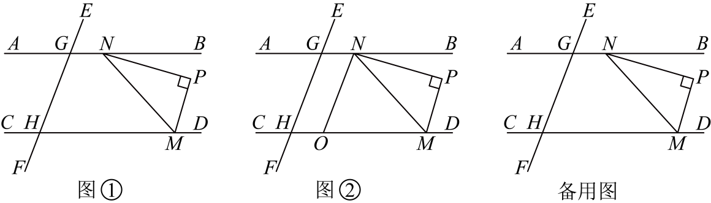

# Mathematics - 题目 2338

**ID**: 3621c4bb8be6427d87414acd7f7243ad
**年级**: Grade 7
**难度**: Medium-Hard
**题型**: Calculation

## 题目
如图，直线 $AB/\mskip-4mu/CD$ ，直线 $EF$ 与 $AB$ 、 $CD$ 分别交于点 $G$ 、 $H$ ， $\angle EHD=α\left ({0{}\degree <α<90{}\degree }\right )$ ．小明将一个含 $30{}\degree $ 角的直角三角板 $PMN$ 按如图①放置，使点 $N$ 、 $M$ 分别在直线 $AB$ 、 $CD$ 上， $\angle P=90{}\degree $ ， $\angle PMN=60{}\degree $ ．（1）填空： $\angle PNB+\angle PMD=$${}\degree $ ；​​​​​​​‌（2）若 $PM/\mskip-4mu/EF$ ， $\angle MNG$ 的角平分线 $NO$ 交直线 $CD$ 于点 $O$ ．①如图②，当 $NO\mathrm{/\mskip-4mu/}EF$ 时，求 $α$ 的度数；②小明将三角板 $PMN$ 向左平移，直接写出 $\angle MON$ 的度数（用含 $α$ 的式子表示）．

## 解答

1. （1）解：如图①，过点P作 $PQ{\rm{/\mskip-4mu/}}AB$ ，
2. 
3. ∵ $AB{\rm{/\mskip-4mu/}}CD$ ，
4. ∴ $AB{\rm{/\mskip-4mu/}}PQ{\rm{/\mskip-4mu/}}CD$ ，
5. ∴ $\angle PNB=\angle NPQ$ ， $\angle QPM=\angle PMD$ ，
6. ∵ $\angle NPQ+\angle QPM=\angle NPM=90{}\degree $ ，
7. ∴ $\angle PNB+\angle PMD=90{}\degree $ .
8. （2）解：① $\because NO{\rm{/\mskip-4mu/}}EF$ ， $\angle EHD=α$ ，
9. $\therefore \angle NOD=α$ ，
10. $\because AB{\rm{/\mskip-4mu/}}CD$ ，
11. $\therefore \angle ANO=\angle NOD=α$ ，
12. $\because NO$ 是 $\angle MNG$ 的角平分线，
13. $\therefore \angle MNO=\angle ANO=α$ ，
14. $\because PM{\rm{/\mskip-4mu/}}EF$ ，
15. $\therefore PM{\rm{/\mskip-4mu/}}NO$ ，
16. $\therefore \angle PMN=\angle MNO$ ，
17. $\because \angle PMN=60{}\degree $
18. $\therefore α=60{}\degree $ ；
19. ② $\because AB{\rm{/\mskip-4mu/}}CD$ ，
20. $\therefore \angle ANO=\angle MON$ ，
21. $\because NO$ 是 $\angle MNG$ 的角平分线，
22. $\therefore \angle MNO=\angle ANO$ ，
23. $\therefore \angle MON=\angle MNO$ ，
24. 当点 $N$ 在点 $G$ 右侧时，
25. $\because PM{\rm{/\mskip-4mu/}}EF$ ，
26. $\therefore \angle PMC+\angle GHD=180{}\degree $ ，
27. $\therefore \angle PMN+\angle NMO=180{}\degree -α$ ，
28. $\because \angle PMN=60{}\degree $
29. $\therefore \angle NMO=120{}\degree -α$ ，
30. $\therefore \angle MON=\frac {1}{2}\left ({180{}\degree -\angle NMO}\right )=30{}\degree +\frac {1}{2}α$ ；
31. 当点 $N$ 在点 $G$ 左侧时，
32. 
33. $\because PM{\rm{/\mskip-4mu/}}EF$
34. $\therefore \angle PMD=\angle GHD=α$ ，
35. $\therefore \angle NMC=180{}\degree -\angle PMD-\angle PMN=120{}\degree -α$ ，
36. $\because \angle NMC=\angle MNO+\angle MON$ ，
37. $\therefore \angle MON=\frac {1}{2}\angle NMC=60{}\degree -\frac {1}{2}α$ ，
38. 综上可知， $\angle MON$ 的度数为 $30{}\degree +\frac {1}{2}α$ 或 $60{}\degree -\frac {1}{2}α$ ．

## 知识点

**中文**:
  - 平行公理及推论
  - 平行线的判定与性质

**English**:
  - Parallel Axiom
  - Determination and Properties

---
