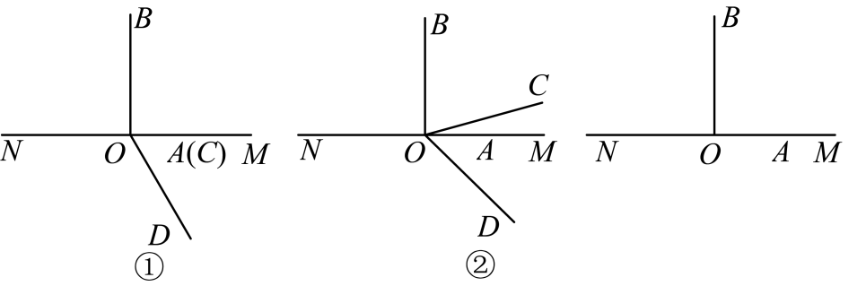

# Mathematics - 题目 3386

**ID**: 37dc81d04eef45f28588d9c40ddddcae
**年级**: Grade 7
**难度**: Medium-Hard
**题型**: Calculation

## 题目
已知  $\angle AOB=90{}^\circ ,\angle COD=60{}^\circ $ ，按如图①所示摆放，将 $OA,OC$ 边重合在直线 $MN$ 上， $OB,OD$ 边在直线 $MN$ 的两侧．(1)保持 $∠AOB$ 不动，将 $\angle COD$ 绕点O旋转至如图②所示的位置，则 $\angle AOC+\angle BOD=$， $\angle BOC-\angle AOD=$；​​​​​​​‌(2)若 $\angle COD$ 按每分钟 $5{}^\circ $ 的速度绕点O逆时针方向旋转， $∠AOB$ 按每分钟 $2{}^\circ $ 的速度也绕点O逆时针方向旋转， $OC$ 旋转到射线 $ON$ 上时都停止运动，设旋转时间为t分钟．求 $\angle MOC-\angle AOD$ 的大小（用t的代数式表示）；(3)保持 $∠AOB$ 不动，将 $\angle COD$ 绕点O逆时针方向旋转 $n{}^\circ (n\leqslant 180{}^\circ )$ ，若射线 $OE$ 平分 $∠AOC$ ，射线 $OF$ 平分 $∠BOD$ ，求 $\angle EOF$ 的大小．

## 解答

1. （1）① $\angle AOC+\angle BOD=\angle AOC+\angle AOD+\angle AOB$
2. $=\angle COD+\angle AOB=60{}^\circ +90{}^\circ =150{}^\circ $ ，
3. ② $\angle BOC-\angle AOD=(\angle AOB-\angle AOC)-(\angle COD-\angle AOC)$
4. $=\angle AOB-\angle AOC-\angle COD+\angle AOC$
5. $=\angle AOB-\angle COD=90{}^\circ -60{}^\circ =30{}^\circ $ ；
6. 故此题答案为： $150{}^\circ ,30{}^\circ $ ；
7. （2）设旋转时间为t秒，则 $0<t\leqslant 36$ ， $\angle MOC=(5t){}^\circ $ ，
8. ① $0<t\leqslant 20$ 时， $OD$ 与 $OA$ 相遇前， $\angle AOD=(60+2t-5t){}^\circ =(60-3t){}^\circ $ ，
9. ∴ $\angle MOC-\angle AOD=(8t-60){}^\circ $ ；
10. ② $20<t\leqslant 36$ 时， $OD$ 与 $OA$ 相遇后， $\angle AOD=\left [5t-(60+2t)\right ]{}^\circ =(3t-60){}^\circ $ ，
11. ∴ $\angle MOC-\angle AOD=(2t+60){}^\circ $ ；
12. （3）设 $OC$ 绕点O逆时针旋转 $n{}^\circ $ ，则 $OD$ 也绕点O逆时针旋转 $n{}^\circ $ ，
13. ① $0<n{}^\circ \leqslant 150{}^\circ $ 时，如图①，
14. 
15. $OE、OF$ 在射线 $OB$ 同侧，
16. ∵ $\angle AOB=90{}^\circ ,\angle MOD=60{}^\circ -n{}^\circ $ ，
17. ∴ $\angle BOD=\angle AOB+\angle MOD=\left ({150-n}\right ){}^\circ $ ，
18. ∵ $OF$ 平分 $∠BOD$ ，
19. ∴ $\angle BOF=\frac {1}{2}(150-n){}^\circ $ ，
20. ∵ $\angle MOC=n{}^\circ $ ， $OE$ 平分 $∠AOC$ ，
21. ∴ $\angle MOE=\frac {1}{2}\angle MOC=\frac {1}{2}n{}^\circ $
22. ∴ $\angle BOE=(90-\frac {1}{2}n){}^\circ $ ，
23. ∴ $\angle EOF=\angle BOE-\angle BOF=15{}^\circ $ ；
24. ② $150{}^\circ <n{}^\circ \leqslant 180{}^\circ $ 时，如图②，
25. 
26. $OE、OF$ 在射线 $OB$ 异侧，
27. ∵ $\angle AOB=90{}^\circ ,\angle MOD=n{}^\circ -60{}^\circ $ ，
28. ∴ $\angle BOD=\angle MOD-\angle AOB=\left ({n-150}\right ){}^\circ $ ，
29. ∵ $OF$ 平分 $∠BOD$ ，
30. ∴ $\angle BOF=\frac {1}{2}(n-150){}^\circ $ ，
31. ∵ $\angle MOC=n{}^\circ $ ， $OE$ 平分 $∠AOC$ ，
32. ∴ $\angle MOE=\frac {1}{2}\angle MOC=\frac {1}{2}n{}^\circ $
33. ∴ $\angle BOE=(90-\frac {1}{2}n){}^\circ $ ，
34. ∴ $\angle EOF=\angle BOE+\angle BOF=15{}^\circ $ ．
35. 综上， $\angle EOF=15{}^\circ $ ．

## 知识点

**中文**:
  - 角平分线
  - 角的运算

**English**:
  - Angle Bisector
  - Operations with Angles

---
