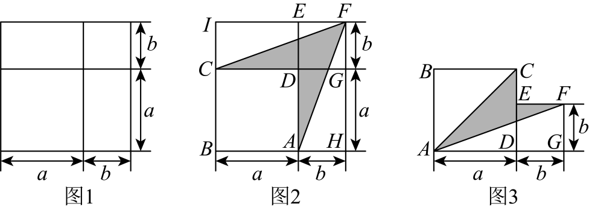

# Mathematics - 题目 2305

**ID**: 3ebb436a35ab404f9c8109c939475fa3
**年级**: Grade 7
**难度**: Medium-Hard
**题型**: Calculation

## 题目
阅读与实践（1）【知识感知】：完全平方公式1 的几何背景：如图1，把一个边长为 $\left ({a+b}\right )$ 的正方形分割成四部分，则这四部分的面积分别为 $a{^{2}}$ ， $ab$ ， $ab$ ， $b{^{2}}$ ，由两种方法计算正方形的面积，可得到等式（请补全等式）： ${\left({a+b}\right)^{2}}=$  _；​​​​​​​‌（2）【类比迁移】：如图 2，将边长为a的正方形ABCD和边长为b的正方形DEFG以图 2 方式摆 放，使得点C，D，G在同一直线上． 若 $a+b=10$ ， $a{^{2}}+b{^{2}}=52$ ，求阴影部分的面积．在求解过程中，同学们应用数学转化思想、数形结合思想、整体思想把求不规则图形 的面积转化为求规则图形的面积的和差进行求解． 经过思考做了以下尝试解答，请你补 全求解过程：$S{{}_{阴影部分}}=S{{}_{正方形BIFH}}-S{{}_{正方形ABCD}}-S{{}_{\vartriangle AHF}}-S{{}_{\vartriangle CIF}}$$={\left({a+b}\right)^{2}}-$ _ $-\frac {1}{2}\cdot b\cdot \left ({a+b}\right )-\frac {1}{2}\cdot b\cdot \left ({a+b}\right )$$=ab$将等式  $a+b=10$  两边同时平方得： ${\left({a+b}\right)^{2}}=10{^{2}}$化简得：将 $a{^{2}}+b{^{2}}=52$ 代入①中得： $52+2ab=100$解得： $S{{}_{{\rm{阴}}{\rm{影}}{\rm{部}}{\rm{分}}}}=ab=$ _．（3）【拓展应用】：如图 3，将边长为a的正方形 $ABCD$ 和边长为b的正方形 $DEFG$ 以图 3 方式摆 放，使得点A，D，G在同一直线上． 若 $a-b=12$ ， $ab=158$ ，求阴影部分的面积．

## 解答

1. （1）根据正方形面积的两种计算方法（整体法和部分法），边长为 $(a+b)$ 的正方形面积，整体计算为 $(a+b){^{2}}$ ；部分计算为四部分面积和 $a{^{2}}+ab+ab+b{^{2}}$ ，
2. 所以 $(a+b){^{2}}=a{^{2}}+2ab+b{^{2}}$  .
3. （2） $S{{}_{{\rm{阴}}{\rm{影}}{\rm{部}}{\rm{分}}}} =S{{}_{{\rm{正}}{\rm{方}}{\rm{形}}BIFH}}  -S{{}_{{\rm{正}}{\rm{方}}{\rm{形}}ABCD}}  -S{{}_{\vartriangle AHF}}  -S{{}_{\vartriangle CIF}}$
4. $={\left({a+b}\right)^{2}}-a{^{2}}-\frac {1}{2}\cdot b\cdot \left ({a+b}\right )-\frac {1}{2}\cdot b\cdot \left ({a+b}\right )$
5. $=ab$ ；
6. 将等式  $a+b=10$  两边同时平方得： ${\left({a+b}\right)^{2}} =10{^{2}}$
7. 化简得：
8. 将 $a{^{2}}+b{^{2}}=52$ 代入①中得： $52+2ab=100$
9. 解得： $S{{}_{{\rm{阴}}{\rm{影}}{\rm{部}}{\rm{分}}}}=ab=24$ ．
10. （3）阴影部分面积 $S=S{{}_{正方形ABCD}}+S{{}_{正方形DEFG}}-S{{}_{\vartriangle ABC}}-S{{}_{\vartriangle AEF}}$  ．
11. ∵ $S{{}_{正方形ABCD}}=a{^{2}}$ ， $S{{}_{正方形DEFG}}=b{^{2}}$ ； $S{{}_{\vartriangle ABC}}=\frac {1}{2}a{^{2}}$ ， $S{{}_{\vartriangle AEF}}=\frac {1}{2}b(a+b)$  ．
12. ∴ $S=a{^{2}}+b{^{2}}-\frac {1}{2}a{^{2}}-\frac {1}{2}b(a+b)=\frac {1}{2}a{^{2}}+b{^{2}}-\frac {1}{2}ab-\frac {1}{2}b{^{2}}=\frac {1}{2}(a{^{2}}+b{^{2}}-ab)$ ．
13. ∵ $(a-b){^{2}}=a{^{2}}-2ab+b{^{2}}$ ，
14. ∴ $a{^{2}}+b{^{2}}=(a-b){^{2}}+2ab$ ．
15. ∵ $a-b=12$ ， $ab=158$ ，
16. ∴ $a{^{2}}+b{^{2}}=12{^{2}}+2\times 158=144+316=460$ ．
17. ∴ $S=\frac {1}{2}(460-158)=\frac {1}{2}\times 302=151$ ．

## 知识点

**中文**:
  - 完全平方公式
  - 完全平方公式与几何图形

**English**:
  - Perfect Square Formula
  - Perfect Square Formula and Geometric Figures

---
