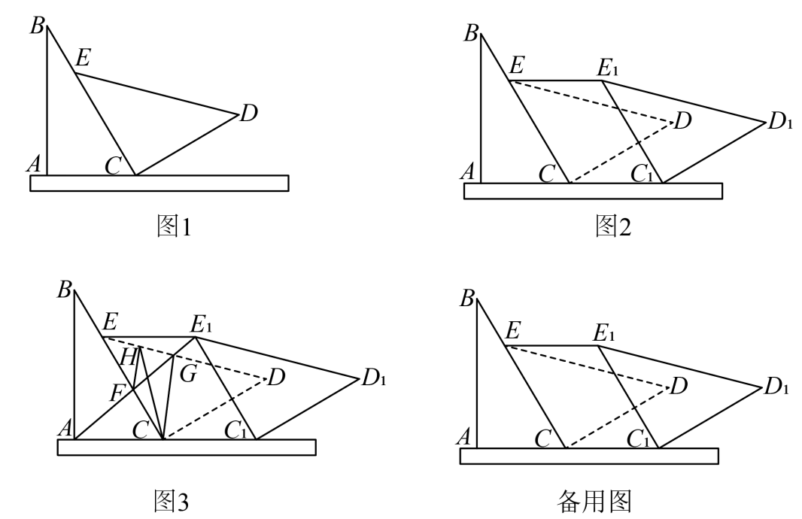

# Mathematics - 题目 813

**ID**: 4373229d274a4c568c186f01956eb2be
**年级**: Grade 7
**难度**: Medium-Hard
**题型**: Calculation

## 题目
将一副三角板和直尺按图1的方式摆放，固定 $60{}\degree $ 的三角板 $ABC$ 和直尺，将 $45{}\degree $ 的三角板 $CDE$ 沿射线 $AC$ 平移，得到 $\mathrm{△}C{{}_{1}}D{{}_{1}}E{{}_{1}}$ ，其中 $EC\mathrm{/\mskip-4mu/}E{{}_{1}}C{{}_{1}}$ ．如图2所示．（1）连接 $EE{{}_{1}}$ ，求 $\angle EE{{}_{1}}D{{}_{1}}$ 的度数：（2）连接 $AE{{}_{1}}$ 交ED于点 ${\rm \mathit{G}，}BC$ 于点F，连接 $CG$ ，过F作 $FH{\rm{/\mskip-4mu/}}CG$ ，交 $ED$ 于点H，连接 $HC$ ，如图3，探究当 $\angle EFG=\angle FGC+\angle GCD$ 时．线段 $CG$ 与 $HC$ 的大小关系；​​​​​​​‌（3）过点A的直线l与直线 $E{{}_{1}}D{{}_{1}}$ 交于点 ${\rm \mathit{P}，}MP$ 平分 $\angle APD{{}_{1}}$ ， $C{{}_{1}}N$ 平分 $\angle AC{{}_{1}}D{{}_{1}}$ ，三角板 $CDE$ 在平移的过程中，是否存在某个时刻直线 $MP$ 与直线 $C{{}_{1}}N$ 没有交点，若存在，求出 $\angle PAC$ 的度数，若不存在，请说明理由．

## 解答

1. （1）解：由题意得 $EC\mathrm{/\mskip-4mu/}E{{}_{1}}C{{}_{1}}$ ， $CC{{}_{1}}\mathrm{/\mskip-4mu/}EE{{}_{1}}$ ， $\angle ACB=60{}\degree $ ， $\angle D{{}_{1}}E{{}_{1}}C{{}_{1}}=\angle DEC=45{}\degree $ ，
2. ∵ $CC{{}_{1}}\mathrm{/\mskip-4mu/}EE{{}_{1}}$ ，
3. ∴ $\angle E{{}_{1}}EC=\angle ACB=60{}\degree $ ，
4. ∵ $EC\mathrm{/\mskip-4mu/}E{{}_{1}}C{{}_{1}}$ ，
5. ∴ $\angle EE{{}_{1}}C{{}_{1}}=180{}\degree -\angle E{{}_{1}}EC=120{}\degree $ ，
6. ∴ $\angle EE{{}_{1}}D{{}_{1}}=\angle EE{{}_{1}}C{{}_{1}}+\angle D{{}_{1}}E{{}_{1}}C{{}_{1}}=120{}\degree +45{}\degree =165{}\degree $ ；
7. （2）解：∵ $FH{\rm{/\mskip-4mu/}}CG$ ，
8. ∴ $\angle HFG=\angle FGC$ ， $\angle EFH=\angle ECG$ ，
9. ∵ $\angle EFG=\angle FGC+\angle GCD$ ，
10. ∴ $\angle EFH+\angle HFG=\angle FGC+\angle GCD$ ，
11. ∴ $\angle ECG=\angle GCD$ ，
12. ∵三角板 $CDE$ 是等腰直角三角形，
13. ∴ $CD=CE$ ，
14. ∵ $CG=CG$ ，
15. ∴ $\vartriangle CDG≌\vartriangle CEG\left ({{\rm{S}}{\rm{A}}{\rm{S}}}\right )$ ，
16. ∴ $\angle CGD=\angle CGE=\frac {1}{2}\times 180{}\degree =90{}\degree $ ，
17. ∴ $CG\bot DE$ ，
18. ∴ $CH>CG$ ；
19. （3）解：∵直线 $MP$ 与直线 $C{{}_{1}}N$ 没有交点，
20. ∴ $MP{\rm{/\mskip-4mu/}}C{{}_{1}}N$ ，
21. 
22. ∵ $EC\mathrm{/\mskip-4mu/}E{{}_{1}}C{{}_{1}}$ ， $\angle ACB=60{}\degree $ ，
23. ∴ $\angle E{{}_{1}}C{{}_{1}}A=\angle ACB=60{}\degree $ ，
24. ∴ $\angle AC{{}_{1}}D{{}_{1}}=60{}\degree +90{}\degree =150{}\degree $ ，
25. ∵ $C{{}_{1}}N$ 平分 $\angle AC{{}_{1}}D{{}_{1}}$ ，
26. ∴ $\angle AC{{}_{1}}N=\angle D{{}_{1}}C{{}_{1}}N=\frac {1}{2}\angle AC{{}_{1}}D{{}_{1}}=75{}\degree $ ，
27. ∴ $\angle E{{}_{1}}C{{}_{1}}N=90{}\degree -75{}\degree =15{}\degree $ ，
28. ∴ $\angle D{{}_{1}}NC{{}_{1}}=\angle D{{}_{1}}E{{}_{1}}C{{}_{1}}+\angle E{{}_{1}}C{{}_{1}}N=45{}\degree +15{}\degree =60{}\degree $ ，
29. ∵ $MP{\rm{/\mskip-4mu/}}C{{}_{1}}N$ ，
30. ∴ $\angle AMP=\angle AC{{}_{1}}N=75{}\degree $ ， $\angle D{{}_{1}}PM=\angle D{{}_{1}}NC{{}_{1}}=60{}\degree $ ，
31. ∵ $MP$ 平分 $\angle APD{{}_{1}}$ ，
32. ∴ $\angle APM=\angle D{{}_{1}}PM=60{}\degree $ ，
33. ∴ $\angle PAC=180{}\degree -\angle AMP-\angle APM=180{}\degree -75{}\degree -60{}\degree =45{}\degree $ ．

## 知识点

**中文**:
  - 平移的性质
  - 平行线的判定与性质

**English**:
  - Properties of Translation
  - Determination and Properties

---
