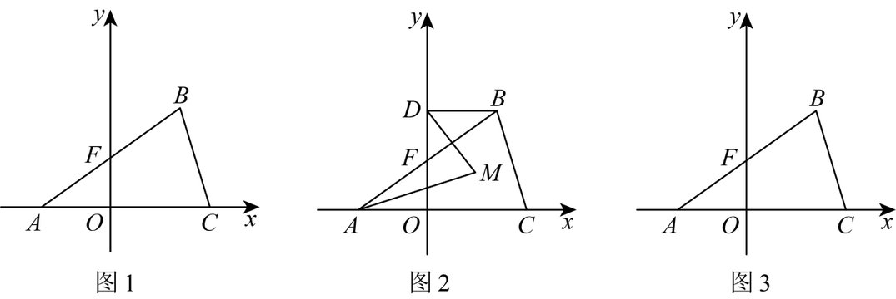

# Mathematics - 题目 1383

**ID**: 4b1bdef2b7604dcea727176069a1c854
**年级**: Grade 7
**难度**: Medium-Hard
**题型**: Calculation

## 题目
如图1，在平面直角坐标系中，已知点 $A(m,0)$ ， $B(n,4)$ ， $C(5,0)$ ，且满足 $|2m+n|+(m-n+6){^{2}}=0$ ，线段 $AB$ 交 $y$ 轴于点 $F$ ．(1)求出点 $A$ ， $B$ 的坐标；​​​​​​​‌(2)如图2，点 $D$ 是 $y$ 轴正半轴上的一点，若 $DB\mathrm{/\mskip-4mu/}AC$ ， $\angle BAC=α$ ， $AM$ 、 $DM$ 分别平分 $∠CAB$ 、 $\angle ODB$ ，求 $∠AMD$ （用含 $α$ 的代数式表示）；(3)如图3，坐标轴上是否存在一点 $P$ （点 $C$ 除外），使得三角形 $ABP$ 的面积和三角形 $ABC$ 的面积相等？若存在，请直接写出 $P$ 点坐标；若不存在，请说明理由．

## 解答

1. （1）解： $\because |2m+n|+(m-n+6){^{2}}=0$ ，
2. $\therefore $  $\begin{cases}2m+n=0\\m-n+6=0\end{cases}$ ，
3. $\therefore m=-2$ ， $n=4$ ，
4. $\therefore A(-2,0)$ ， $B(4,4)$ ；
5. （2）过点 $M$ 作 $MN/\mskip-4mu/DB$ ，
6. $\because $  $DM$ 平分 $\angle ODB$ ， $\angle BDO=90{}\degree $ ，
7. $\therefore \angle 2=\angle 4=\frac {1}{2}\angle ODB=45{}\degree $ ，
8. $\because $  $AM$ 平分 $∠CAB$ ， $\angle BAO=α$ ，
9. $\therefore ∠1=∠6=\frac {1}{2}α$ ，
10. $\because $  $MN/\mskip-4mu/DB$ ，
11. $\therefore \angle 5=\angle 2=45{}\degree $ ，
12. $\because $  $DB\mathrm{/\mskip-4mu/}AC$ ，
13. $\therefore MN/\mskip-4mu/AC$ ，
14. $\therefore ∠7=∠6=\frac {1}{2}α$ ，
15. $\therefore \angle AMD=\angle 5+\angle 7=45{}\degree +\frac {1}{2}α$ ；
16. （3）存在，点 $P$ 坐标为 $\left ({-9,0}\right )$ ， $\left ({0,6}\right )$ 或 $\left ({0,-\frac {10}{3}}\right )$ ，
17. ①点 $P$ 在 $x$ 轴点 $A$ 左侧，
18. $\because $  $A(-2,0)$ ， $B(4,4)$ ， $C(5,0)$ ，
19. $\therefore $  $AC=5+2=7$ ，
20. $\therefore $  $S{{}_{三角形ABC}}=\frac {1}{2}AC\cdot y{{}_{B}}=\frac {1}{2}\times 7\times 4=14$ ，
21. $\because $ 三角形 $ABP$ 与三角形 $ABC$ 面积相等，如图：
22. $\therefore $  $S{{}_{三角形ABP}}=\frac {1}{2}AP\cdot y{{}_{B}}=14$ ，
23. 即 $\frac {1}{2}\times AP\times 4=14$ ，
24. $\therefore AP=7$ ，
25. $\therefore $  $OP=PA+OA=7+2=9$ ，
26. $\therefore $ 点 $P\left ({-9,0}\right )$ ，
27. ②点 $P$ 在 $y$ 轴上，连接 $OF$ ，
28. $\therefore S{{}_{三角形AOB}}=\frac {1}{2}AO\cdot y{{}_{B}}=\frac {1}{2}\times 2\times 4=4$ ，
29. 
30. 又 $\because S{{}_{三角形AOB}}=S{{}_{三角形AOF}}+S{{}_{三角形BOF}}=\frac {1}{2}AO\cdot OF+\frac {1}{2}OF\cdot x{{}_{B}}=\frac {1}{2}\times 2OF+\frac {1}{2}\times 4OF$ ，
31. $\therefore \frac {1}{2}\times 2OF+\frac {1}{2}\times 4OF=4$ ，
32. $\therefore OF=\frac {4}{3}$ ，
33. $\because S{{}_{三角形ABP}}=S{{}_{三角形AFP}}+S{{}_{三角形BFP}}=\frac {1}{2}PF\cdot AO+\frac {1}{2}PF\cdot x{{}_{B}}=\frac {1}{2}\times 6PF=3PF$ ，
34. $S{{}_{三角形ABP}}=S{{}_{三角形ABC}}$ ，
35. $\therefore 14=3PF$ ，
36. $\therefore PF=\frac {14}{3}$ ，
37. $\therefore $  $OP=OF+PF=\frac {4}{3}+\frac {14}{3}=6$ 或 $OP=PF-OF=\frac {14}{3}+\frac {4}{3}=\frac {10}{3}$ ，
38. $\therefore $ 点 $P$ 坐标为 $\left ({0,6}\right )$ 或 $\left ({0,-\frac {10}{3}}\right )$ ，
39. $\therefore $ 点 $P$ 坐标为 $\left ({-9,0}\right )$ ， $\left ({0,6}\right )$ 或 $\left ({0,-\frac {10}{3}}\right )$ ．

## 知识点

**中文**:
  - 三角形的角平分线
  - 绝对值非负性的应用
  - 平行线性质的应用

**English**:
  - Angle Bisectors
  - Applications of Non-negativity of Absolute Value
  - Applications of Properties

---
