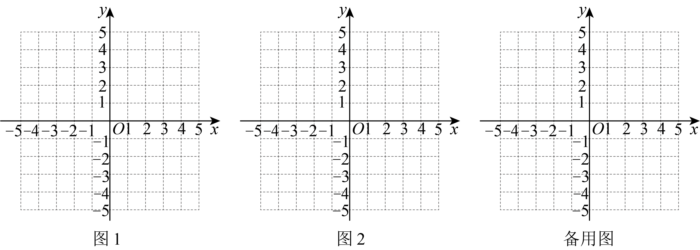

# Mathematics - 题目 2896

**ID**: 4b63220476f841ce90ff824bc521a05f
**年级**: Grade 7
**难度**: Medium-Hard
**题型**: Calculation

## 题目
在平面直角坐标系 $xOy$ 中，点 $M\left ({a,b}\right )$ ，对于点 $P\left ({x,y}\right )$ 给出如下定义：将点 $P$ 向右（ $a\geqslant 0$ 时）或向左（ $a<0$ 时）平移 $\left |{a}\right |$ 个单位长度，再向上（ $b\geqslant 0$ 时）或向下（ $b<0$ 时）平移 $\left |{b}\right |$ 个单位长度，得到点 $P^{′}{\left ({x^{′},y^{′}}\right )}$ ，再计算得到点 $Q\left ({3-x^{′},3-y^{′}}\right )$ ，我们称点 $Q$ 是点 $P$ 的“广称点”．（1） $M\left ({2,-1}\right )$ ，则点 $A\left ({-2,-3}\right )$ 的广称点坐标是；​​​​​​​‌（2） $M\left ({1,2}\right )$ ，点 $B\left ({0,m}\right )$ ，点 $B$ 的广称点是 $C$ ，当 $S{{}_{\vartriangle BOC}}=2$ ，求点 $B$ 的坐标；（3） $M\left ({t,2t}\right )$ ，点 $C\left ({-1,0}\right )$ ， $D\left ({-2,1}\right )$ ，点 $E$ 是线段 $CD$ 上一点，对于在以 $O$ 为中心，四边垂直或平行于坐标轴，边长为 $4\sqrt {3}$ 的正方形边上存在点 $E$ 的广称点，直接写出 $t$ 的取值范围．

## 解答

1. （1）解：根据题意，得 $M\left ({2,-1}\right )$ ，这里 $a=2{\rm{>}}0,b=-1{\rm{<}}{{0}}$ ，
2. ∵ $A\left ({-2,-3}\right )$ ，
3. ∴ $A^{′}{\left ({-2+2,-3-1}\right )}$ 即 $A^{′}{\left ({0,-4}\right )}$ ，
4. ∴ $Q\left ({3-0,3+4}\right )$ 即 $Q\left ({3,7}\right )$ ，
5. ∴点 $A\left ({-2,-3}\right )$ 的广称点坐标是 $Q\left ({3,7}\right )$ .
6. （2）解：根据题意，得 $M\left ({1,2}\right )$ ，这里 $a=1{\rm{>}}0,b=2{\rm{>}}{{0}}$ ，
7. ∵点 $B\left ({0,m}\right )$ ，
8. ∴ $OB=\left |{m}\right |$ ， $B^{′}{\left ({1,m+2}\right )}$ ，
9. ∴ $C\left ({3-1,3-m-2}\right )$ 即 $C\left ({2,1-m}\right )$ ，
10. ∵ $S{{}_{\vartriangle BOC}}=2$ ，
11. ∴ $\frac {1}{2}OB·\left |{x{{}_{C}}}\right |=2$ ，
12. ∴ $\frac {1}{2}\times 2\times \left |{m}\right |=2$ 即 $\left |{m}\right |=2$ ，
13. 解得 $m=2$ 或 $m=\mathrm{-}2$ ，
14. ∴点 $B$ 的坐标为 $\left ({0,2}\right )$ 或 $\left ({0,-2}\right )$ ．
15. （3）解：∵点 $C(-1,0)$ ， $D(-2,1)$ ，
16. 设 $CD$ 解析式为 $y=kx+b$ ，
17. 根据题意，得 $\begin{cases}-k+b=0\\-2k+b=1\end{cases}$ ，
18. 解得 $\begin{cases}\begin{matrix}k=-1\\b=-1\end{matrix}\end{cases}$ ，
19. ∴ $y{\rm{=}}-x-{{1}}$ ，
20. ∵点 $E$ 是线段 $CD$ 上一点，
21. ∴ $E\left ({k,-k-1}\right )$ ，且 $-2\leqslant k\leqslant -1,0\leqslant -k-1\leqslant 1$
22. ∴ $-2\leqslant k\leqslant -1,0\leqslant -k-1\leqslant 1$ ，
23. ∵以 $O$ 为中心，四边垂直或平行于坐标轴，边长为 $4\sqrt {3}$ 的正方形 $NFGH$ ，
24. 
25. ∴ $N\left ({-2\sqrt {3},2\sqrt {3}}\right )$ ， $F\left ({-2\sqrt {3},-2\sqrt {3}}\right )$ ， $G\left ({2\sqrt {3},-2\sqrt {3}}\right )$ ， $H\left ({2\sqrt {3},2\sqrt {3}}\right )$ ，
26. ∵ $M\left ({t,2t}\right )$ ，
27. 当 ${\rm{t}}\geqslant 0$ 时，这里 $a=t,b=2{\rm{t}}$ ，
28. ∵点 $E\left ({k,-k-1}\right )$ ，
29. ∴ $E^{′}{\left ({k+t,-k-1+2t}\right )}$ ，
30. ∴ $Q\left ({3-k-t,4+k-2t}\right )$ ，
31. ∴ $4+k-2t=-2\sqrt {3}$ ，
32. ∴ $k=-4-2\sqrt {3}+2t$
33. ∴ $-2\leqslant -4-2\sqrt {3}+2t\leqslant -1$
34. ∴ $\sqrt {3}+1\leqslant t\leqslant \frac {2\sqrt {3}+3}{2}$ ；
35. ∵ $3-k-t=2\sqrt {3}$
36. ∴ $k=3-2\sqrt {3}-t$
37. ∴ $-2\leqslant 3-2\sqrt {3}-t\leqslant -1$ ，
38. ∴ $4-2\sqrt {3}\leqslant t\leqslant 5-2\sqrt {3}$ ，
39. 综上所述， $t$ 的取值范围为 $4-2\sqrt {3}\leqslant t\leqslant 5-2\sqrt {3}$ 或 $\sqrt {3}+1\leqslant t\leqslant \frac {2\sqrt {3}+3}{2}$ ．

## 知识点

**中文**:
  - 几何变换——平移综合题

**English**:
  - Translation Comprehensive Problems

---
