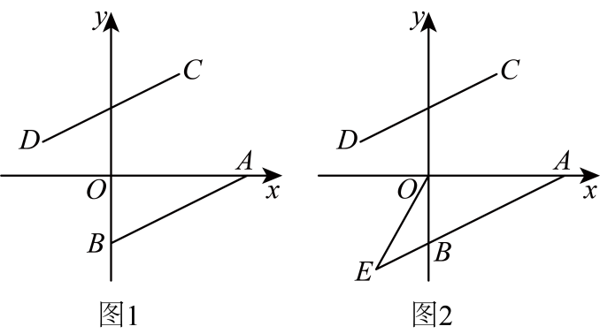

# Mathematics - 题目 2084

**ID**: 4dc0c488d6c745faab911e14dd61c1be
**年级**: Grade 7
**难度**: Medium-Hard
**题型**: Calculation

## 题目
如图1，在平面直角坐标系 $xOy$ 中，点A的坐标为 $\left ({a,0}\right )$ ，点B的坐标为 $\left ({0,b}\right )$ ，点C的坐标为 $\left ({2,3}\right )$ ，连接 $AB$ ．若a，b满足 $\sqrt {a-4}+\left |{b+2}\right |=0$ ．平移线段 $AB$ ，使点A与点C重合，点B对应点为点D．（1）填空： $a=$， $b=$，点D的坐标为；​​​​​​​‌（2）如图2，延长线段 $AB$ 至点 $E\left ({m,n}\right )$ ．连接 $OE$ ，请利用 $\mathrm{△}BOE$ ， $\vartriangle AOB$ ， $△AOE$ 的面积关系，求出m，n满足的关系式；（3）过点D作射线 $DF{\rm{/\mskip-4mu/}}x$ 轴，交y轴于点F，动点P从点D出发沿射线以每秒2个单位的速度向右运动，连接 $OP，BP，BP$ 交x轴于点Q，设运动时间为t秒， $△POQ$ 的面积为S，若 $S\geqslant \frac {1}{3}$ ，求t的取值范围．

## 解答

1. （1）解： $\because \sqrt {a-4}+\left |{b+2}\right |=0$ ，
2. $\therefore a-4=0，b+2=0$ ，
3. 解得： $a=4，b=-2$ ，
4. $\therefore A\left ({4,0}\right )，B\left ({0,-2}\right )$ ，
5. ∵平移线段 $AB$ ，使点A与点C重合，点B对应点为点D、点C的坐标为 $\left ({2,3}\right )$ ，
6. $\therefore AB{\rm{/\mskip-4mu/}}CD，AB=CD$ ，
7. 从A到C的平移方式是：先向左平移2个单位，再向上平移3个单位，
8. 将 $B\left ({0,-2}\right )$ 先向左平移2个单位，再向上平移3个单位，得到 $D\left ({0-2，-2+3}\right )$ ，即 $D\left ({-2,1}\right )$ .
9. （2）如图，延长线段 $AB$ 至点 $E\left ({m,n}\right )$ ，则E在第三象限，则 $m<0，n<0$ ，过点E作 $EF\bot y$ 轴于点F，
10. 
11. $\because A\left ({4,0}\right )，B\left ({0,-2}\right )，E\left ({m,n}\right )$ ，
12. $\therefore AO=4{\rm{，}}BO=2，OF=-n，EF=-m$ ，
13. $\therefore S{{}_{\vartriangle BOE}}=\frac {1}{2}BO\times EF=\frac {1}{2}\times 2\times \left ({-m}\right )=-m$ ，
14. $S{{}_{\vartriangle AOB}}=\frac {1}{2}AO\times BO=\frac {1}{2}\times 2\times 4=4$ ，
15. $S{{}_{\vartriangle AOE}}=\frac {1}{2}AO\times OF=\frac {1}{2}\times 4\times \left ({-n}\right )=-2n$ ，
16. $\because S{{}_{\vartriangle AOE}}=S{{}_{\vartriangle AOB}}+S{{}_{\vartriangle BOE}}$ ，
17. $\therefore -2n=4-m$ ，
18. 即 $m=2n+4$ ；
19. （3）如图所示：
20. 
21. $\because D\left ({-2,1}\right )$ ，
22. 依题意， $PD=2t$ ，则 $P\left ({-2+2t,1}\right )，OF=1$ ，
23. $\therefore B\left ({0,-2}\right )，$
24. $\therefore OB=2$ ，
25. $\because S{{}_{\vartriangle BOP}}=S{{}_{\vartriangle OQP}}+S{{}_{\vartriangle OQB}}$ ，
26. $\therefore \frac {1}{2}OB\times PF=\frac {1}{2}OQ\times OF+\frac {1}{2}OQ\times OB=\frac {1}{2}OQ\times BF$ ，
27. $\therefore OQ=\frac {OB\times PF}{BF}=\frac {2\times \left |{-2+2t}\right |}{3}=\frac {2}{3}\left |{-2+2t}\right |$ ，
28. $\therefore S=\frac {1}{2}OQ\times OF=\frac {1}{2}\times \frac {2}{3}\left |{-2+2t}\right |\times 1=\frac {1}{3}\left |{-2+2t}\right |$ ，
29. $:s\geqslant \frac {1}{3}$ ，
30. $\therefore \frac {1}{3}\left |{-2+2t}\right |\geqslant \frac {1}{3}$ ，即 $-2+2t\leqslant -1$ 或 $-2+2t\geqslant 1$ ，
31. 解得： $0\leqslant t\leqslant \frac {1}{2}$ 或 $t\geqslant \frac {3}{2}$ ．

## 知识点

**中文**:
  - 坐标与图形变化——平移
  - 解一元一次不等式组
  - 坐标与图形性质

**English**:
  - Coordinates and Translation
  - Solving Systems of Inequalities
  - Coordinates and Geometric Properties

---
