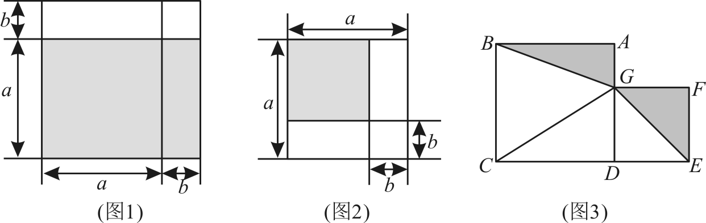

# Mathematics - 题目 2930

**ID**: 5cc12ac1af0a4a3899ff1e5337b704b9
**年级**: Grade 7
**难度**: Medium-Hard
**题型**: Calculation

## 题目
如图1，用不同的方法表示阴影部分的面积，可以得到完全平方公式 $(a+b){^{2}}=a{^{2}}+2ab+b{^{2}}$ ．（1）如图2，用不同的方法表示阴影部分的面积，可得公式．（2）利用完全平方公式，解决下列问题：①若 $(x-2025){^{2}}+(x-2026){^{2}}=2031$ ，则 $(x-2025)(x-2026)$ 的值为；​​​​​​​‌②如图3，在线段 $CE$ 上取一点D，分别以 $CD,DE$ 为边作正方形 $ABCD,DEFG$ ，连接 $BG,CG,EG$ ．若图中两个阴影部分的面积之和为6，且 $\vartriangle CDG$ 的面积为4，求 $CE$ 的长．

## 解答

1. （1）解：一方面，阴影部分面积为 $(a-b){^{2}}$ ；
2. 另一方面，阴影部分面积为 $a{^{2}}-2ab+b{^{2}}$ ，
3. ∴ $(a-b){^{2}}=a{^{2}}-2ab+b{^{2}}$ .
4. （2）解：①设 $x-2025=a，x-2026=b$ ，
5. ∵ $(x-2025){^{2}}+(x-2026){^{2}}=2031$ ，
6. ∴ $a{^{2}}+b{^{2}}=2031$ ；
7. 由所设得 $a-b=x-2025-(x-2026)=1$ ，
8. ∵ $(a-b){^{2}}=a{^{2}}-2ab+b{^{2}}$ ，
9. ∴ $1=2031-2ab$ ，
10. ∴ $ab=1015$ .
11. ②设 $CD=x,DE=y$ ，
12. 由题意，得 $S{{}_{\vartriangle CDG}}=\frac {1}{2}CD\cdot GD=\frac {1}{2}xy=4$ ，
13. ∴ $xy=8$ ．
14. 又 $S{{}_{\vartriangle ABG}}=\frac {1}{2}AB\cdot AG=\frac {1}{2}x(x-y)，S{{}_{\vartriangle EFG}}=\frac {1}{2}EF\cdot GF=\frac {1}{2}y{^{2}}$ ．
15. $\therefore S{{}_{阴影}}=S{{}_{\vartriangle ABG}}+S{{}_{\vartriangle EFG}}=\frac {1}{2}x(x-y)+\frac {1}{2}y{^{2}}=\frac {1}{2}x{^{2}}+\frac {1}{2}y{^{2}}-\frac {1}{2}xy=\frac {1}{2}x{^{2}}+\frac {1}{2}y{^{2}}-4=6$ ．
16. 整理，得 $x{^{2}}+y{^{2}}=20$ ．
17. $\therefore (x+y){^{2}}=x{^{2}}+y{^{2}}+2xy=20+2\times 8=36$ ．
18. $\therefore x+y=6$ 或 $-6$ （舍去）．
19. 故 $CE=CD+DE=6$ ．

## 知识点

**中文**:
  - 完全平方公式
  - 完全平方公式与几何图形

**English**:
  - Perfect Square Formula
  - Perfect Square Formula and Geometric Figures

---
