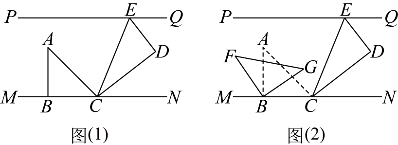

# Mathematics - 题目 1696

**ID**: 60cb6d69fb7242c6b998d22e05d35ed0
**年级**: Grade 7
**难度**: Medium-Hard
**题型**: Calculation

## 题目
如图，直线 $PQ\mathrm{/\mskip-4mu/}MN$ ，一副三角板（ $\angle ABC=\angle CDE=90{}\degree $ ， $\angle ACB=\angle A=45{}\degree $ ， $\angle DEC=60{}\degree $ ， $\angle DCE=30{}\degree $ ）．按图（1）所示方式放置，其中点E在直线 $PQ$ 上，点B，C均在直线 $MN$ 上，且 $CE$ 平分 $\angle ACN$ ．（1）求 $\angle DEQ$ 的度数．（2）如图（2），将 $\vartriangle ABC$ 绕点B以每秒 $3{}\degree $ 的速度按逆时针方向旋转（A，C的对应点分别为F，G），设旋转时间为 $t{\rm{s}}\left ({0\leqslant t\leqslant 60}\right )$ ．①在旋转过程中，若边 $BG/\mskip-4mu/CD$ ，求t的值．②若在 $\vartriangle ABC$ 绕点B旋转的同时， $\vartriangle CDE$ 绕点E以每秒 $2{}\degree $ 的速度按顺时针方向旋转（C，D的对应点为H，K）．当边 $FG$ 与 $\vartriangle HKE$ 的一边平行时，请写出对应的t值．​​​​​​​‌

## 解答

1. （1）解：∵ $\angle ACB=45{}\degree $ ，
2. ∴ $\angle ACN=135{}\degree $ ，
3. ∵ $CE$ 平分 $\angle ACN$ ，
4. ∴ $\angle ECN=67.5{}\degree $ ，
5. ∵ $PQ\mathrm{/\mskip-4mu/}MN$ ，
6. ∴ $\angle QEC=180{}\degree -\angle ECN=180{}\degree -67.5{}\degree =112.5{}\degree $ ，
7. ∵ $\angle DEC=60{}\degree $ ，
8. ∴ $\angle DEQ=\angle QEC-\angle DEC=112.5{}\degree -60{}\degree =52.5{}\degree $ ；
9. （2）解：①如图：
10. 
11. ∵ $\angle DCE=30{}\degree $ ，
12. ∴ $\angle DCN=67.5{}\degree -30{}\degree =37.5{}\degree $ ，
13. ∵ $BG/\mskip-4mu/CD$ ，
14. ∴ $\angle CBG=\angle DCN$ ，
15. ∴ $3t=37.5{}\degree $ ，
16. ∴ $t=12.5$ 秒，
17. ②当 $FG\mathrm{/\mskip-4mu/}HK$ 时，分别延长 $FG$ 和 $BG，BG$ 交 $HE$ 于点I，交 $PQ$ 于点，交 $HK$ 于点O，如图所示：
18. 
19. ∴ $∠JGL=∠FGB=45{}\degree $ ，
20. ∵ $FG\mathrm{/\mskip-4mu/}HK$ ，
21. ∴ $∠JOK=∠JGL=45{}\degree $ ，
22. ∵ $\angle EHK=30{}\degree $ ，
23. ∴ $∠HIO=∠JIE=15{}\degree $ ，
24. ∵ $\angle DEQ=52.5{}\degree $ ，
25. ∴ $∠QEK=52.5{}\degree +2t$ ，
26. ∴ $\angle JEI=180{}\degree -\left ({52.5{}\degree +2t+60{}\degree }\right )$ ，
27. ∴ $\angle PJB=180{}\degree -\left ({52.5{}\degree +2t+60{}\degree }\right )+15{}\degree $ ，
28. ∴ $180{}\degree -\left ({52.5{}\degree +2t+60{}\degree }\right )+15{}\degree =3t$ ,
29. 解得： $t{{}_{1}}=16.5$ ；
30. 延长 $FG$ ，交 $PQ$ 于点O，如图所示：
31. 
32. ∵ $∠QEK=52.5{}\degree +2t$ ，
33. ∴ $\angle PEK=180{}\degree -\left ({52.5{}\degree +2t}\right )$ ，
34. ∴ $\angle PLK=90{}\degree +180{}\degree -\left ({52.5{}\degree +2t}\right )$ ，
35. ∵ $\angle GBN=3t,\angle BGF=45{}\degree $ ，
36. ∴ $∠GIB=3t-45{}\degree $ ，
37. ∵ $FG/\mskip-4mu/HK，PQ/\mskip-4mu/MN$ ，
38. ∴ $\angle PLK+\angle EOI=180{}\degree ，\angle GIB+\angle EOI=180{}\degree $ ，
39. ∴ $∠PLK=∠GIB$ ，
40. ∴ $90{}\degree +180{}\degree -\left ({52.5{}\degree +2t}\right )=3t-45{}\degree $ ，
41. 解得： $t{{}_{2}}=52.5$ ；
42. 当 $FG/\mskip-4mu/EK$ ，
43. 
44. 同理可得， $180{}\degree -\left ({52.5{}\degree +2t}\right )=3t-45{}\degree $
45. 解得： $t{{}_{3}}=34.5$ ；
46. 当 $FG\mathrm{/\mskip-4mu/}HE$ ，
47. 
48. 同理可得： $3t=45{}\degree +180{}\degree -60{}\degree -\left ({52.5{}\degree +2t}\right )$ ，
49. 解得： $t{{}_{4}}=22.5$ ；
50. 
51. 同理可得： $60{}\degree -\left ({180{}\degree -3t+45{}\degree }\right )+52.5{}\degree +2t=180{}\degree $ ，
52. 解得： $t{{}_{5}}=58.5$ ．
53. 综上可得：t的值为 $16.5{\rm{s}}，22.5{\rm{s}}，34.5{\rm{s}}，52.5{\rm{s}}，58.5{\rm{s}}$ ．

## 知识点

**中文**:
  - 两直线平行同位角相等
  - 行程问题
  - 角平分线

**English**:
  - Parallel Lines have Equal Corresponding Angles
  - Distance-Speed-Time Problems
  - Angle Bisector

---
