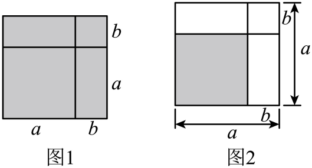
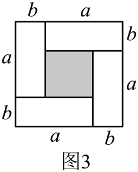
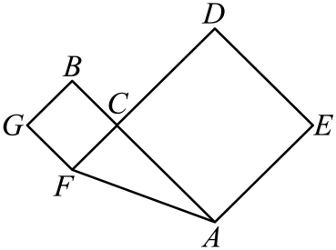

# Mathematics - 题目 3952

**ID**: 6ac06f732f264c3ea3cb41c4df1b2669
**年级**: Grade 7
**难度**: Medium-Hard
**题型**: Calculation

## 题目
数学活动【知识生成】数形结合是数学学习的一种重要的思想方法，借助图的直观性，可以帮助理解数学问题．（1）如图1是一个边长为 $a+b$ 的正方形，用两条分割线将其分为两个正方形和两个长方形，正方形的边长分别为 $a$ 和 $b$ ；​​​​​​​‌图2是一个边长为 $a$ 的正方形，用两条分割线将其分为两个正方形和两个长方形，正方形的边长分别为 $a-b$ 和 $b$ ，请分别写出阴影部分的面积所揭示的乘法公式：图1；图2；【拓展探究】（2）用4个全等的长和宽分别为 $a,b$ 的长方形拼摆成一个如图3的正方形，请你通过计算阴影部分的面积，直接写出这三个代数式 ${\left({a+b}\right)^{2}}$ ， ${\left({a-b}\right)^{2}}$ ， $ab$ 之间的等量关系．【解决问题】（3）如图， $C$ 是线段 $AB$ 上的一点，分别以 $AC,BC$ 为边向两边作正方形 $ACDE$ 和 $BCFG$ ，若 $AB=6$ ，两正方形的面积和为20，求 $\mathrm{△}AFC$ 的面积．【知识迁移】（4）若 $\left ({2023-m}\right )\left ({2024-m}\right )=6$ ，则 ${\left({2023-m}\right)^{2}}+{\left({2024-m}\right)^{2}}=$．（直接写出结果）

## 解答

1. 解：（1）由图1可知满足的乘法公式为 ${\left({a+b}\right)^{2}}=a{^{2}}+2ab+b{^{2}}$ ；由图2可知满足的乘法公式为 ${\left({a-b}\right)^{2}}=a{^{2}}-2ab+b{^{2}}$
2. （2）根据图形可知,图中阴影部分的面积为 ${\left({a-b}\right)^{2}}$ 或者 ${\left({a+b}\right)^{2}}-4ab$ ，
3. ∴满足的关系式为 ${\left({a-b}\right)^{2}}={\left({a+b}\right)^{2}}-4ab$ ；
4. （3）由 $AB=6$ 可设 $AC=x,BC=y$ ，则 $x+y=6$ ，
5. ∴ ${\left({x+y}\right)^{2}}=x{^{2}}+2xy+y{^{2}}=36$ ，
6. ∵两正方形的面积和为20，即 $x{^{2}}+y{^{2}}=20$ ，
7. ∴ $2xy=36-\left ({x{^{2}}+y{^{2}}}\right )=16$ ，
8. ∴ $xy=8$ ，
9. ∴ $S{{}_{\vartriangle AFC}}=\frac {1}{2}xy=4$ ；
10. （4）由题意可知 $\left ({2024-m}\right )-\left ({2023-m}\right )=1$ ，
11. ∴ $\left [\left ({2024-m}\right )-\left ({2023-m}\right )\right ]{^{2}}={\left({2024-m}\right)^{2}}-2\left ({2024-m}\right )\left ({2023-m}\right )+{\left({2023-m}\right)^{2}}=1$ ,
12. ∵ $\left ({2023-m}\right )\left ({2024-m}\right )=6$ ，
13. ∴ ${\left({2023-m}\right)^{2}}+{\left({2024-m}\right)^{2}}=1+2\left ({2023-m}\right )\left ({2024-m}\right )=1+12=13$ .

## 知识点

**中文**:
  - 完全平方公式与几何图形

**English**:
  - Perfect Square Formula and Geometric Figures

---
