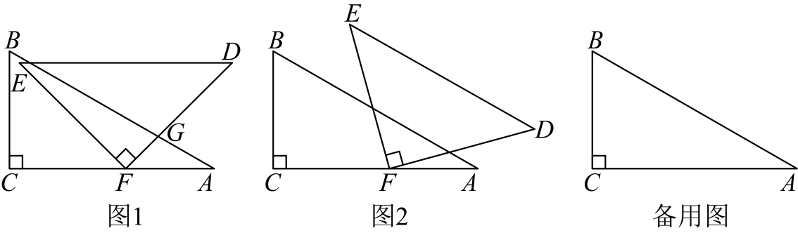

# Mathematics - 题目 3135

**ID**: 76aad06e3648425daa96a4dd3940fd84
**年级**: Grade 7
**难度**: Medium-Hard
**题型**: Calculation

## 题目
如图1，数学课上老师将一副三角板按图中所示位置摆放，点 $F$ 在直线 $AC$ 上，且 $ED{\rm{/\mskip-4mu/}}AC$ ， $DF$ 与 $AB$ 相交于点 $G$ ，其中 $\angle ACB\mathrm{=}90{}\degree $ ， $\angle ABC=60{}\degree $ ， $\angle BAC=30{}\degree $ ， $\angle EFD=90{}\degree $ ， $\angle DEF=\angle EDF=45{}\degree $ ．（1）求此时 $\angle DGA$ 的度数；​​​​​​​‌（2）如图2，若三角板 $DEF$ 绕点 $F$ 按顺时针方向旋转，当 $ED{\rm{/\mskip-4mu/}}AB$ 时，求此时 $\angle DFA$ 的度数；（3）在（2）的前提下，三角板 $DEF$ 绕 $F$ 点按逆时针方向以每秒 $5{}\degree $ 的速度旋转，设旋转的时间为 $t\left ({0<t<72}\right )$ 秒，当三角板 $DEF$ 第一次回到图 $2$ 的位置时，在这个旋转过程中，是否还存在三角板 $DEF$ 的某一条边与 $AB$ 平行的情况 $?$ 若存在，请求出所有满足题意的 $t$ 值；若不存在，请说明理由．

## 解答

1. （1）解：如图1，过 $G$ 作 $GH/\mskip-4mu/AC$ ．
2. ∴ $ED\mathrm{/\mskip-4mu/}AC$ ， $GH/\mskip-4mu/AC$ ，
3. ∴ $ED\mathrm{/\mskip-4mu/}GH\mathrm{/\mskip-4mu/}AC$ ．
4. ∴ $\angle DGH=\angle EDF=45{}\degree $ ， $\angle AGH=\angle BAC=30{}\degree $ ，
5. ∴ $\angle DGA=\angle DGH+\angle AGH=75{}\degree $ ．
6. 
7. （2）解：如图2，过F作 $FH/\mskip-4mu/AB$ ．
8. ∵ $ED\mathrm{/\mskip-4mu/}AB$ ， $FH/\mskip-4mu/AB$ ，
9. ∴ $ED\mathrm{/\mskip-4mu/}AB\mathrm{/\mskip-4mu/}FH$ ．
10. ∴ $\angle DFH=\angle EDF=45{}\degree $ ， $\angle AFH=\angle BAC=30{}\degree $ ，
11. ∴ $\angle DFA=\angle DFH-\angle AFH=15{}\degree $ ．
12. 
13. （3）解：如图3，当 $EF/\mskip-4mu/AB$ 时，
14. ∵ $EF/\mskip-4mu/AB$ ， $\angle BAC=30{}\degree $ ，
15. ∴ $\angle EFA=150{}\degree $ ，
16. ∴ $\angle DFA=\angle EFA-\angle EFD=60{}\degree $ ．
17. ∴ $5t+15=60$ ，
18. 解得： $t=9$ ．
19. 
20. 如图4，当 $DF/\mskip-4mu/AB$ 时，
21. ∵ $DF/\mskip-4mu/AB$ ， $\angle BAC=30{}\degree $ ，
22. ∴ $\angle DFA=150{}\degree $ ．
23. ∴ $5t+15=150$ ，
24. 解得： $t=27$ ．
25. 
26. 如图5，当 $DE/\mskip-4mu/AB$ 时，过 $F$ 作 $FG\mathrm{/\mskip-4mu/}AB$ ．
27. ∵ $DE/\mskip-4mu/AB$ ， $FG\mathrm{/\mskip-4mu/}AB$ ，
28. ∴ $DE\mathrm{/\mskip-4mu/}FG\mathrm{/\mskip-4mu/}AB$ ．
29. ∴ $\angle AFG=180{}\degree -\angle BAC=180{}\degree -30{}\degree =150{}\degree $ ， $\angle GFD=\angle EDF=45{}\degree $ ．
30. ∴ $5t=150+45-15$ ，
31. 解得： $t=36$ ．
32. 
33. 如图6，当 $EF{\rm{/\mskip-4mu/}}AB$ 时，
34. ∵ $EF{\rm{/\mskip-4mu/}}AB$ ， $\angle BAC=30{}\degree $ ，
35. ∴ $\angle EFA=30{}\degree $ ，
36. ∴ $\angle AFD=30{}\degree +90{}\degree =120{}\degree $
37. ∴ $5t+15=360-120$ ，
38. 解得： $t=45$ ．
39. 
40. 如图7，当 $DF/\mskip-4mu/AB$ 时，
41. ∵ $DF/\mskip-4mu/AB$ ， $\angle BAC=30{}\degree $ ，
42. ∴ $\angle DFA=150{}\degree $ ．
43. ∴ $5t+15=360-30$ ，
44. 解得： $t=63$ ．
45. 
46. 综上， $t$ 值为 $9$ 秒或 $27$ 秒或 $36$ 秒或 $45$ 秒或 $63$ 秒时，存在三角板的某一条边与 $AB$ 平行的情况．

## 知识点

**中文**:
  - 平行公理及推论
  - 平行线性质的应用

**English**:
  - Parallel Axiom
  - Applications of Properties

---
