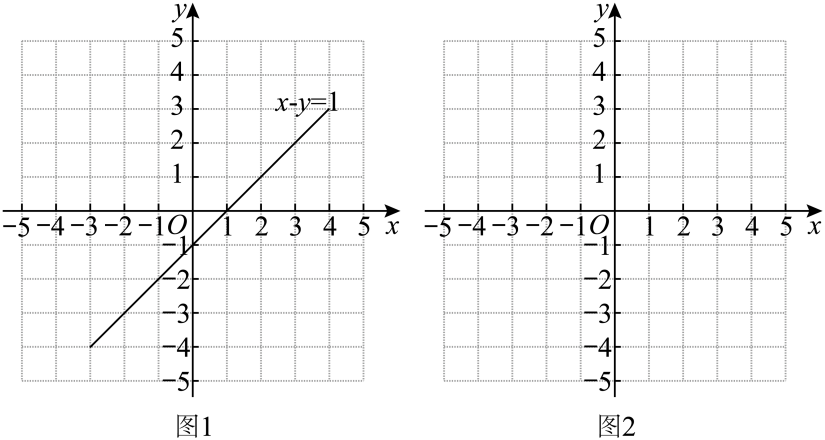
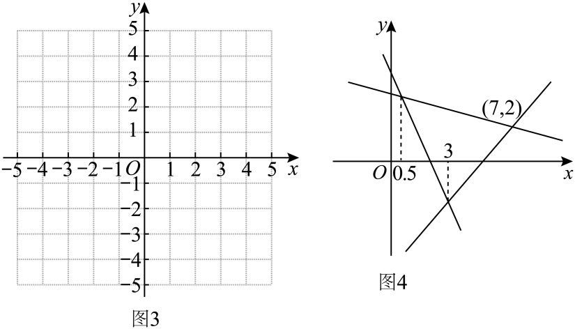

# Mathematics - 题目 3607

**ID**: 7bbb2faa067943e685d403bb8bd01c1a
**年级**: Grade 7
**难度**: Medium-Hard
**题型**: Calculation

## 题目
【材料阅读】二元一次方程 $x-y=1$ 有无数组解，如： $\begin{cases}x=-1\\y=-2\end{cases}$ ， $\begin{cases}x=0\\y=-1\end{cases}$ ， $\begin{cases}x=1\\y=0\end{cases}$ ， $\begin{cases}x=\frac {5}{2}\\y=\frac {3}{2}\end{cases}$ ，如果我们将方程的解看成一组有序数对，那么这些有序数对可以用平面直角坐标系中的点表示，探究发现：以方程 $x-y=1$ 的解为坐标的点落在同一条直线上，如图1所示，同时这条直线上的点的坐标全都是该方程的解．我们把这条直线称为该方程的图象．【问题探究】（1）请在图2中画出二元一次方程组 $\begin{cases}2x+y=4\\x-y=-1\end{cases}$ 中的两个二元一次方程的图象，并直接写出该方程组的解为；​​​​​​​‌（2）已知关于 $x$ ， $y$ 的二元一次方程 $\begin{cases}x+2y=4①\\kx-3y=3②\end{cases}$ 无解，请在图3中画出符合题意的两条直线，设方程①图象与 $x$ ， $y$ 轴的交点分别是 $\mathrm{A}$ 、 $B$ ，方程②图象与 $x$ ， $y$ 轴的交点分别是 $C$ 、 $D$ ，计算 $∠ABO+∠DCO$ 的度数．【拓展应用】（3）图4中包含关于 $x$ ， $y$ 的二元一次方程组 $\begin{cases}2x+y=4\\mx-2m+y=-3\end{cases}$ 的两个二元一次方程的图象，请直接写出该方程组的解

## 解答

1. 解：（1）如图所示，即为所求；
2. 由图象可知，直线 $2x+y=4$ 与直线 $x-y=-1$ 交于点 $\left ({1，2}\right )$ ，
3. ∴ $\begin{cases}x=1\\y=2\end{cases}$ 同时是方程 $2x+y=4$ 和方程 $x-y=-1$ 的解，
4. ∴ $\begin{cases}x=1\\y=2\end{cases}$ 是方程组 $\begin{cases}2x+y=4\\x-y=-1\end{cases}$ 的解
5. 
6. （2）∵方程组 $\begin{cases}x+2y=4\\kx-3y=3\end{cases}$ 无解，
7. ∴直线 $x+2y=4$ 与直线 $kx-3y=3$ 没有交点，
8. ∴直线 $x+2y=4$ 与直线 $kx-3y=3$ 平行，
9. 在方程 $kx-3y=3$ 中，当 $x=0$ 时， $y=-1$ ，
10. ∴直线 $kx-3y=3$ 经过点 $\left ({0，-1}\right )$ ，
11. 如图所示，直线 $AB$ 和直线 $CD$ 即为所求；
12. ∵ $AB/\mskip-4mu/CD$ ，
13. ∴ $\angle ABO=\angle CDO$ ，
14. ∵ $\angle DCO+\angle CDO=90{}\degree $ ，
15. ∴ $∠ABO+∠DCO=90{}\degree $ ；
16. 
17. （3）在方程 $mx-2m+y=-3$ 中，当 $x=2$ 时，则 $2m-2m+y=-3$ ，即此时 $y{\rm{=}}-{{3}}$ ，
18. ∴ $\begin{cases}x=2\\y=-3\end{cases}$ 是方程 $mx-2m+y=-3$ 的解，即直线 $mx-2m+y=-3$ 经过点 $\left ({2，-3}\right )$ ；
19. ∴直线 $mx-2m+y=-3$ 为直线 $AB$ 或直线 $EF$ 中的一条，
20. 把 $\begin{cases}x=7\\y=2\end{cases}$ 代入方程 $2x+y=4$ 中，左边 $=2\times 7+2=16\ne 4$ ，方程左右两边不相等，
21. ∴ $\begin{cases}x=7\\y=2\end{cases}$ 不是方程 $2x+y=4$ 的解，即直线 $2x+y=4$ 不经过点 $\left ({7，2}\right )$ ，
22. ∴直线 $AB$ 即为直线 $2x+y=4$
23. ∴直线 $mx-2m+y=-3$ 为直线 $EF$ ，
24. 在方程 $2x+y=4$ 中，当 $x=3$ 时，则 $2\times 3+y=4$ ，解得 $y{\rm{=}}-{{2}}$ ，
25. ∴ $\begin{cases}x=3\\y=-2\end{cases}$ 是方程 $2x+y=4$ 的一个解，
26. ∵直线 $mx-2m+y=-3$ 与直线 $2x+y=4$ 的交点横坐标为2，
27. ∴直线 $mx-2m+y=-3$ 与直线 $2x+y=4$ 的交点坐标为 $\left ({3，-2}\right )$ ，
28. ∴二元一次方程组 $\begin{cases}2x+y=4\\mx-2m+y=-3\end{cases}$ 的解为 $\begin{cases}x=3\\y=-2\end{cases}$
29. 

## 知识点

**中文**:
  - 与二元一次方程组有关的求参数问题
  - 二元一次方程的解

**English**:
  - Parameter Problems in Systems
  - Solution of Linear Equation

---
