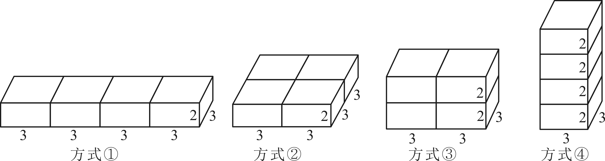
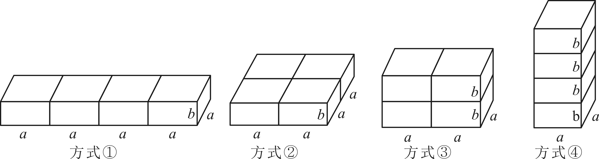

# Mathematics - 题目 342

**ID**: 81e1a6db73f941769378ec022a0d46d7
**年级**: Grade 7
**难度**: Medium-Hard
**题型**: Calculation

## 题目
【实际问题】快递公司将4个相同的长方体物品包装成一个大长方体包裹，每个长方体物品的长、宽、高分别是 $3{\rm{d}}{\rm{m}}，3{\rm{d}}{\rm{m}}，2{\rm{d}}{\rm{m}}$ ．大长方体包裹的表面积最小是多少？【解决问题】如图，将这4个小长方体拼成一个大的长方体，有4种方式：这4种方式中表面积的最小值为dm^{2}；​​​​​​​‌【问题拓展】小明觉得这种问题很有趣，他想研究：将4个长、宽、高分别是 $a$ ， $a$ ， $b\left ({a>b>0}\right )$ 的小长方体拼成一个大的长方体．这个大长方体表面积最小是多少？显然，这里也有4种类似的方式：（1）猜想结论：由前面的实际问题我们可以猜想：方式③拼成的大长方体表面积最小．（2）验证结论：设方式①，②，③，④搭成的大长方体表面积分别是 $S{{}_{1}}$ ， $S{{}_{2}}$ ， $S{{}_{3}}$ ， $S{{}_{4}}$ ．因为 $S{{}_{1}}=2\left ({ab+4ab+4a{^{2}}}\right )=8a{^{2}}+10ab$ ， $S{{}_{2}}=2\left ({2ab+2ab+4a{^{2}}}\right )=8a{^{2}}+8ab$ ， $S{{}_{3}}=2\left ({2ab+4ab+2a{^{2}}}\right )=4a{^{2}}+12ab$ ，所以 $S{{}_{1}}-S{{}_{3}}=\left ({8a{^{2}}+10ab}\right )-\left ({4a{^{2}}+12ab}\right )=4a{^{2}}-2ab=2a\left ({2a-b}\right )$ ，因为 $a>b>0$ ，所以 $2a-b>0$ ，所以 $2a\left ({2a-b}\right )>0$ ，所以 $S{{}_{1}}>S{{}_{3}}$ ．①请你用上面的方法比较 $S{{}_{2}}$ 和 $S{{}_{3}}$ 的大小；②求出 $S{{}_{4}}$ ，并比较 $S{{}_{4}}$ 和 $S{{}_{3}}$ 的大小；（3）归纳结论：将四个长、宽、高分别是 $a$ ， $a$ ， $b\left ({a>b>0}\right )$ 的小长方体拼成一个大的长方体，这个大长方体表面积的最小值是多少？（直接写出你的结论）（4）应用结论：某包装厂需要将长、宽、高分别是 $10{\rm{c}}{\rm{m}}，10{\rm{c}}{\rm{m}}，4{\rm{c}}{\rm{m}}$ 的4个完全相同的长方体零件，包装到一个大长方体形纸盒中，大长方体表面积的最小值是cm^{2}．

## 解答

1. 解：【解决问题】依题意可得四种拼法对应的大长方体尺寸及表面积分别为：
2. 方式①： $2\times \left ({12\times 3+3\times 2+12\times 2}\right )=132\left ({{\rm{d}}{\rm{m}}{^{2}}}\right )$
3. 方式②：  $2\times \left ({6\times 6+6\times 2+6\times 2}\right ){\rm{=}}120\left ({{\rm{d}}{\rm{m}}{^{2}}}\right )$
4. 方式③： $2\times \left ({6\times 3+6\times 4+3\times 4}\right )=108\left ({{\rm{d}}{\rm{m}}{^{2}}}\right )$
5. 方式④：  $2\times \left ({3\times 3+3\times 8+3\times 8}\right ){\rm{=}}114\left ({{\rm{d}}{\rm{m}}{^{2}}}\right )$
6. ∴四种方式中表面积的最小值是  $108{\rm{d}}{\rm{m}}{^{2}}$ ．
7. 【问题拓展】① $S{{}_{2}}-S{{}_{3}}=\left ({8a{^{2}}+8ab}\right )-\left ({4a{^{2}}+12ab}\right )=4a{^{2}}-4ab=4a\left ({a-b}\right )$ ，
8. ∵ $a>b>0$ ，
9. ∴ $a-b\mathrm{>}0$ ，
10. ∴ $4a\left ({a-b}\right )>0$ ，
11. ∴ $S{{}_{2}}>S{{}_{3}}$ ；
12. ② $S{{}_{4}}=4ab\times 4+2a{^{2}}=2a{^{2}}+16ab$ ，
13. $S{{}_{4}}-S{{}_{3}}=\left ({2a{^{2}}+16ab}\right )-\left ({4a{^{2}}+12ab}\right )=-2a{^{2}}+4ab=2a\left ({-a+2b}\right )$ ，
14. 当 $2b-a>0$ 时， $S{{}_{4}}>S{{}_{3}}$ ；
15. 当 $2b-a<0$ 时， $S{{}_{4}}<S{{}_{3}}$ ；
16. （3）答案为：当 $2b-a>0$ 时，表面积最小值为 $S{{}_{3}}=4a{^{2}}+12ab$ ；
17. 当 $2b-a<0$ 时，表面积最小值为 $S{{}_{4}}=2a{^{2}}+16ab$ ；
18. （4）∵ $a=10,b=4$ ，
19. ∴ $2b-a<0$ ，
20. 此时 $S{{}_{4}}=2a{^{2}}+16ab$ 最小，
21. $S{{}_{4}}=2\times 10{^{2}}+16\times 10\times 4=200+640=840\left ({{\rm{c}}{\rm{m}}{^{2}}}\right )$ ．
22. 故大长方体的最小表面积是  $840{\rm{c}}{\rm{m}}{^{2}}$ ．

## 知识点

**中文**:
  - 整式的加减
  - 认识立体图形

**English**:
  - Addition and Subtraction of Polynomials
  - Recognizing Solid Figures

---
