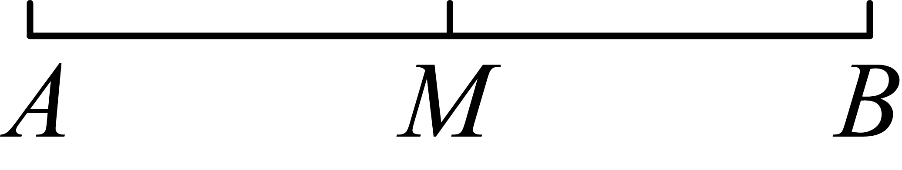

# Mathematics - 题目 3911

**ID**: 89ee6e07249c4ebbb189a0a806e18cf7
**年级**: Grade 7
**难度**: Medium-Hard
**题型**: Calculation

## 题目
对于数轴上的点 $A$ ， $B$ ， $C$ ， $D$ ，点 $M$ ， $N$ 分别是线段 $AB$ ， $CD$ 的中点，若 $MN=\frac {e}{2}\left ({AB+CD}\right )$ ，则将 $e$ 的值称为线段 $AB$ ， $CD$ 的相对离散度，特别地，当点 $M$ ， $N$ 重合时，规定 $e=0$ ．设数轴上的点 $O$ 表示的数是 $0$ ，点 $T$ 表示的数是 $2$ ．（1）若数轴上点 $A$ ， $B$ ， $C$ ， $D$ 表示的数分别是 $-4$ ， $-1$ ， $3$ ， $6$ ，则线段 $AB$ 的中点表示的数是，线段 $AB$ ， $CD$ 的相对离散度是；​​​​​​​‌（2）设数轴上点 $O$ 右侧的点 $\mathrm{S}$ 表示的数是 $s$ ，若线段 $OS$ ， $OT$ 的相对离散度 $e=\frac {1}{2}$ ，求 $s$ 的值；（3）数轴上点 $P$ ， $Q$ 都在 $O$ 点的右侧（其中 $P$ ， $Q$ 不重合），点 $R$ 是线段 $PQ$ 的中点，设线段 $OP$ ， $OT$ 的相对离散度为 $e{{}_{1}}$ ，线段 $OQ$ ， $OT$ 的相对离散度为 $e{{}_{2}}$ ，当 $e{{}_{1}}=e{{}_{2}}$ 时，直接写出 $R$ 所表示的数 $r$ 的取值范围．（参考材料： $1$ ．若 $ab=4$ ，则 $a+b>4$ ．其中 $a>0$ ， $b>0$ 且 $a\ne b$ ； $2$ ．如图：点 $M$ 把线段 $AB$ 分成相等的两条线段 $AM$ 与 $BM$ ，点 $M$ 叫作线段 $AB$ 的中点）

## 解答

1. （1）解：设线段 $AB$ ， $CD$ 的中点为 $M$ ， $N$ ，
2. 由题意可得： $AB=-1-\left ({-4}\right )=3$ ， $CD=6-3=3$
3. ∴线段 $AB$ 的中点 $M$ 表示的数是 $\frac {\left ({-4}\right )+\left ({-1}\right )}{2}=-\frac {5}{2}$ ，线段 $CD$ 的中点 $N$ 表示的数是 $\frac {6+3}{2}=\frac {9}{2}$ ，
4. ∴ $MN=\frac {9}{2}-\left ({-\frac {5}{2}}\right )=7$ ，
5. ∵ $MN=\frac {e}{2}\left ({AB+CD}\right )$ ，
6. ∴ $7=\frac {e}{2}\left ({3+3}\right )$ ，
7. ∴ $e=\frac {7}{3}$ .
8. （2）解：设 $OS$ ， $OT$ 中点记为 $L$ ， $K$ ，
9. 由题意可得： $OS=s-0=s$ ， $OT=2-0=2$ ，
10. ∴点 $L$ ， $K$ 在数轴上表示的数分别为 $\frac {s+0}{2}=\frac {s}{2}$ ， $\frac {2+0}{2}=1$ ，
11. ∴ $LK=\left |{1-\frac {s}{2}}\right |$ ，
12. ∵线段 $OS$ ， $OT$ 的相对离散度 $e=\frac {1}{2}$ ， 且 $LK=\frac {e}{2}\left ({OS+OT}\right )$ ，
13. ∴ $\left |{1-\frac {s}{2}}\right |=\frac {1}{2}\times \frac {1}{2}\left ({s+2}\right )$ ，
14. ∴ $s+2=\left |{4-2s}\right |$ ，
15. ∴ $s+2=4-2s$ 或 $s+2=-\left ({4-2s}\right )$ ，
16. ∴ $s=\frac {2}{3}$ 或 $s=6$ ，
17. ∴ $s$ 的值为 $\frac {2}{3}$ 或 $6$ ；
18. （3）解： $r>2$ ，理由如下：
19. 设数轴上点 $P、Q$ 对应的数分别为 $m、n$ ，
20. ∵数轴上点 $P、Q$ 都在 $O$ 点的右侧 (其中 $P、Q$ 不重合)，
21. ∴ $m>0$ ， $n>0$ 且 $m\ne n$ ，
22. ∴ $OP=m-0=m$ ， $OQ=n-0=n$ ， $OT=2-0=2$ ，
23. ∵点 $R$ 是线段 $PQ$ 的中点，
24. ∴点 $R$ 所表示的数 $r=\frac {m+n}{2}$ ，
25. 设线段 $OP$ ， $OT$ 的中点为 $M$ ， $N$ ，则 $M$ 对应的数为 $\frac {m+0}{2}=\frac {m}{2}$ ， $N$ 对应的数为 $\frac {2+0}{2}=1$ ，
26. ∴ $MN=\left |{\frac {m}{2}-1}\right |$ ，
27. ∵线段 $OP$ ， $OT$ 的相对离散度为 $e{{}_{1}}$ ，且 $MN=\frac {e{{}_{1}}}{2}\left ({OP+OT}\right )$ ，
28. ∴ $\left |{\frac {m}{2}-1}\right |=\frac {e{{}_{1}}}{2}\left ({m+2}\right )$ ，
29. ∴ $e{{}_{1}}=\frac {\left |{m-2}\right |}{m+2}$ ，
30. 同理 $e{{}_{2}}=\frac {\left |{n-2}\right |}{n+2}$ ，
31. ∵ $e{{}_{1}}=e{{}_{2}}$ ，
32. ∴ $\frac {\left |{m-2}\right |}{m+2}=\frac {\left |{n-2}\right |}{n+2}$ ，
33. $①$ 当 $m-2>0$ ， $n-2>0$ 时，
34. 解得： $m=n$ ，
35. ∵ $P、Q$ 不重合,
36. ∴ $m\ne n$
37. 此种情况不合题意，故舍去；
38. $②$ 当 $m-2<0$ ， $n-2<0$ 时，
39. 解得： $m=n$ ，
40. 同样，此种情况不合题意，故舍去；
41. $③$ 当 $m-2>0$ ， $n-2<0$ 时，
42. 解得： $mn=4$ ；
43. $④$ 当 $m-2<0$ ， $n-2>0$ 时，
44. ∴ $mn=4$ ，
45. ∵ $m\ne n$ ，
46. ∴ $m{^{2}}-2mn+n{^{2}}={\left({m-n}\right)^{2}}>0$ ，
47. ∴ ${\left({m-n}\right)^{2}}+4mn>4mn$ ，
48. 即 ${\left({m+n}\right)^{2}}>16$ ，
49. ∴ $\frac {{\left({m+n}\right)^{2}}}{4}>4$
50. 即： ${\left({\frac {m+n}{2}}\right)^{2}}>4$ ，
51. ∴ $\frac {m+n}{2}>2$ ，
52. 即 $r>2$ ．

## 知识点

**中文**:
  - 数轴上两点之间的距离
  - 绝对值方程
  - 线段的中点

**English**:
  - Distance Between Two Points on Number Line
  - Absolute Value Equations
  - Midpoint of a Line Segment

---
