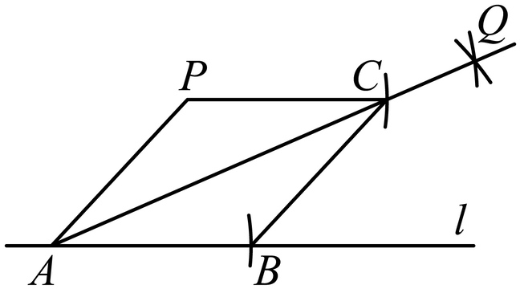

# Mathematics - 题目 3458

**ID**: 95145a27ce1b45cf96498bf9cc24c9a6
**年级**: Grade 7
**难度**: Medium-Hard
**题型**: Calculation

## 题目
如图，点 $P$ 在直线 $l$ 外．①在直线 $l$ 上任取一点A，连接 $AP$ ；​​​​​​​‌②以点A为圆心， $AP$ 长为半径画弧，交直线 $l$ 于点 $B$ ；③分别以点 $P$ 和点 $B$ 为圆心，以大于 $\frac {1}{2}BP$ 的长为半径画弧，两弧在 $\angle BAP$ 内交于点 $Q$ ，作射线 $AQ$ ；④以点 $P$ 为圆心， $PA$ 长为半径画弧，交射线 $AQ$ 于点 $C$ ；⑤连接 $CB,CP$ ．(1)由②得 $AP$ 与 $AB$ 的数量关系是；由③得到的结论是．(2)求证：四边形 $ABCP$ 是菱形．

## 解答

1. （1）解：∵以点A为圆心， $AP$ 长为半径画弧，交直线l于点B，
2. ∴ $AP=AB$ ，
3. ∵步骤③是作角平分线的尺规作图方法，
4. ∴射线 $AQ$ 平分 $\angle BAP$ ,
5. 故此题答案为 $AP=AB$ ；射线 $AQ$ 平分 $\angle BAP$ ;
6. （2）证明：∵以点A为圆心， $AP$ 长为半径画弧，交直线l于点B，
7. ∴ $AP=AB$ ，
8. ∵射线 $AQ$ 平分 $\angle BAP$ ，
9. ∴ $\angle BAC=\angle PAC$ ；
10. 在 $\vartriangle ABC$ 和 $\mathrm{△}APC$ 中，
11. $\begin{cases}AB=AP\\\angle BAC=\angle PAC\\AC=AC\end{cases}$ ，
12. ∴ $\vartriangle ABC≌\vartriangle APC\left ({{\rm{S}}{\rm{A}}{\rm{S}}}\right )$ ，
13. ∴ $BC=PC$ ，
14. 又∵以点 $P$ 为圆心， $PA$ 长为半径画弧，交射线 $AQ$ 于点 $C$ ，
15. ∴ $PA=PC$ ，
16. ∴ $AP=AB=BC=PC$ ，
17. ∴四边形 $ABCP$ 是菱形．

## 知识点

**中文**:
  - 两直线平行同旁内角互补
  - 角平分线
  - 平行公理及推论

**English**:
  - Parallel Lines have Supplementary Consecutive Angles
  - Angle Bisector
  - Parallel Axiom

---
