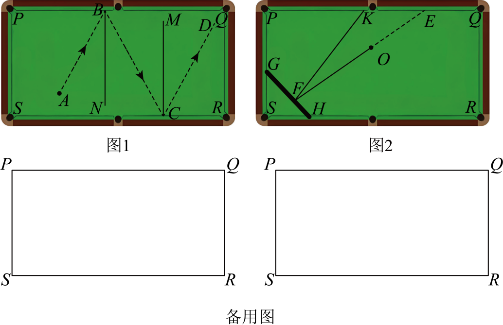

# Mathematics - 题目 2280

**ID**: 954be833c4044d71bdd05731d1387903
**年级**: Grade 7
**难度**: Medium-Hard
**题型**: Calculation

## 题目
如图1，台球比赛中，一个球从桌面上的点 $\mathrm{A}$ 滚向桌边 $PQ$ ，碰到 $PQ$ 上的点 $B$ 后便反弹滚向桌边 $SR$ ，碰到 $SR$ 上的点 $C$ 后再反弹滚向点 $D$ ．已知 $PQ/\mskip-4mu/SR$ ， $BN$ 、 $CM$ 分别平分 $∠ABC$ 、 $\angle BCD$ ，且在球碰到桌边时始终有 $BN\bot PQ$ ， $CM\bot SR$ ．（1）如果球反弹一次就“落入球网”，即球 $\mathrm{A}$ 滚向桌边 $PQ$ 上的点 $B$ 处，直接反弹到 $R$ 处的球洞中，若 $\angle ABP=40{}\degree $ ，则 $BC$ 与 $SR$ 所夹锐角度数为；​​​​​​​‌（2）判断图1中球经过两次反弹后的路径 $CD$ 与原来的路径 $AB$ 的位置关系，并证明；（3）如图2，为增加比赛难度，在桌面的转角处放置一个可以转动的小木条 $GH$ ，从桌边 $PQ$ 上的点 $E$ 沿 $EO$ 方向击中球 $O$ 后落在小木条上的点 $F$ 处，再反弹到桌边 $PQ$ 上的点 $K$ 处．已知 $\angle PEF=35{}\degree $ ， $\angle GHS=α$ ， $\angle EKF=β$ ，当 $20{}\degree \leqslant α\leqslant 70{}\degree $ （且 $KF$ 与 $EF$ 不重合）时，直接写出 $β$ 的取值范围．

## 解答

1. （1）解：由题可得：点 $C$ 与点 $R$ 重合，如图：且 $\angle ABP=40{}\degree $ ，
2. ∴ $\angle ABQ=180{}\degree -\angle ABP=180{}\degree -40{}\degree =140{}\degree $ ，
3. ∵ $BN\bot PQ$ ，
4. ∴ $\angle QBN=90{}\degree $ ，
5. ∴ $\angle ABN=\angle ABQ-\angle QBN=140{}\degree -90{}\degree =50{}\degree $ ，
6. ∵ $BN$ 平分 $∠ABC$ ，
7. ∴ $\angle ABC=2\angle ABN=2\times 50{}\degree =100{}\degree $ ，
8. ∴ $\angle PBC=\angle ABC+\angle ABP=100{}\degree +40{}\degree =140{}\degree $ ，
9. ∵ $PQ/\mskip-4mu/SR$ ，
10. ∴ $\angle PBC+\angle BCS=180{}\degree $ ，
11. ∴ $\angle BCS=180{}\degree -\angle PBC=180{}\degree -140{}\degree =40{}\degree $ .
12. 
13. （2）解： $CD\mathrm{/\mskip-4mu/}AB$ ，理由如下：
14. ∵ $BN\bot PQ$ ， $CM\bot SR$ ，
15. ∴ $\angle NBM=\angle NCM=90{}\degree $ ，
16. ∵ $PQ/\mskip-4mu/SR$ ，
17. ∴ $\angle BNC+\angle NBM=180{}\degree $ ，
18. ∴ $\angle BNC=180{}\degree -\angle NBM=180{}\degree -90{}\degree =90{}\degree $ ，
19. ∴ $\angle BNC+\angle NCM=180{}\degree $ ，
20. ∴ $BN\mathrm{/\mskip-4mu/}MC$ ，
21. ∴ $\angle NBC=\angle MCB$ ，
22. ∵ $BN$ 、 $CM$ 分别平分 $∠ABC$ 、 $\angle BCD$ ，
23. ∴ $\angle ABC=2\angle NBC$ ， $\angle DCB=2\angle MCB$ ，
24. ∴ $\angle ABC=\angle DCB$ ，
25. ∴ $CD\mathrm{/\mskip-4mu/}AB$ ；
26. （3）解：作 $FM/\mskip-4mu/PQ$ ， $NF\bot GH$ ，垂足为 $F$ ，由题意可得 $NF$ 为法线，如图：
27. 
28. ∵ $PQ/\mskip-4mu/SR$ ，
29. ∴ $FM\mathrm{/\mskip-4mu/}PQ\mathrm{/\mskip-4mu/}SR$ ，
30. ∵ $\angle PEF=35{}\degree $ ， $\angle GHS=α$
31. ∴ $\angle EFM=\angle PEF=35{}\degree $ ， $\angle MFH=\angle GHS=α$ ，
32. ∵ $NF\bot GH$ ，
33. ∴ $\angle NFH=90{}\degree $ ，
34. ∴ $\angle NFE=\angle NFH-\angle EFM-\angle MFH=90{}\degree -35{}\degree -α$ ，
35. ∵“入射角 $=$ 反射角”原理，
36. ∴ $\angle EFK=2\left ({90{}\degree -35{}\degree -α}\right )$ ，
37. ∵ $\angle EKF=β$ ，
38. ∴ $\angle EKF=β=180{}\degree -\angle EFK-\angle PEF=180{}\degree -2\left ({90{}\degree -35{}\degree -α}\right )-35{}\degree $ ，
39. 即 $β=180{}\degree -2\left ({90{}\degree -35{}\degree -α}\right )-35{}\degree =35{}\degree +2α$ ，
40. ∵ $20{}\degree \leqslant α\leqslant 70{}\degree $ ，
41. ∴ $75{}\degree \leqslant β\leqslant 175{}\degree $ ；

## 知识点

**中文**:
  - 平行线的判定与性质
  - 角平分线

**English**:
  - Determination and Properties
  - Angle Bisector

---
