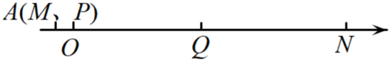
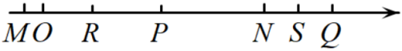

# Mathematics - 题目 3060

**ID**: 970d14a7139b451c8477c32383b45865
**年级**: Grade 7
**难度**: Medium-Hard
**题型**: Calculation

## 题目
已知：数轴上有点A，表示的数为a，且满足关于x的方程 $(a-1)x{^{\left |{a}\right |}}+1=0$ 为一元一次方程．数轴上还存在线段 $MN$ 和线段 $PQ$ （点M始终在点N左边，点P始终在点Q左边）．(1)当 $A{\rm{、}}M{\rm{、}}P$ 三点重合，且 $MN=16$ ， $PQ=10$ 时，求 $a$ 的值及 $N{\rm{、}}Q$ 所表示的数．(2)如图，若线段 $MP$ 的中点为 $R$ ，线段 $NQ$ 的中点为 $\mathrm{S}$ ，求 $\frac {2RS}{MN+PQ}$ 的值．(3)在（1）的条件下，点M从A点出发，使线段 $MN$ 以1个单位每秒的速度向右匀速运动，点P从A点出发，使线段 $PQ$ 以3个单位每秒的速度向右匀速运动，当点P与点N重合时，线段 $PQ$ 以原速返回向左运动，当点Q与点M相遇时，线段 $PQ$ 再次以原速向右运动……当点N所表示的数为 $2023$ 时，求点P与点N共相遇了多少次？​​​​​​​‌

## 解答

1. （1）解：∵关于x的方程 $(a-1)x{^{\left |{a}\right |}}+1=0$ 为一元一次方程
2. ∴ $\left \{\hspace{-0.5em}\begin{array}{l}a-1\ne 0\\\left |{a}\right |=1\end{array}\hspace{-0.5em}\right.$
3. 解得： $a=-1$
4. ∵ $A{\rm{、}}M{\rm{、}}P$ 三点重合
5. ∴ $AQ=PQ=10$ ， $AN=MN=16$
6. ∴ $N$ 点表示的数为： $-1+16=15$ ； $Q$ 点表示的数为： $-1+10=9$
7. （2）解：∵线段 $MP$ 的中点为 $R$ ，线段 $NQ$ 的中点为 $\mathrm{S}$
8. ∴ $MP=2RP$ ， $NQ=2NS$
9. ∴ $2RS=2(RP+PN+NS)$
10. $=2RP+2PN+2NS$
11. $=(MP+PN)+(PN+NQ)$
12. $=MN+PQ$
13. ∴ $\frac {2RS}{MN+PQ}=1$
14. （3）解：在（1）的条件下 $N$ 表示的数为 $15$ ，当点 $N$ 所表示的数为 $2023$ 时；
15. ∴线段 $MN$ 的总运动时间为： $(2023-15)\div 1=2008$ （秒）
16. 点 $P$ 与点 $N$ 第一次重合所用时间为： $\left [15-(-1)\right ]\div (3-1)=8$ （秒）
17. 从点 $P$ 与点 $N$ 第一次重合到点 $P$ 与点 $N$ 第二次重合所需时间为：
18. $(16+10)\div (3+1)+(16+10)\div (3-1)=\frac {39}{2}$ （秒）
19. 即从点 $P$ 与点 $N$ 第一次重合后的每 $\frac {39}{2}$ 秒，点 $P$ 与点 $N$ 相遇一次；
20. 故点 $P$ 与点 $N$ 共相遇： $(2008-8)\div \frac {39}{2}+1\approx 103$ （次）
21. 答：当点 $N$ 所表示的数为 $2023$ 时，求点 $P$ 与点 $N$ 共相遇了 $103$ 次．

## 知识点

**中文**:
  - 数轴上的动点问题
  - 用数轴上的点表示有理数
  - 线段的中点

**English**:
  - Moving Point Problems on Number Line
  - Representing Rational Numbers on Number Line
  - Midpoint of a Line Segment

---
