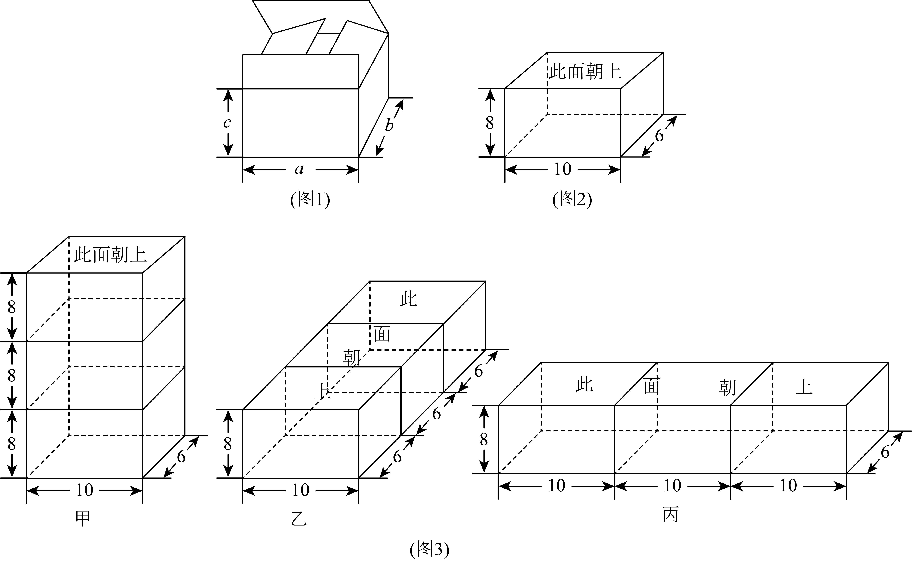

# Mathematics - 题目 890

**ID**: 9cbd2d514c344640b6cbb5047d71e519
**年级**: Grade 7
**难度**: Medium-Hard
**题型**: Calculation

## 题目
某网络商铺为了销售玩具，定制了一批长方体外包装盒（如图1所示），所有外包装盒的上下底面均为双层设置（即上盖纸板的总面积是上底面的2倍，下底盖同样如此），若设这个长方体外包装盒的长为 $a{\rm{c}}{\rm{m}}$ 、宽为 $b{\rm{c}}{\rm{m}}$ ，高为 $c{\rm{c}}{\rm{m}}$ ．（1）用含有 $a,b,c$ 的代数式表示该长方体外包装盒的所需纸板的总面积；​​​​​​​‌（2）如图2，若该玩具店在“双十一”期间为了促销，某种玩具采取了“买二送一”的方式，已知单个玩具装在一个长为 $10{\rm{c}}{\rm{m}}$ ，宽为 $6{\rm{c}}{\rm{m}}$ ，高为 $8{\rm{c}}{\rm{m}}$ 的小纸盒内（如图2），现要将三个玩具放到图1所示的外包装盒里，有如图所示的甲、乙、丙三种摆放方式（如图3），分别计算这三种摆放方式下所需的外包装盒纸板的总面积，并比较哪种摆放方式下需要的外包装盒纸板的总面积最小（注：玩具不能倒放、侧放，外包装盒也是上盖纸板朝上）．

## 解答

1. （1）解：由题意可知： $2ac+2bc+2\times 2ab=\left ({2ac+2bc+4ab}\right ){\rm{c}}{\rm{m}}{^{2}}$ ，
2. 即：该长方体外包装盒的所需纸板的总面积为 $\left ({2ac+2bc+4ab}\right ){\rm{c}}{\rm{m}}{^{2}}$ ；
3. （2）按图甲的方式摆放，需要 $2\times 10\times 3\times 8+2\times 6\times 3\times 8+4\times 10\times 6=1008{\rm{c}}{\rm{m}}{^{2}}$ ；
4. 按图乙的方式摆放，需要 $2\times 10\times 8+2\times 3\times 6\times 8+4\times 10\times 3\times 6=1168{\rm{c}}{\rm{m}}{^{2}}$ ；
5. 按图丙的方式摆放，需要 $2\times 3\times 10\times 8+2\times 6\times 8+4\times 3\times 10\times 6=1296{\rm{c}}{\rm{m}}{^{2}}$ ；
6. ∵ $1008<1168<1296$ ，
7. ∴按图甲摆放方式下需要的外包装盒纸板的总面积最小．

## 知识点

**中文**:
  - 几何体的展开图
  - 列代数式

**English**:
  - Nets of Geometric Solids
  - Writing Algebraic Expressions

---
