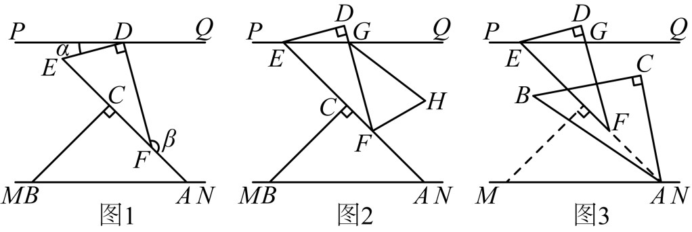

# Mathematics - 题目 8

**ID**: be6957ace8df4fe498392de570876b11
**年级**: Grade 7
**难度**: Medium-Hard
**题型**: Calculation

## 题目
将两块直角三角板如图1放置， $PQ{\rm{/\mskip-4mu/}}MN$ ， $\angle ACB=\angle EDF=90{}\degree $ ， $\angle ABC=\angle BAC=45{}\degree $ ， $\angle DFE=30{}\degree $ ， $\angle DEF=60{}\degree $ ．（1）若三角板如图1摆放时，则 $\angle α=$， $\angle β=$．（2）现固定 $\vartriangle ABC$ 的位置不变，将 $\vartriangle DEF$ 沿 $AC$ 方向平移至点E正好落在 $PQ$ 上，如图2所示， $DF$ 与 $PQ$ 交于G，作 $\angle FGQ$ 和 $\angle GFA$ 的角平分线交于点H，求 $\angle GHF$ 的度数；​​​​​​​‌（3）现固定 $\vartriangle DEF$ ，将 $\vartriangle ABC$ 绕点A顺时针旋转至 $AC$ 与直线 $AN$ 首次重合的过程中，当线段 $BC$ 与 $\vartriangle DEF$ 的一条边平行时，请直接写出 $\angle BAM$ 的度数．

## 解答

1. （1）解：过作 $EI{\rm{/\mskip-4mu/}}PQ$ ，如图，
2. 
3. ∵ $PQ{\rm{/\mskip-4mu/}}MN$ ，
4. ∴ $PQ{\rm{/\mskip-4mu/}}EI{\rm{/\mskip-4mu/}}MN$ ，
5. ∴ $\angle α=\angle DEI$ ， $\angle IEA=\angle BAC$ ，
6. ∴ $\angle DEA=\angle α+\angle BAC$ ，
7. 又 $\angle DEF=60{}\degree $ ， $\angle BAC=45{}\degree $ ，
8. ∴ $α=\angle DEA-\angle BAC=60{}\degree -45{}\degree =15{}\degree $ ，
9. ∵E、C、A三点共线， $\angle DFE=30{}\degree $ ，
10. ∴ $\angle β=180{}\degree -\angle DFE=180{}\degree -30{}\degree =150{}\degree $ .
11. （2）解：∵ $PQ{\rm{/\mskip-4mu/}}MN$ ， $\angle BAC=45{}\degree $ ，
12. ∴ $\angle GEF=\angle CAB=45{}\degree $ ，
13. 又 $\angle DFE=30{}\degree $ ，
14. ∴ $\angle FGQ=180{}\degree -\left ({180{}\degree -\angle GEF-\angle GFE}\right )=\angle GEF+\angle GFE=75{}\degree $ ，
15. ∵ $GH$ ， $FH$ 分别平分 $\angle FGQ$ 和 $\angle GFA$ ，
16. ∴ $\angle FGH=\frac {1}{2}\angle FGQ=37.5{}\degree $ ， $\angle GFH=\frac {1}{2}\angle DFA=75{}\degree $ ，
17. ∴ $\angle FHG=180{}\degree -37.5{}\degree -75{}\degree =67.5{}\degree $ ；
18. （3）解：①当 $BC/\mskip-4mu/DE$ 时，如图1，
19. 
20. ∵ $\angle D=90{}\degree $ ， $\angle C=90{}\degree $
21. ∴ $DE\bot DF$ ， $BC\bot AC$ ，
22. ∵ $BC/\mskip-4mu/DE$ ，
23. ∴ $DF\bot BC$ ，
24. ∴ $AC{\rm{/\mskip-4mu/}}DF$ ，
25. ∴ $\angle CAE=\angle DFE=30{}\degree $ ，
26. ∵ $\angle BAM+\angle BAC=\angle MAE+\angle CAE$ ，
27. ∴ $\angle BAM=\angle MAE+\angle CAE-\angle BAC=45{}\degree +30{}\degree -45{}\degree =30{}\degree $ ；
28. ②当 $BC{\rm{/\mskip-4mu/}}EF$ 时，如图2，
29. 
30. 此时 $\angle BAE=\angle ABC=45{}\degree $ ，
31. ∴ $\angle BAM=\angle BAE+\angle EAM=45{}\degree +45{}\degree =90{}\degree $ ；
32. ③当 $BC\mathrm{/\mskip-4mu/}DF$ 时，如图3，
33. 
34. 由①同理得 $AC{\rm{/\mskip-4mu/}}DE$ ， $\angle CAN=\angle DEG=15{}\degree $ ，
35. ∴ $\angle BAM=\angle MAN-\angle CAN-\angle BAC=180{}\degree -15{}\degree -45{}\degree =120{}\degree $ ．
36. 综上所述， $\angle BAM$ 的度数为 $30{}\degree $ 或 $90{}\degree $ 或 $120{}\degree $ ．

## 知识点

**中文**:
  - 平行线的判定与性质
  - 角平分线

**English**:
  - Determination and Properties
  - Angle Bisector

---
