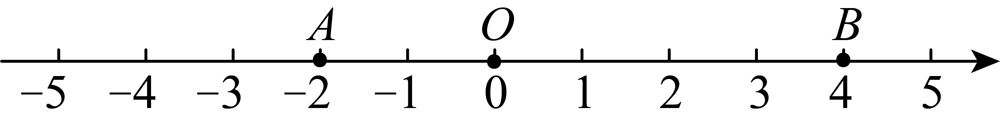

# Mathematics - 题目 468

**ID**: c646ba4812e84cc3b10866f2447fe9d2
**年级**: Grade 7
**难度**: Medium-Hard
**题型**: Calculation

## 题目
数轴上互不重合的三个点 $M$ ， $T$ ， $N$ 表示的数分别为 $m$ ， $t$ ， $n$ ，如果 $\left |{t-n}\right |$ 是 $\left |{m-n}\right |$ 的 $k$ 倍，那么就称点 $T$ 是点 $M$ 关于点 $N$ 的“ $k$ 倍关联点”．如图所示，点 $A$ ，点 $B$ 表示的数分别是 $-2{\rm ，4}$ ．（1）点 $B$ 是点 $A$ 关于原点 $O$ 的“ $k$ 倍关联点”，则 $k=$；​​​​​​​‌（2）点 $C$ 是点 $A$ 关于点 $B$ 的“2倍关联点”，求点 $C$ 表示的数；（3）点 $E$ ， $F$ 表示的数分别是 $e$ ， $f$ ，点 $E$ ， $F$ 不与点 $A$ ， $B$ 重合，若点 $B$ 是点 $A$ 关于点 $E$ 的“ $k$ 倍关联点”，且 $e=2-f$ ，则点 $B$ 是点 $A$ 关于点 $F$ 的“倍关联点”（用含 $k$ 的代数式表示）．

## 解答

1. （1）解：由题意得， $\left |{4-0}\right |=k\left |{-2-0}\right |$ ，
2. 解得 $k=2$ .
3. （2）解：设 $C$ 表示的数为 $c$ ，
4. 由题意得， $\left |{c-4}\right |=2\left |{-2-4}\right |$ ，
5. 解得 $c=16$ 或 $c=-8$ ，
6. ∴点 $C$ 表示的数为 $16$ 或 $-8$ ；
7. （3）解：∵点 $B$ 是点 $A$ 关于点 $E$ 的“ $k$ 倍关联点”，
8. ∴ $\left |{4-e}\right |=k\left |{-2-e}\right |$ ，
9. 设点 $B$ 是点 $A$ 关于点 $F$ 的“ $x$ 倍关联点”
10. ∴ $\left |{4-f}\right |=x\left |{-2-f}\right |①$
11. ∵ $e=2-f$ ，
12. ∴将 $e=2-f$ 代入 $\left |{4-e}\right |=k\left |{-2-e}\right |$ ，则得到 $\left |{2+f}\right |=k\left |{f-4}\right |②$ ，
13. ∵ $\left |{4-f}\right |=\left |{f-4}\right |$ ， $\left |{-2-f}\right |=\left |{2+f}\right |$ ，
14. ∴ $\left |{2+f}\right |=kx\left |{2+f}\right |$ ，
15. ∵点 $E$ ， $F$ 不与点 $A$ ， $B$ 重合，
16. ∴ $f\ne -2$ ，
17. ∴ $kx=1$ ，
18. ∴ $x=\frac {1}{k}$ .

## 知识点

**中文**:
  - 用数轴上的点表示有理数
  - 绝对值方程

**English**:
  - Representing Rational Numbers on Number Line
  - Absolute Value Equations

---
