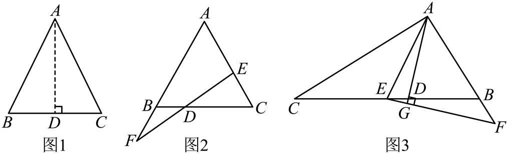

# Mathematics - 题目 3684

**ID**: dd3bf041b8014c9d9cef13a80cc17dd9
**年级**: Grade 7
**难度**: Medium-Hard
**题型**: Calculation

## 题目
全等三角形是我们初中数学的重要知识点之一，它为我们学习后面几何知识做好铺垫，掌握全等三角形的证明是做一系列复杂几何证明的基础．【问题初探】（1）构造全等三角形的方法有很多，有一种常见的方法是作高线，将需要证明的边或角放在两个直角三角形中进而通过全等证明关系．比如，我们可以通过作高线证明三角形中一个重要的结论“在同一个三角形中，如果两个角相等，那么这两个角所对的边也相等”．如图1，在 $\vartriangle ABC$ 中，已知 $\angle B=\angle C$ ，可证 $AB=AC$ ，小聪同学的作法是作 $BC$ 边上的高线 $AD$ ．现在请你完成小聪同学的证明过程；​​​​​​​‌【类比分析】（2）通过上述例子，我们发现通过作高线构造直角三角形证明全等确实是一种有效的方法，由此推出了三角形中的重要结论．现在请你借助上述的方法或结论继续探索，如图2，在 $\vartriangle ABC$ 中，已知 $∠ABC=\angle ACB$ ，点E为边 $AC$ 上一点，点F为边 $AB$ 延长线上一点，连接 $EF$ 与边 $BC$ 交于点D，若点D恰为线段 $EF$ 中点，试探究线段 $CE$ 与线段 $BF$ 的数量关系，并说明理由；【学以致用】（3）如图3，在 $\vartriangle ABC$ 中， $\angle CAB=90{}\degree $ ， $AD$ ， $AE$ 分别为 $\vartriangle ABC$ 的角平分线和中线，过点E作 $EF⊥AD$ 与线段 $AD$ 的延长线交于点G，与边 $AB$ 的延长线交于点F，已知 $\vartriangle ABC$ 的面积是30，线段 $AF$ 的长为8，求 $\mathrm{△}AED$ 的面积．

## 解答

1. （1）证明：过A作 $AD⊥BC$ 于D，
2. ∴ $\angle ADB=\angle ADC=90{}\degree $ ，
3. ∵ $AD=AD$ ， $\angle B=\angle C$ ，
4. ∴ $\vartriangle ADB≌\vartriangle ADC\left ({{\rm{A}}{\rm{A}}{\rm{S}}}\right )$ ，
5. ∴ $AB=AC$ ；
6. （2）解： $CE=BF$ ；
7. 理由：过E作 $EG{\rm{/\mskip-4mu/}}AB$ 交 $BC$ 于G，
8. 
9. ∴ $\angle F=\angle DEG$ ， $\angle FBD=\angle EGD$ ，
10. ∵点D为线段 $EF$ 中点，
11. ∴ $DF=DE$ ，
12. ∴ $\vartriangle BFD≌\vartriangle GED\left ({{\rm{A}}{\rm{A}}{\rm{S}}}\right )$ ，
13. ∴ $BF=EG$ ，
14. ∵ $∠ABC=\angle ACB$ ，
15. ∴ $\angle EGC=\angle ECG$ ，
16. ∴ $EG=CE$ ，
17. ∴ $CE=BF$ ；
18. （3）如图，延长 $FE$ 交AC于点H，过B作 $BM{\rm{/\mskip-4mu/}}AC$ ，过点D作 $DK\bot AC$ 于点 ${\rm \mathit{K}，}DJ\bot AB$ 于点J，
19. 
20. ∵ $AD$ 是角平分线，
21. ∴ $\angle FAG=\angle HAG=45{}\degree $ ，
22. ∵ $AD\bot EF$ ，
23. ∴ $\angle AGH=\angle AGF$ ，
24. ∵ $AG=AG$ ，
25. ∴ $\vartriangle AGF≌\vartriangle AGH\left ({{\rm{A}}{\rm{S}}{\rm{A}}}\right )$ ，
26. ∴ $AF=AH$ ， $\angle AHG=\angle AFG$ ，
27. 由（2）中证明方法可知 $\vartriangle CHE≌\vartriangle BME\left ({{\rm{A}}{\rm{A}}{\rm{S}}}\right )$ ，
28. ∴ $CH=BM$ ， $\angle CHE=\angle BME$ ，
29. ∴ $\angle AHG=\angle BMF=\angle AFG$ ，
30. ∴ $BM=BF$ ，
31. ∵ $\angle BAC=90{}\degree $ ，
32. ∴ $\angle AHG=\angle AFG=45{}\degree $ ，
33. ∵ $\angle AGF=90{}\degree $ ，
34. ∴ $\angle GAF=45{}\degree $ ，
35. ∵ $AF=8$ ，
36. ∴设 $BF=x$ ，则 $BM=CH=x$ ， $AB=8-x$ ，
37. ∴ $AC=AH+CH=8+x$ ，
38. ∴ $S{{}_{\vartriangle ABC}}=\frac {1}{2}AB\cdot AC=30$ ，
39. 即 $\left ({8-x}\right )\left ({8+x}\right )=60$ ，
40. 解得 $x=2$ ，负值舍去，
41. ∴ $BF=2$ ， $AB=8-2=6$ ， $AC=8+2=10$ ，
42. ∴ $BC=\sqrt {AB{^{2}}+AC{^{2}}}=\sqrt {6{^{2}}+10{^{2}}}=2\sqrt {34}$ ，
43. ∵ $AD$ 平分 $∠BAC$ ， $DK\bot AC$ ， $DJ\bot AB$ ，
44. ∴ $DK=DJ$ ，
45. ∴ $S{{}_{\vartriangle ADC}}+S{{}_{\vartriangle ADB}}=S{{}_{\vartriangle ABC}}$ ，
46. ∴ $\frac {1}{2}AC\times DK+\frac {1}{2}AB\times DJ=30$ ，
47. ∴ $\frac {1}{2}\times 10DJ+\frac {1}{2}\times 6DJ=30$ ，
48. 解得： $DJ=\frac {15}{4}$ ，
49. ∵ $∠DAJ=\frac {1}{2}∠BAC=45{}\degree $ ， $\angle AJD=90{}\degree $ ，
50. ∴ $\vartriangle ADJ$ 为等腰直角三角形，
51. ∴ $AJ=DJ=\frac {15}{4}$ ，
52. ∴ $BJ=AB-AJ=6-\frac {15}{4}=\frac {9}{4}$ ，
53. ∴ $BD=\sqrt {DJ{^{2}}+BJ{^{2}}}=\frac {3}{4}\sqrt {34}$ ，
54. ∵ $AE$ 是 $\vartriangle ABC$ 的中线，
55. ∴ $AE=BE=\frac {1}{2}BC=\sqrt {34}$ ，
56. ∴ $ED=BE-BD=\frac {\sqrt {34}}{4}$ ，
57. ∴ $\frac {ED}{BC}=\frac {\frac {\sqrt {34}}{4}}{2\sqrt {34}}=\frac {1}{8}$ ，
58. ∴ $S{{}_{\vartriangle AED}}=\frac {1}{8}S{{}_{\vartriangle ABC}}=\frac {15}{4}$ ．
59. ∴ $\mathrm{△}AED$ 的面积为 $\frac {15}{4}$ ．

## 知识点

**中文**:
  - 全等三角形的综合问题
  - 等腰三角形的判定与性质
  - 勾股定理

**English**:
  - Comprehensive Problems
  - Determination and Properties
  - Pythagorean Theorem

---
